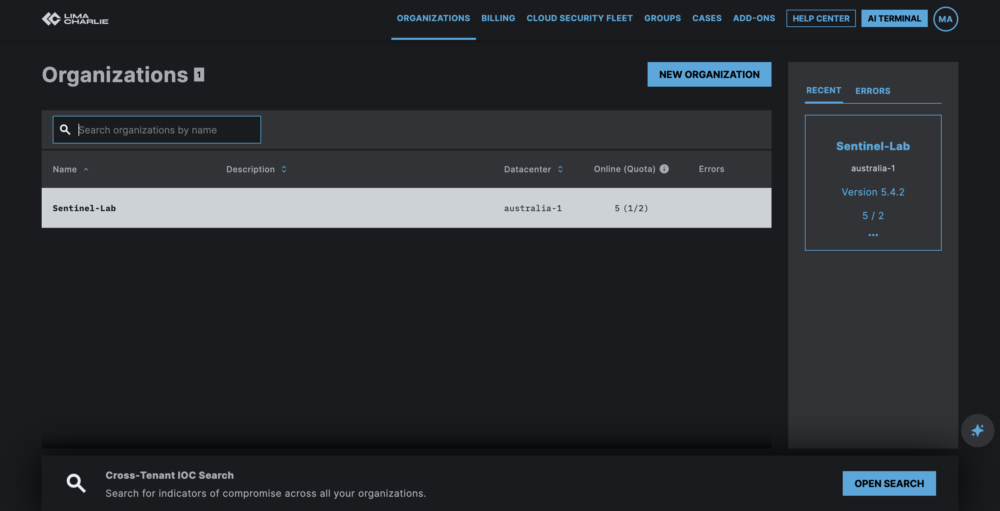
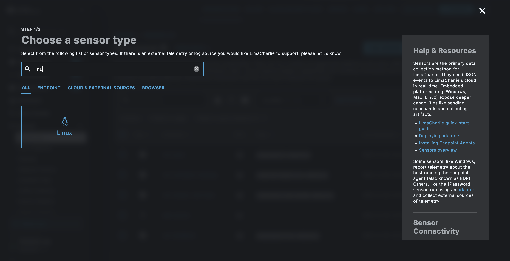
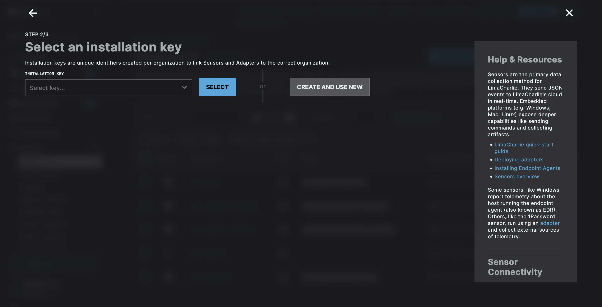
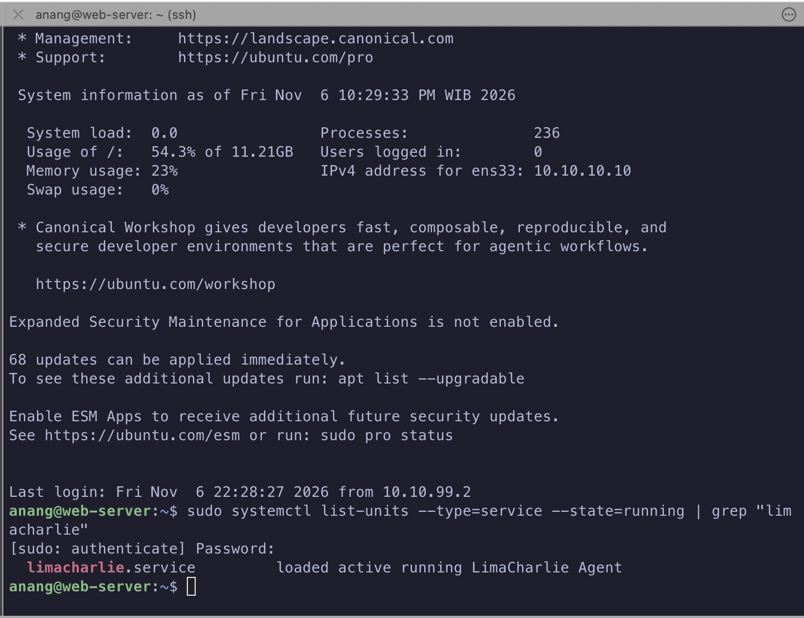
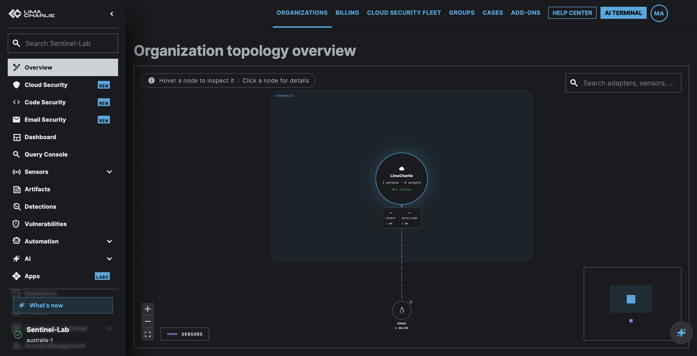
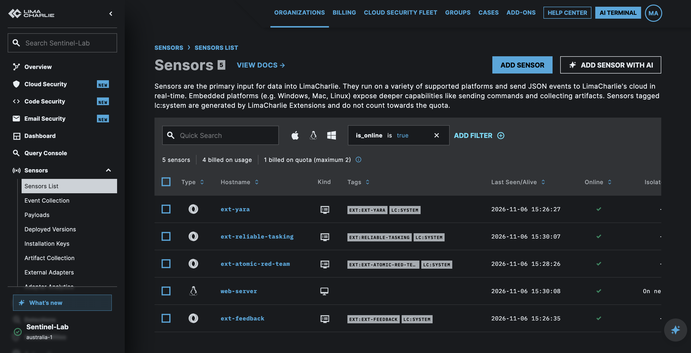

# 🛰️ EDR — LimaCharlie

> ✅ **STATUS: SENSOR LIVE di Web-Server.** Agent LimaCharlie jalan sebagai service Linux (`limacharlie.service`) di VM Web-Server (`10.10.10.10`, Ubuntu + DVWA). Baru sampai tahap sensor nongol online di dashboard — belum ada telemetry/deteksi yang dianalisis (lanjutan di sesi berikutnya).

## Tujuan

Jalanin **LimaCharlie** sebagai EDR (Endpoint Detection & Response) buat nutup sisi **endpoint telemetry** — pelengkap WAF (yang nangkep di layer network/app) dengan visibility proses, file, network, dkk langsung dari host. LimaCharlie dipilih karena punya **free tier** (2 sensor billed, cukup buat lab).

Rencana cakupan endpoint (bertahap): **Web-Server (DVWA) duluan**, baru nanti nambah Windows client (Win7).

---

## Prerequisites

- Akun LimaCharlie (daftar via [limacharlie.io](https://limacharlie.io)) — gratis, quota **2 sensor billed**.
- Endpoint target udah bisa diakses (SSH/RDP) buat install agent — di sini: Web-Server (`10.10.10.10`, Ubuntu Server + DVWA).

---

## Step-by-Step

### 1. Daftar + pilih Organization

Setelah daftar, bikin **Organization** baru (1 organization = 1 "tenant" LimaCharlie, isinya sensor + deteksi + billing sendiri). Nama organization: **`Sentinel-Lab`**.

**Datacenter**: gak ada opsi Asia/Indonesia, jadi dipilih **`australia-1`** (paling deket secara geografis dari opsi yang ada).



> Kalau organization-nya udah pernah dibuat sebelumnya (kayak di lab ini), tinggal pilih dari daftar — gak perlu bikin baru tiap mau nambah sensor.

### 2. Tambah Sensor — pilih tipe

Dari halaman **Sensors List**, klik **Add Sensor**. Step 1/3: cari & pilih tipe sensor sesuai OS target. Target di sini Web-Server (Ubuntu) → pilih **Linux**.



> Sensor LimaCharlie buat platform embedded (Windows/Mac/Linux) itu EDR beneran — bisa kirim command + collect artifact, bukan cuma kirim event satu arah.

### 3. Buat Installation Key

Step 2/3: **installation key** itu identifier unik per-organization buat ngelink sensor baru ke tenant yang bener. Karena belum punya key, pilih **Create and use new**.



Step 3/3 (gak ke-screenshot) ngarahin ke halaman download — installer/agent binary-nya udah ke-embed installation key di atas, jadi tinggal dieksekusi di endpoint target.

### 4. Download + install di endpoint

Di VM Web-Server (`10.10.10.10`), download installer dari link Step 3, lalu install (binary LimaCharlie daemon). Setelah install, agent otomatis jalan sebagai **service** (mirip pola Wazuh agent).

### 5. Verifikasi service jalan

```bash
sudo systemctl list-units --type=service --state=running | grep "limacharlie"
```

```
limacharlie.service    loaded active running LimaCharlie Agent
```



---

## Verifikasi

- Halaman **Overview** (topology) nunjukin node organization `LimaCharlie` konek ke 1 node `Linux` — `1 sensors`, `1 online`. Ini bukti level organization kalau sensor `web-server` beneran kebaca topology-nya, bukan cuma nangkring di tabel.



- Dashboard **Sensors List** nunjukin `web-server` (ikon Linux), status **Online**.
- **Quota**: dari 5 sensor yang keliatan di dashboard, cuma **1** yang kepake kuota billing (`web-server`) — 4 sisanya (`ext-yara`, `ext-reliable-tasking`, `ext-atomic-red-team`, `ext-feedback`) itu sensor semu bertag `lc:system`, di-generate otomatis oleh LimaCharlie Extensions (built-in), **gak makan kuota** free tier (`2` sensor billed).



- `systemctl` di endpoint confirm service `limacharlie.service` **active running**.

---

## Catatan & Gotcha

- **Datacenter gak ada pilihan Asia/Indonesia** — dipilih `australia-1`, paling deket yang tersedia. Belum dicek dampaknya ke latensi telemetry.
- **Sensor count bisa menyesatkan**: dashboard nunjukin "5 sensors" tapi yang beneran endpoint fisik cuma 1 (`web-server`). 4 lainnya itu sensor virtual dari Extension (`ext-*`, tag `lc:system`) — bawaan platform, bukan hasil install manual.
- **Baru sampai "service jalan"** — belum masuk ke konfigurasi Detection & Response (D&R rules), belum ada telemetry yang dianalisis/dites. Lanjutan ada di `Labs/edr/limacharlie/` (belum dibuat).
- **Rencana endpoint berikutnya**: Windows client (Win7) — belum dieksekusi, DVWA/Web-Server jadi target pertama.
