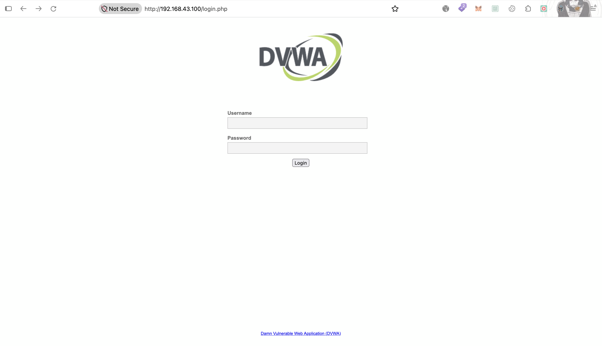
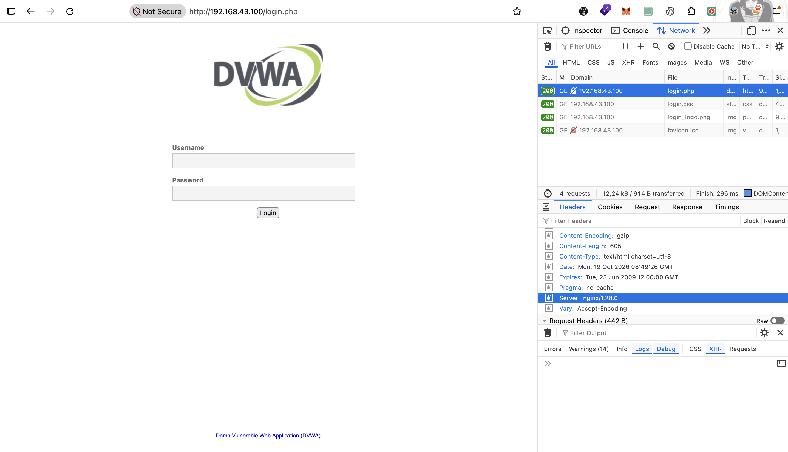
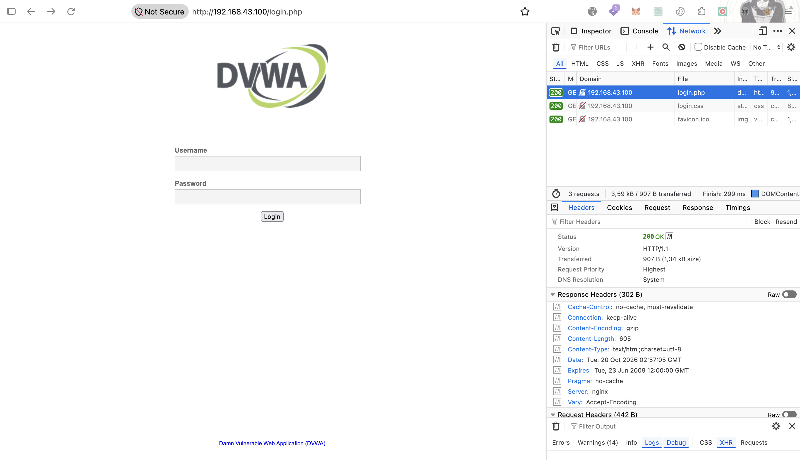

# 🔧 Tahap 1 — Nginx Reverse Proxy

> ✅ **Selesai 2026-10-19**, hardening (`server_tokens off`, `proxy_http_version 1.1`) 2026-10-20. Bagian dari [ModSecurity build from scratch](./README.md).

## Tujuan

Fokus percobaan ini **cuma reverse proxy**, belum ada WAF sama sekali (belum ada ModSecurity, belum ada rule). Tujuannya mastiin jalur `client → nginx → DVWA` jalan dulu, biar nanti kalau ada masalah di tahap WAF, jelas masalahnya bukan di proxy.

---

## Prerequisites

- WAF VM + Docker siap, folder kerja `/data/waf/scratch`, stack lain di `:80` udah di-`down` (lihat [`README.md`](./README.md))
- DVWA di `10.10.10.10:80` jalan

---

## Step-by-Step

> Config tahap ini sekarang ada di [`conf/nginx/tahap-1-reverse-proxy.conf`](./conf/nginx/tahap-1-reverse-proxy.conf). Jalanin ulang: set `NGINX_CONF=tahap-1-reverse-proxy.conf` di `.env` VM, lalu `docker compose up -d --force-recreate` (lihat [`README.md`](./README.md)). Snapshot di bawah nunjukin compose waktu Tahap 1 dikerjain, sebelum conf dipisah per tahap.

Pakai image resmi **`nginx:1.28.0`**. Versi ini dikunci karena di Tahap 3, connector ModSecurity harus di-compile dari **source nginx dengan versi yang sama persis**.

**File di repo → VM `/data/waf/scratch`:**

```
/data/waf/scratch/
├── .env
├── docker-compose.yml
└── conf/
    └── nginx/
        └── nginx.conf
```

`.env` (gitignored, bikin langsung di VM):

```ini
BACKEND_URL=http://10.10.10.10:80
```

`conf/nginx/nginx.conf`: config nginx **utuh** (blok `events` + `http` + `server`), bukan cuma potongan server block. Config utuh ini sengaja dipakai dari awal, karena di Tahap 3 baris `load_module` buat connector ModSecurity harus ditaruh di **main context** (paling atas `nginx.conf`, di luar blok `http`).

Biar `${BACKEND_URL}` keisi dari `.env`, file ini di-mount sebagai **template**:

| Setting compose | Fungsi |
|-----------------|--------|
| Mount ke `/etc/nginx/templates/nginx.conf.template` | Entrypoint image resmi nginx nge-render semua `*.template` di folder itu pakai `envsubst` waktu container start |
| `NGINX_ENVSUBST_OUTPUT_DIR=/etc/nginx` | Hasil render ditulis ke `/etc/nginx/nginx.conf` (default-nya ke `/etc/nginx/conf.d/`) |

`envsubst` cuma ngeganti env var yang terdefinisi, jadi variabel nginx (`$host`, `$remote_addr`, dll) gak ikut ketimpa.

> Kalau `nginx.conf` di-mount langsung ke `/etc/nginx/nginx.conf` (tanpa template), `${BACKEND_URL}` gak dirender. Nginx bakal baca itu sebagai variabel nginx dan gagal start dengan error `unknown "BACKEND_URL" variable`.

| Directive | Fungsi |
|-----------|--------|
| `server_tokens off` | Header `Server` jadi `nginx` doang, versi gak kebuka (termasuk di halaman error bawaan). Kata `nginx`-nya sendiri gak bisa dihapus tanpa modul tambahan (`headers-more`) |
| `proxy_http_version 1.1` | Nginx ngobrol ke backend pakai HTTP/1.1 (default-nya 1.0). Ini belum bikin keepalive: nginx tetap ngirim `Connection: close`, jadi tiap request tetap koneksi baru. Keepalive butuh blok `upstream` + `keepalive` + `proxy_set_header Connection ""` |
| `listen 8080` | Port di dalam container, di-map ke host `:80` |
| `proxy_pass ${BACKEND_URL}` | Terusin request ke DVWA |
| `proxy_set_header Host $host` | Host asli dari client diteruskan ke backend |
| `X-Real-IP $remote_addr` | IP yang konek ke nginx (gak bisa dipalsuin client) |
| `X-Forwarded-For $proxy_add_x_forwarded_for` | IP client ditambahin ke header XFF kiriman client (bisa dipalsuin) |
| `X-Forwarded-Proto $scheme` | Protokol asli (`http`) |

**Snapshot config Tahap 1** (waktu dikerjain, conf masih satu file `conf/nginx/nginx.conf`):

`docker-compose.yml`:

```yaml
services:
  waf-scratch:
    image: nginx:1.28.0
    container_name: waf-scratch
    restart: unless-stopped
    env_file: .env
    environment:
      - NGINX_ENVSUBST_OUTPUT_DIR=/etc/nginx
    ports:
      - "80:8080"
    volumes:
      - ./conf/nginx/nginx.conf:/etc/nginx/templates/nginx.conf.template:ro
```

`conf/nginx/nginx.conf` (termasuk hardening `server_tokens off` + `proxy_http_version 1.1`):

```nginx
events {
    worker_connections 1024;
}

http {
    server_tokens off;
    proxy_http_version 1.1;

    server {
        listen 8080;
        server_name _;

        location / {
            proxy_pass ${BACKEND_URL};
            proxy_set_header Host $host;
            proxy_set_header X-Real-IP $remote_addr;
            proxy_set_header X-Forwarded-For $proxy_add_x_forwarded_for;
            proxy_set_header X-Forwarded-Proto $scheme;
        }
    }
}
```

**Copy ke VM (dari Mac, lewat WireGuard):**

```bash
cd Infrastructure/waf/modsecurity-scratch
scp -r docker-compose.yml conf anang@10.10.10.5:/data/waf/scratch/
```

**Jalanin di VM:**

```bash
cd /data/waf/modsec-crs && docker compose down
cd /data/waf/scratch
echo "BACKEND_URL=http://10.10.10.10:80" > .env
docker compose up -d
docker compose logs
docker exec waf-scratch cat /etc/nginx/nginx.conf
```

Command terakhir nunjukin hasil render template. `proxy_pass` harus udah berisi `http://10.10.10.10:80`.

---

## Verifikasi

**Dari VM:**
```bash
curl -I http://localhost/                # → 302 ke login.php (DVWA)
docker ps --format '{{.Names}}\t{{.Ports}}'   # cuma waf-scratch yang pegang :80
```

**Dari Mac / Kali (lewat NAT pfSense):** buka `http://<IP-WAN-pfSense>/` → halaman login DVWA.

**Serangan lolos (belum ada WAF):**
```bash
curl -s -o /dev/null -w "%{http_code}\n" "http://<IP-WAN-pfSense>/?id=1'%20OR%20'1'='1"    # → bukan 403
```
Ini baseline buat dibandingin setelah ModSecurity dipasang.

✅ Confirmed live 2026-10-19, akses dari Mac lewat NAT pfSense (`http://<IP-WAN-pfSense>/`):

**Reverse proxy jalan**: halaman login DVWA kebuka lewat WAF VM.



**Response header `Server: nginx/1.28.0`**: yang balas ke client itu nginx di WAF VM, bukan Apache di Web-Server. Secara default `proxy_pass` gak nerusin header `Server` dari backend, jadi identitas Apache gak kelihatan dari luar. Versi nginx masih kebuka karena `server_tokens` belum diatur (belum ada hardening di tahap ini).



**Access log Apache di Web-Server** (`/var/log/apache2/access.log`):

```
10.10.10.5 - - [19/Oct/2026:16:57:41 +0700] "GET /login.php HTTP/1.0" 200 917 "-" "Mozilla/5.0 (Macintosh; Intel Mac OS X 10.15; rv:158.0) Gecko/20100101 Firefox/158.0"
```

| Kolom | Artinya |
|-------|---------|
| `10.10.10.5` | Yang konek ke Apache itu WAF, bukan client asli. IP asli ada di header `X-Real-IP`, tapi gak dicatat format log `combined` (perlu `mod_remoteip` di Apache) |
| `HTTP/1.0` | Nginx ngobrol ke backend pakai **HTTP/1.0** (default `proxy_http_version`), walaupun browser pakai HTTP/1.1. Efeknya, tiap request bikin koneksi baru ke backend (gak ada keepalive upstream) |
| User-Agent | Header `User-Agent` dari browser diteruskan apa adanya |

Dua temuan di atas (`Server: nginx/1.28.0` dan `HTTP/1.0` ke backend) ditindaklanjuti dengan nambah `server_tokens off` dan `proxy_http_version 1.1` ke `nginx.conf`. Cek setelah `docker compose up -d --force-recreate`:

```bash
curl -sI http://localhost/login.php | grep -i server    # → Server: nginx (tanpa versi)
sudo tail -3 /var/log/apache2/access.log                  # di Web-Server → "... HTTP/1.1" 200 ...
```

✅ `server_tokens off` confirmed 2026-10-20: response header jadi `Server: nginx`, versi udah gak kebuka.



`Version: HTTP/1.1` di DevTools itu koneksi **browser → nginx**, bukan nginx → Apache (dari awal juga udah 1.1). Bukti `proxy_http_version 1.1` ada di access log Apache.

✅ `proxy_http_version 1.1` confirmed 2026-10-20 di access log Apache. Request sebelum perubahan masih `HTTP/1.0`, sesudahnya `HTTP/1.1`:

```
10.10.10.5 - - [19/Oct/2026:16:57:41 +0700] "GET /login.php HTTP/1.0" 200 917 "-" "Mozilla/5.0 (Macintosh; Intel Mac OS X 10.15; rv:158.0) Gecko/20100101 Firefox/158.0"
10.10.10.5 - - [20/Oct/2026:09:57:05 +0700] "GET /login.php HTTP/1.1" 200 919 "-" "Mozilla/5.0 (Macintosh; Intel Mac OS X 10.15; rv:158.0) Gecko/20100101 Firefox/158.0"
```

Source IP tetap `10.10.10.5` (WAF), sesuai harapan karena `mod_remoteip` belum dipasang.
