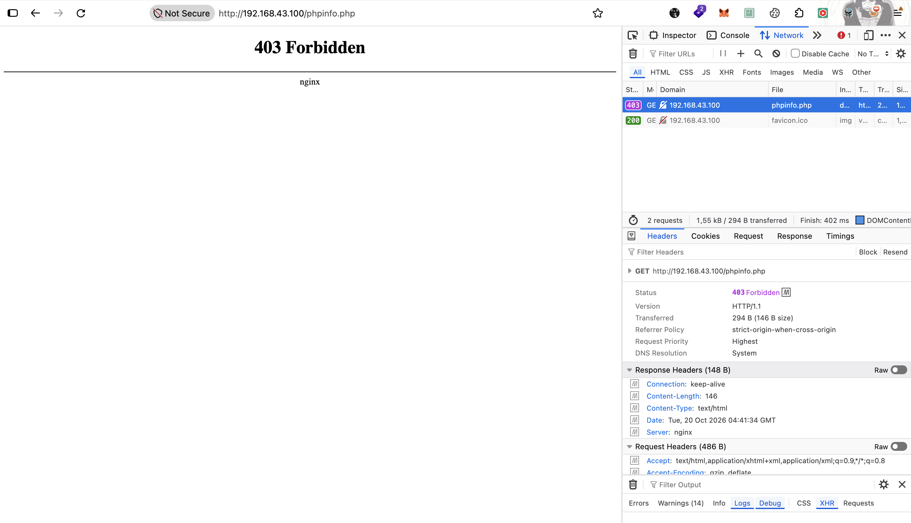
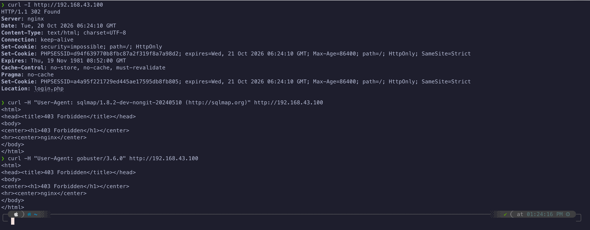
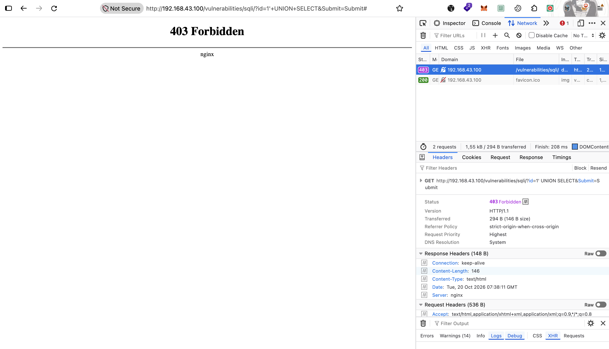
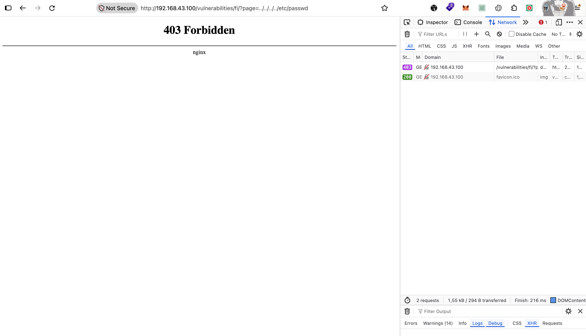
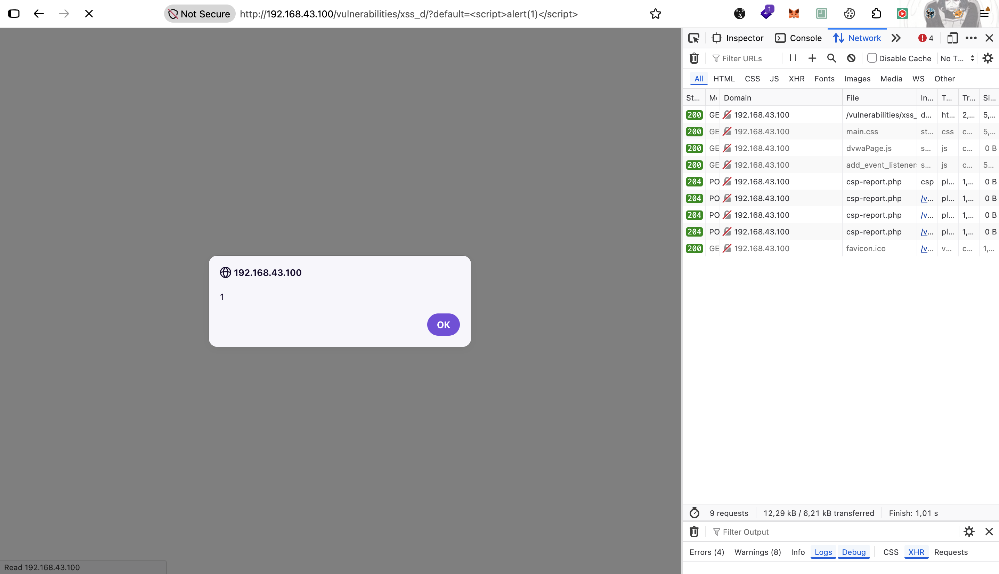
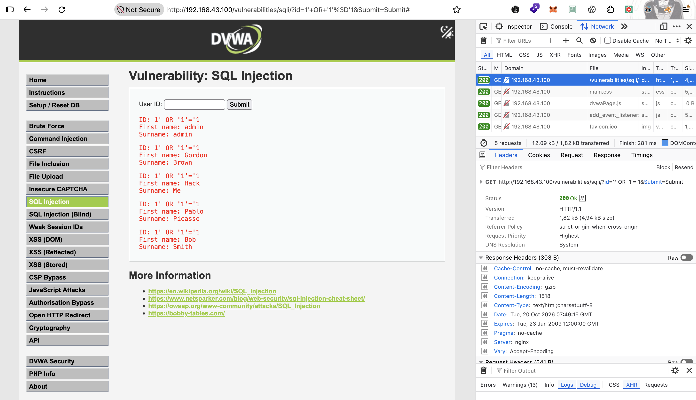
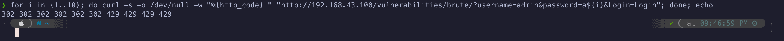
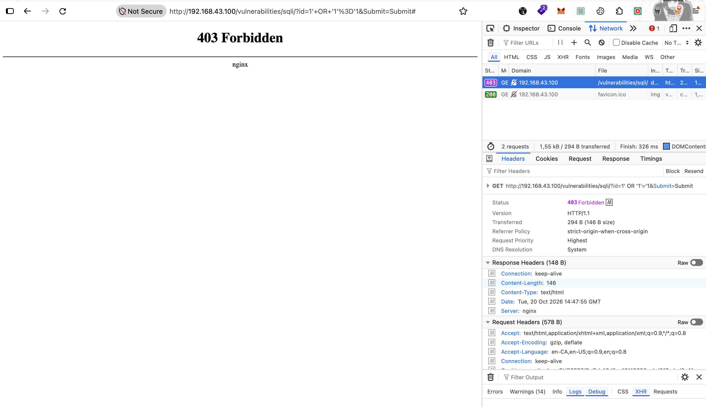
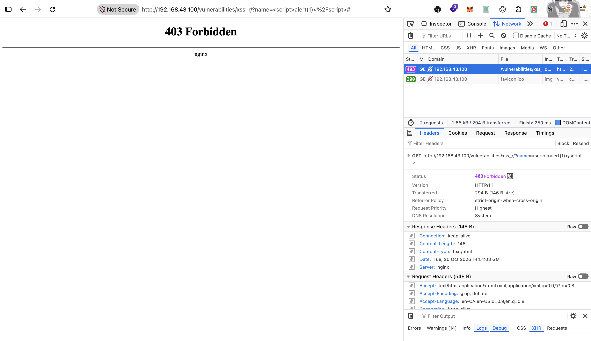

# 🔧 Tahap 2 — Nginx Native Filter

> ✅ **Selesai 2026-10-20**, dua iterasi: iterasi 1 (bagian 2) buat lihat batasan, iterasi 2 (bagian 4) tuning. Bagian dari [ModSecurity build from scratch](./README.md).

## Tujuan

Masih **tanpa ModSecurity**. Nginx sendiri punya fitur buat nolak request (`map`, `if` + `return`, `location`, `limit_req`), jadi tahap ini bikin **"WAF versi paling primitif"** pakai fitur bawaan itu. Tujuannya dua:

1. Lihat request diblok (`403`/`429`) dan kecatat di **log nginx** di VM
2. Ngerasain **batasannya**: regex nginx ngecek string **mentah** (belum di-decode), gak bisa baca **body POST**, dan gak punya scoring. Batasan ini yang nanti dijawab ModSecurity

---

## Prerequisites

- Tahap 1 selesai, lihat [`01-nginx-reverse-proxy.md`](./01-nginx-reverse-proxy.md)

---

## Step-by-Step

> Config final tahap ini (iterasi 2) ada di [`conf/nginx/tahap-2-native-filter.conf`](./conf/nginx/tahap-2-native-filter.conf). Jalanin ulang: set `NGINX_CONF=tahap-2-native-filter.conf` di `.env` VM, lalu `docker compose up -d --force-recreate`. Path `conf/nginx/nginx.conf` di bawah itu nama file waktu tahap ini dikerjain, sebelum conf dipisah per tahap.

**Struktur di VM:**

```
/data/waf/scratch/
├── .env
├── docker-compose.yml
├── conf/
│   └── nginx/
│       └── nginx.conf
└── logs/               ← baru: access.log + error.log nginx
```

### 1. Log ke file (compose)

Image resmi nginx nge-link `/var/log/nginx/access.log` ke `stdout` dan `error.log` ke `stderr`. Kalau folder host di-mount ke `/var/log/nginx`, symlink itu ketutup mount, jadi nginx nulis ke **file beneran** di host.

Tambahan di `docker-compose.yml`:

```yaml
    volumes:
      - ./conf/nginx/nginx.conf:/etc/nginx/templates/nginx.conf.template:ro
      - ./logs:/var/log/nginx
```

```bash
mkdir -p /data/waf/scratch/logs
```

File log dibuka sama **master process** nginx (jalan sebagai root di container), jadi folder ini gak perlu di-`chown` ke uid worker.

### 2. `nginx.conf` versi Tahap 2 (iterasi 1)

```nginx
events {
    worker_connections 1024;
}

http {
    server_tokens off;
    proxy_http_version 1.1;

    log_format waf '$remote_addr [$time_local] "$request" $status $body_bytes_sent '
                   '"$http_user_agent" rule=$waf_rule';

    access_log /var/log/nginx/access.log waf;
    error_log  /var/log/nginx/error.log warn;

    map $http_user_agent $bad_ua {
        default 0;
        "~*(sqlmap|nikto|nmap|masscan|wpscan|dirbuster|gobuster)" 1;
    }

    map $args $bad_args {
        default 0;
        "~*(union.*select|<script|\.\./|etc/passwd)" 1;
    }

    limit_req_zone $binary_remote_addr zone=brute:10m rate=5r/m;

    server {
        listen 8080;
        server_name _;

        set $waf_rule "-";

        proxy_set_header Host $host;
        proxy_set_header X-Real-IP $remote_addr;
        proxy_set_header X-Forwarded-For $proxy_add_x_forwarded_for;
        proxy_set_header X-Forwarded-Proto $scheme;

        if ($bad_ua) {
            set $waf_rule "R1-scanner-ua";
            return 403;
        }

        if ($bad_args) {
            set $waf_rule "R2-sqli-xss-args";
            return 403;
        }

        location ~* (^/(config|docs|\.git)/|/setup\.php$|/phpinfo\.php$) {
            set $waf_rule "R3-sensitive-paths";
            return 403;
        }

        location /vulnerabilities/brute/ {
            limit_req zone=brute burst=5 nodelay;
            limit_req_status 429;
            proxy_pass ${BACKEND_URL};
        }

        location / {
            proxy_pass ${BACKEND_URL};
        }
    }
}
```

| Bagian | Fungsi |
|--------|--------|
| `server_tokens off`, `proxy_http_version 1.1` | Bawaan dari Tahap 1 (lihat tabel directive di [`01-nginx-reverse-proxy.md`](./01-nginx-reverse-proxy.md)) |
| `log_format waf` | Format log custom: IP client, request, status, User-Agent, plus **`rule=`** buat nyatat rule mana yang nge-block |
| `map $http_user_agent $bad_ua` | **R1**: User-Agent tool scanner → `$bad_ua = 1` |
| `map $args $bad_args` | **R2**: pola SQLi / XSS / path traversal di **query string mentah** → `$bad_args = 1` |
| `set $waf_rule "-"` | Default isi kolom `rule=` buat request yang lolos |
| `proxy_set_header` di level `server` | Diwarisin semua `location`, jadi gak perlu ditulis ulang di tiap location |
| `if (...) { set; return 403; }` | Eksekusi R1 & R2 di level server, sebelum request masuk location mana pun |
| `location ~* (...)` | **R3**: path sensitif DVWA (`/config/`, `/docs/`, `/.git/`, `setup.php`, `phpinfo.php`) → 403 |
| `limit_req` di `/vulnerabilities/brute/` | **R4**: modul Brute Force DVWA dibatasi 5 request/menit per IP (burst 5), lebihnya dibalas **429** |

Catatan desain:

- **`map` di context `http`, `if` di context `server`.** `map` cuma ngitung variabel (dievaluasi pas variabelnya dipakai), dan `if` yang isinya cuma `set` + `return` termasuk pemakaian `if` yang aman di nginx.
- **`$args` itu query string mentah, belum di-URL-decode.** `<script` yang dikirim sebagai `%3Cscript` gak ke-match R2. Ini sengaja dibiarin buat diuji di Verifikasi.
- **Body POST gak diperiksa sama sekali.** `map`/`if` jalan sebelum body dibaca, jadi payload di form login atau form DVWA lolos.
- **envsubst aman**: variabel nginx (`$bad_ua`, `$waf_rule`, `$args`, dll) bukan env var, jadi gak ikut dirender. Yang dirender cuma `${BACKEND_URL}`.

### 3. Copy & jalanin

```bash
# dari Mac
cd Infrastructure/waf/modsecurity-scratch
scp -r docker-compose.yml conf anang@10.10.10.5:/data/waf/scratch/

# di VM
cd /data/waf/scratch
mkdir -p logs
docker compose up -d --force-recreate
docker exec waf-scratch nginx -t
```

### 4. Iterasi 2 — tuning rule

Hasil iterasi 1 nunjukin dua bypass (XSS dari browser ke-encode, SQLi `' OR '1'='1` gak masuk pola). Config di [`conf/nginx/tahap-2-native-filter.conf`](./conf/nginx/tahap-2-native-filter.conf) ditambal:

| Perubahan | Iterasi 1 | Iterasi 2 |
|-----------|-----------|-----------|
| R2 dipecah per kategori | 1 `map $bad_args` (SQLi + XSS + traversal), label `R2-sqli-xss-args` | 3 `map`: R2 XSS, R5 SQLi, R6 path traversal |
| XSS | `<script` mentah | `(<\|%3C)(script\|iframe\|img\|svg)\|javascript:\|onerror(=\|%3D)` |
| SQLi | `union.*select` | + `order(\+\|%20)+by` + apostrof (`'` / `%27`) yang diikuti `OR`/`AND` atau komentar (`--`, `#`, `;`) |
| Path traversal | `\.\./\|etc/passwd` | + `etc/shadow`, `etc/hosts`, `etc/group`, `/tmp/` |
| Label R4 | `rule=-` | `map $status $waf_rule_log`: status `429` → `R4-brute-rate-limit` |

```nginx
map $status $waf_rule_log {
    429 "R4-brute-rate-limit";
    default $waf_rule;
}

log_format waf '$remote_addr [$time_local] "$request" $status $body_bytes_sent "$http_user_agent" rule=$waf_rule_log';

map $args $bad_args_xss {
    default 0;
    "~*(<|%3C)(script|iframe|img|svg)|javascript:|onerror(=|%3D)" 1;
}

map $args $bad_args_sqli {
    default 0;
    "~*(union.*select|order(\+|%20)+by|('|%27)(\+|%20)*(or|and)(\+|%20|'|%27)|('|%27)(\+|%20)*(--|%23|;|%3B))" 1;
}

map $args $bad_args_path_traversal {
    default 0;
    "~*(\.\./|etc/passwd|etc/shadow|etc/hosts|/tmp/|etc/group)" 1;
}
```

Catatan desain:

- **Label R4 lewat `$status`, bukan `set`.** `set` jalan di fase rewrite, sebelum `limit_req` mutusin `429`. Kalau di-`set` di location, request yang lolos ikut berlabel R4. `map` dievaluasi lazy waktu log ditulis, pas `$status` udah final. Asumsinya semua `429` datang dari R4 (satu-satunya `limit_req`).
- **Apostrof gak diblok mentah-mentah.** `%27` sendirian bikin `O'Brien` / `don't` ikut `403`, padahal `curl`/sqlmap bisa ngirim `'` mentah yang gak ketangkep `%27`. Jadi dicocokin `('|%27)` + konteks SQL setelahnya.
- **Urutan di file ≠ urutan eksekusi.** Semua `if` level server (R1 → R2 → R5 → R6) jalan duluan di fase rewrite, baru nginx milih `location` (R3, R4, `/`). Contoh: `/phpinfo.php?id=1' or 1` kecatat `R5`, bukan `R3`.

---

## Verifikasi

Jalanin dari Mac atau Kali. Ganti `<WAF>` jadi `http://<IP-WAN-pfSense>`:

| # | Uji | Command | Harapan |
|---|-----|---------|---------|
| 1 | Request normal | `curl -s -o /dev/null -w "%{http_code}\n" <WAF>/login.php` | `200` |
| 2 | R1: UA scanner | `curl -s -o /dev/null -w "%{http_code}\n" -A "sqlmap/1.8" <WAF>/` | `403` |
| 3 | R2: SQLi di query | `curl -s -o /dev/null -w "%{http_code}\n" "<WAF>/?id=1%20union%20select%201,2"` | `403` |
| 4 | R2: huruf besar | `curl -s -o /dev/null -w "%{http_code}\n" "<WAF>/?id=1%20UNION%20SELECT%201,2"` | `403` (`~*` case-insensitive) |
| 5 | R2: XSS mentah | `curl -s -o /dev/null -w "%{http_code}\n" "<WAF>/?q=<script>alert(1)</script>"` | `403` |
| 6 | **Bypass**: XSS di-encode | `curl -s -o /dev/null -w "%{http_code}\n" "<WAF>/?q=%3Cscript%3Ealert(1)%3C/script%3E"` | **lolos**, `$args` gak di-decode |
| 7 | **Bypass**: SQLi tanpa `union` | `curl -s -o /dev/null -w "%{http_code}\n" "<WAF>/?id=1'%20OR%20'1'='1"` | **lolos**, gak ada pola yang cocok |
| 8 | **Bypass**: payload di body POST | `curl -s -o /dev/null -w "%{http_code}\n" -d "username=admin' union select 1,2-- -&password=x&Login=Login" <WAF>/login.php` | **lolos**, body gak diperiksa |
| 9 | R3: path sensitif | `curl -s -o /dev/null -w "%{http_code}\n" <WAF>/setup.php` | `403` |
| 10 | R4: brute force | `for i in $(seq 1 15); do curl -s -o /dev/null -w "%{http_code} " "<WAF>/vulnerabilities/brute/?username=admin&password=x$i&Login=Login"; done; echo` | Sekitar 6 request pertama lolos, sisanya `429` |
| 11 | Header `Server` | `curl -sI <WAF>/login.php \| grep -i server` | `Server: nginx` (tanpa versi) |

Uji 10 tanpa session login DVWA bakal dibalas redirect (`302`) ke `login.php`. Gak masalah, karena yang diukur `429`-nya.

**Cek log di VM:**

```bash
tail -20 /data/waf/scratch/logs/access.log
grep -v 'rule=-' /data/waf/scratch/logs/access.log     # cuma request yang diblok rule
grep -c ' 429 ' /data/waf/scratch/logs/access.log       # jumlah request yang kena rate limit
tail -5 /data/waf/scratch/logs/error.log                 # limit_req nyatat "limiting requests" di sini
```

Request yang lolos (uji 6–8) juga harus muncul di **access log Apache** di Web-Server. Itu bukti payload-nya sampai ke backend.

### Hasil iterasi 1

✅ **R3 confirmed 2026-10-20.** Akses `http://<IP-WAN-pfSense>/phpinfo.php` dari browser dibalas `403 Forbidden` oleh nginx, request gak diteruskan ke DVWA.



Access log WAF (`/data/waf/scratch/logs/access.log`):

```
172.18.0.1 [20/Oct/2026:04:38:32 +0000] "HEAD /login.php HTTP/1.1" 200 0 "curl/8.18.0" rule=-
192.168.43.193 [20/Oct/2026:04:40:02 +0000] "GET /login.php HTTP/1.1" 200 607 "Mozilla/5.0 (Macintosh; Intel Mac OS X 10.15; rv:158.0) Gecko/20100101 Firefox/158.0" rule=-
192.168.43.63 [20/Oct/2026:04:40:29 +0000] "POST /login.php HTTP/1.1" 302 0 "Mozilla/5.0 (Windows NT 10.0; Win64; x64; rv:158.0) Gecko/20100101 Firefox/158.0" rule=-
192.168.43.63 [20/Oct/2026:04:40:35 +0000] "GET /index.php HTTP/1.1" 200 2473 "Mozilla/5.0 (Windows NT 10.0; Win64; x64; rv:158.0) Gecko/20100101 Firefox/158.0" rule=-
192.168.43.63 [20/Oct/2026:04:40:44 +0000] "GET /phpinfo.php HTTP/1.1" 403 146 "Mozilla/5.0 (Windows NT 10.0; Win64; x64; rv:158.0) Gecko/20100101 Firefox/158.0" rule=R3-sensitive-paths
```

| Temuan | Artinya |
|--------|---------|
| `rule=R3-sensitive-paths` + `403` | Kolom `rule=` jalan, request yang diblok langsung kelihatan rule-nya |
| `192.168.43.193` / `192.168.43.63` | Log WAF nyatat **IP client asli** (Mac / PC), beda sama Apache yang cuma lihat `10.10.10.5` |
| `172.18.0.1` | Request `curl localhost` dari VM sendiri masuk lewat gateway bridge Docker, bukan `127.0.0.1` |
| `+0000` | Container jalan di **UTC**, sedangkan Apache `+0700`. Perlu diingat pas nyocokin log WAF ↔ Apache / Wazuh |
| `POST /login.php` → `rule=-` | Login normal lolos. Body POST gak diperiksa sama sekali (lihat uji 8) |

✅ **R1 confirmed 2026-10-20.** Dari Mac, request normal dapat `302` ke `login.php` (DVWA), sedangkan request dengan User-Agent tool scanner langsung dibalas `403` sama nginx:

```bash
curl -I http://<IP-WAN-pfSense>                                                                    # → 302 Found, Location: login.php
curl -H "User-Agent: sqlmap/1.8.2-dev-nongit-20240510 (http://sqlmap.org)" http://<IP-WAN-pfSense>   # → 403 Forbidden
curl -H "User-Agent: gobuster/3.6.0" http://<IP-WAN-pfSense>                                         # → 403 Forbidden
```



Access log WAF:

```
192.168.43.193 [20/Oct/2026:06:24:10 +0000] "HEAD / HTTP/1.1" 302 0 "curl/8.7.1" rule=-
192.168.43.193 [20/Oct/2026:06:24:13 +0000] "GET / HTTP/1.1" 403 146 "sqlmap/1.8.2-dev-nongit-20240510 (http://sqlmap.org)" rule=R1-scanner-ua
192.168.43.193 [20/Oct/2026:06:24:16 +0000] "GET / HTTP/1.1" 403 146 "gobuster/3.6.0" rule=R1-scanner-ua
```

Request `curl` biasa (`curl/8.7.1`) lolos dengan `rule=-`, sedangkan dua UA scanner dicatat `403` + `rule=R1-scanner-ua` lengkap sama UA aslinya. UA ini yang nanti jadi field penting di decoder Wazuh.

UA yang dipakai format asli sqlmap (`sqlmap/<versi> (http://sqlmap.org)`) dan gobuster. Regex `~*(sqlmap|...|gobuster)` gak di-anchor, jadi cukup kata itu muncul di mana pun dalam UA. Kelemahannya, R1 cuma nangkep tool yang **jujur** soal UA-nya: sqlmap `--random-agent` atau gobuster `-a "Mozilla/5.0 ..."` langsung lolos.

**R2 diuji 2026-10-20** dari browser (Firefox) di Mac, langsung ke modul DVWA yang relevan:

| Serangan | URL | Hasil | Rule |
|----------|-----|-------|------|
| SQLi | `/vulnerabilities/sqli/?id=1' UNION SELECT&Submit=Submit` | ✅ `403` | `R2-sqli-xss-args` |
| Path traversal | `/vulnerabilities/fi/?page=../../../../etc/passwd` (dan `etc/shadow`) | ✅ `403` | `R2-sqli-xss-args` |
| XSS (DOM) | `/vulnerabilities/xss_d/?default=<script>alert(1)</script>` | ⚠️ **Lolos**, `200`, `alert(1)` jalan | `-` |







Access log WAF:

```
192.168.43.193 [20/Oct/2026:07:38:11 +0000] "GET /vulnerabilities/sqli/?id=1%27+UNION+SELECT&Submit=Submit HTTP/1.1" 403 146 "Mozilla/5.0 (Macintosh; Intel Mac OS X 10.15; rv:158.0) Gecko/20100101 Firefox/158.0" rule=R2-sqli-xss-args
192.168.43.193 [20/Oct/2026:07:40:14 +0000] "GET /vulnerabilities/xss_d/?default=%3Cscript%3Ealert(1)%3C/script%3E HTTP/1.1" 200 1618 "Mozilla/5.0 (Macintosh; Intel Mac OS X 10.15; rv:158.0) Gecko/20100101 Firefox/158.0" rule=-
192.168.43.193 [20/Oct/2026:07:42:30 +0000] "GET /vulnerabilities/fi/?page=../../../../etc/passwd HTTP/1.1" 403 146 "Mozilla/5.0 (Macintosh; Intel Mac OS X 10.15; rv:158.0) Gecko/20100101 Firefox/158.0" rule=R2-sqli-xss-args
192.168.43.193 [20/Oct/2026:07:42:40 +0000] "GET /vulnerabilities/fi/?page=../../../../etc/shadow HTTP/1.1" 403 146 "Mozilla/5.0 (Macintosh; Intel Mac OS X 10.15; rv:158.0) Gecko/20100101 Firefox/158.0" rule=R2-sqli-xss-args
```

**Kenapa XSS lolos:** address bar nampilin `<script>`, tapi browser **meng-encode `<` dan `>` jadi `%3C` / `%3E` sebelum dikirim**. Nginx nyatat request apa adanya, dan `$args` yang dicek R2 juga string mentah itu (`%3Cscript%3E`), belum di-URL-decode. Regex `<script` gak pernah ketemu. Jadi ini bukan bypass yang disengaja attacker: **semua XSS dari browser otomatis lolos R2**. Pola `<script` cuma kena kalau dikirim tool yang gak encode (misal `curl` dengan `<` mentah).

SQLi dan path traversal kena karena karakter kuncinya gak di-encode browser: spasi jadi `+` (tetap cocok `union.*select`), `'` jadi `%27` (gak ada di regex), dan `../` / `etc/passwd` dikirim apa adanya.

**Bypass SQLi tanpa `union`** (2026-10-20): `/vulnerabilities/sqli/?id=1' OR '1'='1&Submit=Submit` ⚠️ **lolos** `200`, dan DVWA balikin **semua 5 user** (admin, Gordon, Hack, Pablo, Bob). Artinya injeksi-nya beneran berhasil, bukan cuma lolos WAF.



```
192.168.43.193 [20/Oct/2026:07:49:15 +0000] "GET /vulnerabilities/sqli/?id=1%27+OR+%271%27%3D%271&Submit=Submit HTTP/1.1" 200 1518 "Mozilla/5.0 (Macintosh; Intel Mac OS X 10.15; rv:158.0) Gecko/20100101 Firefox/158.0" rule=-
```

Penyebabnya bukan encoding, tapi **cakupan pola**. Regex R2 cuma kenal `union.*select` buat SQLi, sedangkan tautologi `' OR '1'='1` gak punya kata kunci itu. Signature list selalu ketinggalan dari variasi payload (`OR 1=1`, `AND SLEEP(5)`, `'; DROP`, komentar `/**/`, ...), dan nambah pola satu-satu bikin false positive naik (kata `or` / `select` muncul di teks normal). CRS ngatasin ini pakai `@detectSQLi` (libinjection, analisis token SQL) + anomaly scoring, bukan daftar kata.

Ini batasan utama rule native nginx: gak ada **normalisasi input** (URL decode, lowercase, hapus komentar SQL, dll). ModSecurity nyelesaiin ini lewat *transformation* (`t:urlDecodeUni`, `t:htmlEntityDecode`, ...) sebelum rule dicocokin.

✅ **R4 confirmed 2026-10-20.** 10 request brute force beruntun ke modul Brute Force DVWA dari Mac:

```bash
for i in {1..10}; do curl -s -o /dev/null -w "%{http_code} " "http://<IP-WAN-pfSense>/vulnerabilities/brute/?username=admin&password=a${i}&Login=Login"; done; echo
# → 302 302 429 429 429 429 429 429 429 429
```


```
192.168.43.193 [20/Oct/2026:13:54:31 +0000] "GET /vulnerabilities/brute/?username=admin&password=a1&Login=Login HTTP/1.1" 302 0 "curl/8.7.1" rule=-
192.168.43.193 [20/Oct/2026:13:54:31 +0000] "GET /vulnerabilities/brute/?username=admin&password=a2&Login=Login HTTP/1.1" 302 0 "curl/8.7.1" rule=-
192.168.43.193 [20/Oct/2026:13:54:31 +0000] "GET /vulnerabilities/brute/?username=admin&password=a3&Login=Login HTTP/1.1" 429 162 "curl/8.7.1" rule=-
...
192.168.43.193 [20/Oct/2026:13:54:32 +0000] "GET /vulnerabilities/brute/?username=admin&password=a10&Login=Login HTTP/1.1" 429 162 "curl/8.7.1" rule=-
```

| Temuan | Artinya |
|--------|---------|
| `302` | Request lolos ke DVWA, di-redirect ke `login.php` karena `curl` gak bawa session DVWA. Yang diukur cuma ada/gaknya `429` |
| `429` mulai request ke-3 | Rate limit jalan, 8 dari 10 request ditolak nginx dan gak sampai ke DVWA |
| Lolos 2, bukan 6 | Bucket masih keisi run sebelumnya. Run pertama (13:53:58, bucket kosong) lolos **6** (`a1`–`a6`), `a7` dst `429`, persis 1 + `burst=5`. Run kedua jalan 33 detik kemudian: bucket cuma berkurang ±2,75 (1 tiap 12 detik, `5r/m`), jadi sisa ruang 2 request |
| `rule=-` di baris `429` | `$waf_rule` gak di-`set` di location R4, jadi request yang kena rate limit gak berlabel. Bedain lewat kolom status `429` |

### Hasil iterasi 2 (tuning)

Config iterasi 2 (lihat Step-by-Step bagian 4) diuji ulang 2026-10-20. R1 gak dites ulang karena gak berubah.

| Rule | Uji | Iterasi 1 | Iterasi 2 |
|------|-----|-----------|-----------|
| R2 | XSS dari browser, `?name=<script>alert(1)</script>` (`xss_r`) | ⚠️ Lolos (`%3Cscript`) | ✅ `403` `R2-xss-args` |
| R3 | `/setup.php` | ✅ `403` | ✅ `403` `R3-sensitive-paths` |
| R4 | 10 request brute force | ✅ `429`, `rule=-` | ✅ `429` `R4-brute-rate-limit` |
| R5 | SQLi `1' OR '1'='1` | ⚠️ Lolos, 5 user bocor | ✅ `403` `R5-sqli-args` |
| R5 | SQLi `1' ORDER BY 2-- -` | belum dites | ✅ `403` `R5-sqli-args` |
| R6 | `../../../../etc/shadow` | ✅ `403` `R2-sqli-xss-args` | ✅ `403` `R6-path-traversal-args` |

**R4 dengan label baru.** Bucket kosong → lolos 6 (`a1`–`a6`), sisanya `429`. Cuma baris `429` yang dapat label, request yang lolos tetap `rule=-`:

```bash
for i in {1..10}; do curl -s -o /dev/null -w "%{http_code} " "http://<IP-WAN-pfSense>/vulnerabilities/brute/?username=admin&password=a${i}&Login=Login"; done; echo
# → 302 302 302 302 302 302 429 429 429 429
```



```
192.168.43.193 [20/Oct/2026:14:46:59 +0000] "GET /vulnerabilities/brute/?username=admin&password=a6&Login=Login HTTP/1.1" 302 0 "curl/8.7.1" rule=-
192.168.43.193 [20/Oct/2026:14:46:59 +0000] "GET /vulnerabilities/brute/?username=admin&password=a7&Login=Login HTTP/1.1" 429 162 "curl/8.7.1" rule=R4-brute-rate-limit
```

**R5: bypass `' OR '1'='1` ketutup.**



```
192.168.43.193 [20/Oct/2026:14:47:55 +0000] "GET /vulnerabilities/sqli/?id=1%27+OR+%271%27%3D%271&Submit=Submit HTTP/1.1" 403 146 "Mozilla/5.0 (Macintosh; Intel Mac OS X 10.15; rv:158.0) Gecko/20100101 Firefox/158.0" rule=R5-sqli-args
192.168.43.193 [20/Oct/2026:14:49:49 +0000] "GET /vulnerabilities/sqli/?id=1%27+ORDER+BY+2--+-&Submit=Submit HTTP/1.1" 403 146 "Mozilla/5.0 (Macintosh; Intel Mac OS X 10.15; rv:158.0) Gecko/20100101 Firefox/158.0" rule=R5-sqli-args
```

**R2: XSS dari browser ketutup.** Regex sekarang nyocokin `<` mentah **atau** `%3C`, jadi encoding browser gak ngaruh lagi.



```
192.168.43.193 [20/Oct/2026:14:51:03 +0000] "GET /vulnerabilities/xss_r/?name=%3Cscript%3Ealert%281%29%3C%2Fscript%3E HTTP/1.1" 403 146 "Mozilla/5.0 (Macintosh; Intel Mac OS X 10.15; rv:158.0) Gecko/20100101 Firefox/158.0" rule=R2-xss-args
```

**R3 & R6:**

```
192.168.43.193 [20/Oct/2026:14:56:06 +0000] "GET /setup.php HTTP/1.1" 403 146 "Mozilla/5.0 (Macintosh; Intel Mac OS X 10.15; rv:158.0) Gecko/20100101 Firefox/158.0" rule=R3-sensitive-paths
192.168.43.193 [20/Oct/2026:14:58:25 +0000] "GET /vulnerabilities/fi/?page=../../../../etc/shadow HTTP/1.1" 403 146 "Mozilla/5.0 (Macintosh; Intel Mac OS X 10.15; rv:158.0) Gecko/20100101 Firefox/158.0" rule=R6-path-traversal-args
```

**Pemetaan label iterasi 1 → 2** (buat baca log lama):

| Iterasi 1 | Iterasi 2 |
|-----------|-----------|
| `R1-scanner-ua` | `R1-scanner-ua` |
| `R2-sqli-xss-args` (gabungan) | `R2-xss-args`, `R5-sqli-args`, `R6-path-traversal-args` |
| `R3-sensitive-paths` | `R3-sensitive-paths` |
| `-` + status `429` | `R4-brute-rate-limit` |

**Yang masih lolos (belum dites, prediksi dari regex):** `1'/**/OR/**/'1'='1` (komentar SQL pengganti spasi), `1' || '1'='1`, `1 OR 1=1` tanpa kutip (kolom numerik, DVWA Medium), `..%2F` (slash di-encode), dan semua payload di **body POST**. Tiap tambalan regex nutup satu pola dan nyisain variasi lain. Ini batas WAF regex mentah yang jadi alasan lanjut ke ModSecurity (transformation + `@detectSQLi` libinjection).
