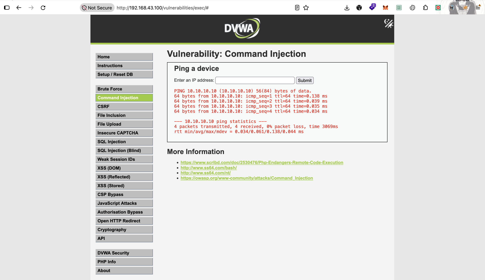
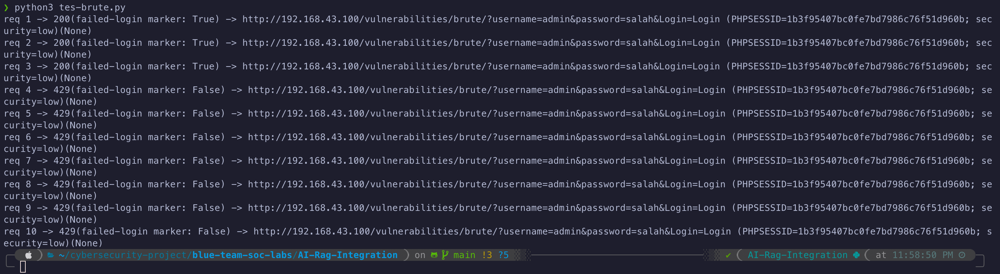

# 🧱 Tahap 4 — SecRule Tulisan Sendiri + Anomaly Scoring & Paranoia

> **Status:** 🚧 **LIVE (progres)** — SQLi & XSS custom rule + anomaly scoring (PL1 block) + paranoia gating (PL2 detection-only) kebukti 2026-10-23; path traversal + command injection `deny` langsung kebukti 2026-10-26; **brute force stateful per-IP** (content-aware, baca response) kebukti 2026-10-28; mekanisme promote PL2→block (fold `100950`/`100951`) udah ada (flip-test nyusul). Docker **sama persis** dengan [Tahap 3](./03-modsecurity-build.md) — tahap ini **murni nambah rule** di atas engine yang udah jadi, gak ada build/compose baru. Bagian dari [ModSecurity build from scratch](./README.md), nyakup roadmap Tahap 4.

## Tujuan

Nulis **SecRule sendiri tanpa CRS**, dan ngerti cara kerja **anomaly scoring** + **paranoia level** dari dalam:

1. **Anatomi SecRule** — variable, operator, transformation, action, phase
2. **Anomaly model** — rule deteksi cuma *nyumbang skor*, satu rule eval yang *mutusin block*
3. **Paranoia level** — misahin rule yang **nge-block** (high confidence) vs yang **cuma log** (shadow / lagi dituning), lewat `blocking_paranoia_level` vs `detection_paranoia_level` + gerbang `skipAfter`

Payload yang **lolos di Tahap 2** (regex native nginx) jadi bahan uji: libinjection `@detectSQLi`/`@detectXSS` harusnya nangkep yang regex mentah lolosin.

| Komponen | Nilai | Catatan |
|----------|-------|---------|
| Engine | `SecRuleEngine On` | Dari Tahap 3 Iterasi 2 |
| Range rule custom | `100000–199999` | Hindari range CRS `900000–999999` |
| Critical anomaly score | `5` | Threshold inbound `5` → 1 hit critical = block |
| Paranoia | blocking `1`, detection `2` | PL1 nge-block, PL2 cuma log |

---

## Prerequisites

- **Tahap 3 selesai** ([`03-modsecurity-build.md`](./03-modsecurity-build.md)) — engine ModSecurity udah nyala, `main.conf` + audit log JSON jalan.
- **Docker gak berubah.** Tahap ini cuma ngedit/nambah file di `conf/nginx/modsec/` (dibaca via mount yang udah ada). Deploy = sync file + `--force-recreate`, **gak rebuild image**.

---

## Konsep: 4 peran di model anomaly

Biar gak ketuker, tiap baris di config punya peran beda:

| Peran | Wujud | Fungsi |
|-------|-------|--------|
| **Init** | `SecAction` (id `100900`) | Bikin ember skor + set threshold & paranoia level |
| **Rule deteksi** | `SecRule ... @detectSQLi` dll | Match serangan → **ngisi ember** skor + log |
| **Gerbang** | `SecRule TX:DETECTION_PARANOIA_LEVEL ... skipAfter` | Nentuin grup rule PL2 **jalan apa nggak** |
| **Keputusan** | `SecRule TX:INBOUND_ANOMALY_SCORE_PL1 ... deny` (id `100999`) | **Baca ember** → `deny` kalau ≥ threshold |

**`block` ≠ pasti block.** `block` artinya "ikut `SecDefaultAction`". Karena `SecDefaultAction phase:2` = `pass`, rule deteksi yang `block` itu **gak nge-block sendiri** — cuma nyumbang skor; yang beneran `deny` cuma `100999`. Rule yang mau murni log pakai **`pass`** (dijamin gak block apapun mode-nya).

---

## Step-by-Step

### 1. Engine config + init (`conf/nginx/modsec/main.conf`)

`main.conf` ngatur engine, audit log, inisialisasi skor, lalu `Include` semua file rule, terus rule keputusan.

```
SecRuleEngine On

SecAuditEngine RelevantOnly
SecAuditLog /var/log/nginx/modsec/modsec_audit.log
SecAuditLogFormat JSON
SecAuditLogRelevantStatus "^(?:5|4(?!04))"
SecRequestBodyAccess On

SecDefaultAction "phase:1,pass,log,auditlog"
SecDefaultAction "phase:2,pass,log,auditlog"

SecAction "id:100900,phase:1,pass,nolog,t:none, \
    setvar:tx.critical_anomaly_score=5, \
    setvar:tx.inbound_anomaly_score_threshold=5, \
    setvar:tx.inbound_anomaly_score_pl1=0, \
    setvar:tx.inbound_anomaly_score_pl2=0, \
    setvar:tx.inbound_anomaly_score=0, \
    setvar:tx.blocking_paranoia_level=1, \
    setvar:tx.detection_paranoia_level=2"

Include /etc/nginx/modsec/rules/*.conf

SecAction "id:100950,phase:2,pass,nolog, \
    setvar:tx.inbound_anomaly_score=+%{tx.inbound_anomaly_score_pl1}"

SecRule TX:BLOCKING_PARANOIA_LEVEL "@ge 2" \
    "id:100951,phase:2,pass,nolog, \
    setvar:tx.inbound_anomaly_score=+%{tx.inbound_anomaly_score_pl2}"

SecRule TX:INBOUND_ANOMALY_SCORE "@ge %{tx.inbound_anomaly_score_threshold}" \
    "id:100999,phase:2,deny,status:403,log, \
    msg:'Inbound Anomaly Score Exceeded (score %{tx.inbound_anomaly_score})'"
```

| Directive | Fungsi |
|-----------|--------|
| `SecAuditLogRelevantStatus "^(?:5\|4(?!04))"` | Audit cuma 4xx/5xx (kecuali 404). Tapi rule yang match dengan `auditlog` bikin transaksinya "relevant" → **tetap keaudit walau 200** |
| `SecDefaultAction phase:2 pass` | Default non-disruptif → `block` di rule = `pass` (mode anomaly) |
| `100900` init | Ember `pl1`/`pl2` + skor gabungan `tx.inbound_anomaly_score` di-nol-in; threshold inbound `5`; blocking `1`, detection `2` |
| `100950`/`100951` fold | Jumlahin ember PL ke **skor gabungan**: PL1 selalu (`SecAction`), PL2 **cuma kalau `blocking ≥ 2`** (`SecRule` bersyarat) |
| `100999` keputusan | Satu-satunya yang `deny` via scoring. Baca **skor gabungan** → naikin `blocking_paranoia_level=2` = promote PL2 jadi blocking **tanpa** nyentuh rule PL2 |

> `main.conf` juga nampung directive buat **brute force** (response body access + collection per-IP + rule block `100998`) — dipisah ke **Step 5** biar bagian anomaly di sini tetap fokus.

### 2. Rule PL1 — produksi, nge-block (`rules/rules-sqli.conf`, `rules/rules-xss.conf`)

Rule **high confidence** pakai libinjection. Nyumbang ke ember `pl1` → ditegakin `100999`.

`rules/rules-sqli.conf`:
```
SecRule ARGS,ARGS_NAMES,REQUEST_HEADERS,REQUEST_BODY,REQUEST_HEADERS:User-Agent "@detectSQLi" \
    "id:100001, \
    phase:2, \
    block, \
    nolog, \
    auditlog, \
    status:403, \
    t:none,t:urlDecodeUni,t:lowercase, \
    msg:'SQL Injection Attack Detected', \
    severity:CRITICAL, \
    tag:'paranoia-level/1', \
    tag:'attack-sqli', \
    setvar:'tx.inbound_anomaly_score_pl1=+%{tx.critical_anomaly_score}'"
```

`rules/rules-xss.conf` — `@detectXSS` (libinjection), pola sama, ember `pl1`, tag `paranoia-level/1`, id `100002`.

| Bagian | Arti |
|--------|------|
| `ARGS,ARGS_NAMES,...` | Variable: di mana nyari (query, nama arg, body, User-Agent) |
| `@detectSQLi` / `@detectXSS` | Operator libinjection — jauh lebih akurat dari regex mentah Tahap 2 |
| `t:urlDecodeUni,t:lowercase` | Transformation: decode + normalisasi **sebelum** dicek (Tahap 2 gagal karena `$args` gak di-decode) |
| `block` + `setvar pl1` | Nyumbang skor ke ember PL1 (block via `100999`) |

### 3. Rule PL2 — shadow / tuning (`rules/tune-rules.conf`)

Rule yang **masih dituning / rawan false positive** ditaruh di sini, dibungkus **gerbang** + ember `pl2`. Selama `blocking=1`, ember `pl2` **gak di-fold** ke skor gabungan, jadi PL2 **cuma ke-log, gak block** (shadow mode).

```
SecRule TX:DETECTION_PARANOIA_LEVEL "@lt 2" \
    "id:100901,phase:2,pass,nolog,skipAfter:END-PL2"

SecRule ARGS,REQUEST_BODY "@rx (?i)(?:<script|`, `<input>`, `<label>` yang legit) → makanya cocok di shadow dulu, bukan langsung block.

### 4. Rule high-confidence — direct `deny` (traversal + command injection)

Beda kelas dari anomaly: pola yang **nyaris mustahil legit** langsung `deny` (block seketika, **gak lewat scoring/threshold**). Cocok buat path traversal / sensitive path / command injection.

**4a. Path traversal** (`rules/rules-path-traversal.conf`):

```
SecRule ARGS,ARGS_NAMES,REQUEST_HEADERS,REQUEST_BODY "@rx (?i)(?:\.\./|\.\.\\|/etc/passwd|/proc/self/environ|/bin/bash|/bin/sh|/usr/bin/...)\b" \
    "id:100004, \
    phase:2, \
    deny, \
    nolog, \
    auditlog, \
    t:none,t:urlDecodeUni,t:lowercase,t:htmlEntityDecode, \
    msg:'Path Traversal Attack Detected', \
    severity:CRITICAL, \
    tag:'paranoia-level/1', \
    tag:'attack-path-traversal'"
```

| Bagian | Arti |
|--------|------|
| `deny` (bukan `block`/`pass`) | **Block seketika** di tempat, gak peduli skor/PL/gerbang |
| **gak ada `setvar`** | Gak nyumbang skor — keputusannya si rule sendiri, bukan `100999` |
| `\.\./`, `/etc/passwd`, path binary | Target LFI/RCE DVWA (File Inclusion + Command Injection) |

> **Scope DVWA:** list path binary (`/bin/bash`, `/usr/bin/*`) sengaja broad — di DVWA mereka = **attack indicator** (Command Injection / LFI), gak ada traffic legit yang kena. Kalau WAF dipasang di depan app lain, review ulang (bisa false positive). **Gotcha:** trailing `\b` bikin `../` **murni** (tanpa nyentuh file terdaftar) bisa lolos; payload DVWA FI (`../../../../etc/passwd`) tetap kena lewat cabang `/etc/passwd`.

**4b. Command injection** (`rules/rules-command-injection.conf`):

Deteksi dari **separator shell + command** (bukan libinjection — gak ada buat CI). Fitur DVWA `exec` itu buat ping IP, jadi serangannya = nyisipin command di belakang IP (`127.0.0.1;whoami`).

```
SecRule ARGS,ARGS_NAMES,REQUEST_HEADERS "@rx (?i)(?:[;|&\x60]|\$\(|\|\|)\s*(?:whoami|id|uname|hostname|wget|curl|nc|cat\s+/etc/passwd|...)\b(?!=)" \
    "id:100005, \
    phase:2, \
    deny, \
    nolog, \
    auditlog, \
    t:none,t:urlDecodeUni,t:lowercase,t:htmlEntityDecode, \
    msg:'Command Injection Attack Detected', \
    severity:CRITICAL, \
    tag:'paranoia-level/1', \
    tag:'attack-command-injection'"
```

| Bagian | Arti |
|--------|------|
| `(?:[;\|&\x60]\|\$\(\|\|\|)` | **Separator shell**: `;` `\|` `&` `` ` `` `$(` `\|\|` — pemisah antar-command |
| `\s*(?:whoami\|id\|...)` | **Command** sesudah separator (kombinasi separator+command = high confidence) |
| `\b(?!=)` | **Negative lookahead** — tolak kalau command diikuti `=` → `&id=5` (param legit / Referer) **gak** FP |
| **tanpa `t:cmdLine`** | `cmdLine` ganti `;`→spasi & hapus spasi sebelum `/` → malah **ngerusak** regex ini (`;whoami` jadi gak kena). Dibuang. |
| `ARGS` (bukan `REQUEST_BODY`) | `ARGS` = GET **+ POST** (parsed) → payload POST `ip` tetep kena, tanpa FP `&id=` dari body mentah |

> **Catatan coverage:** header injection (mis. Shellshock via `User-Agent`) belum jadi fokus — DVWA exec vektornya `ARGS:ip`. `REQUEST_HEADERS` di-scan tapi presisi dijaga `(?!=)`. Kalau ada skenario serang-via-header, pertajam lagi (target header spesifik / command list lebih ketat).

### 5. Rule stateful — brute force (content-aware, baca response)

Kelas rule **paling beda**: bukan cuma liat request, tapi **baca response** (phase 4) dan **nyimpen state per-IP**. WAF gak bisa tau password bener/salah dari request (semua login attempt keliatan sama) — tapi bisa dari **response** DVWA: kalau body-nya ada *"Username and/or password incorrect."* berarti login **gagal**. Hitung gagal per-IP, kalau kebanyakan → block.

Beda sama rate-limit nginx (Tahap 2) yang ngitung **semua** request: ini cuma ngitung **login yang gagal** (content-aware) — request sukses / halaman lain gak nambah counter.

**Tambahan di `main.conf`** (izin baca response + collection per-IP + rule block):

```
SecResponseBodyAccess On
SecResponseBodyMimeType text/html text/plain

SecAction "id:100952,phase:1,pass,nolog,initcol:ip=%{remote_addr}"

SecRule IP:OUTBOUND_FAILED_LOGIN "@ge 3" \
    "id:100998,phase:2,deny,status:429,log, \
    msg:'Outbound Failed Login Count Exceeded (count %{ip.outbound_failed_login})'"
```

| Directive | Fungsi |
|-----------|--------|
| `SecResponseBodyAccess On` + `MimeType` | Izinin ModSecurity baca **response body** (default off). Tanpa ini phase 4 buta |
| `initcol:ip=%{remote_addr}` (`100952`) | Bikin collection **per source IP** → tiap IP punya counter sendiri (targeted, bukan palang buta) |
| `100998` `IP:OUTBOUND_FAILED_LOGIN @ge 3` | Phase 2: counter IP ≥3 → `deny 429` **sebelum** request nyampe DVWA (lockout seluruh akses IP itu, ala fail2ban) |

**Rule counter + reset** (`rules/rules-brute-force.conf`):

```
SecRule RESPONSE_BODY "@contains password incorrect" \
    "id:100006,phase:4,pass,log,t:none,t:lowercase, \
    setvar:ip.outbound_failed_login=+1, \
    expirevar:ip.outbound_failed_login=300, \
    chain"
    SecRule REQUEST_URI "@contains /vulnerabilities/brute/" "t:none"

SecRule RESPONSE_BODY "@contains welcome to the password protected area admin" \
    "id:100007,phase:4,pass,nolog,t:none,t:lowercase, \
    setvar:ip.outbound_failed_login=0, \
    chain"
    SecRule REQUEST_URI "@contains /vulnerabilities/brute/" "t:none"
```

| Bagian | Arti |
|--------|------|
| `RESPONSE_BODY @contains password incorrect` | Baca response (phase 4) — marker login **gagal** DVWA |
| `phase:4` + `pass` | Jalan di fase response body; `pass` = cuma nyatet, gak block di sini (block-nya di `100998`, phase 2) |
| `setvar:ip.outbound_failed_login=+1` | Naikin counter per-IP tiap gagal |
| `expirevar:...=300` | Counter **ilang 300 detik** setelah gagal terakhir (sliding window) |
| `chain` + `REQUEST_URI /brute/` | **Scope** — cuma hitung gagal di endpoint login brute, bukan kata "incorrect" di halaman lain |
| `100007` reset (`=0`) | Kalau login **sukses** (*"welcome to the password protected area"*) → counter **di-nol-in** → user sah yang sempet salah gak kejebak |

**`worker_processes 1`** (di `tahap-3-modsecurity.conf`): collection libmodsecurity v3 itu **in-memory per-worker** — kalau worker >1, counter kepecah antar-worker (request ke-2 bisa nyasar ke worker lain yang counter-nya masih 0). Dipaksa 1 worker biar counting konsisten. Batasan v3; buat lab 1 VM gak masalah.

> **⚠️ Gotcha 1 — rule kedua di chain WAJIB punya action string.** Awalnya chain ini dipasang tanpa `"t:none"` di `SecRule REQUEST_URI` kedua:
> ```
>     chain"
>     SecRule REQUEST_URI "@contains /vulnerabilities/brute/"   ← kosong, gak ada "..."
> ```
> Parser ModSecurity **nungguin action yang gak pernah datang**, lalu **nyebrang ke file berikutnya** (`rules-command-injection.conf`, tetangga alfabetis) dan nganggep isinya sebagai action → error **`Expecting an action`** nyasar ke file yang sebenernya **sehat**. Nyesatin: pesan error nunjuk **korban**, bukan **pelaku** (sempet ngutak-ngatik regex command-injection & path-traversal yang gak salah apa-apa). Fix: kasih `"t:none"` (action minimal) di tiap `SecRule` kedua. **Pelajaran: kalau parse error ModSecurity nunjuk file yang pas dites sendiri valid → curigai rule di file SEBELUMnya di urutan load.**

> **⚠️ Gotcha 2 — compression bikin WAF buta ke response.** Script test (`python-requests`) default kirim `Accept-Encoding: gzip`, jadi DVWA balikin response **ter-gzip**. ModSecurity baca `RESPONSE_BODY` dalam bentuk **byte terkompresi** → "password incorrect" **gak ketemu** → counter gak naik → gak pernah block. (Di sisi client, requests auto-decompress → keliatan "ada" padahal WAF-nya buta — `marker: True` tapi gak kena.) **libmodsecurity v3 gak auto-decompress** response body. Fix di `tahap-3-modsecurity.conf`, dalam `location /`:
> ```nginx
> proxy_set_header Accept-Encoding "";
> ```
> WAF bilang ke DVWA "aku gak nerima kompresi" → upstream balikin **plaintext** → ModSecurity bisa inspeksi → counter jalan buat **semua client** (minta gzip atau nggak). Ini pola standar WAF yang inspeksi response body.

### 6. Kenapa dipisah per file + urutan load

`Include /etc/nginx/modsec/rules/*.conf` baca file **urut alfabetis**:

```
rules-brute-force.conf       → 100006/100007 (stateful, phase 4)
rules-command-injection.conf → 100005 (deny langsung)
rules-path-traversal.conf    → 100004 (deny langsung)
rules-sqli.conf              → 100001 (PL1)
rules-xss.conf               → 100002 (PL1)
tune-rules.conf             → 100901 gerbang → 100003 (PL2) → END-PL2
```

`b` < `c`/`r` < `t`, jadi `tune-rules.conf` **ke-load terakhir** → gerbang otomatis ada **setelah semua rule PL1 / deny**. Ini penting: gerbang `skipAfter:END-PL2` cuma boleh ngebungkus rule PL2. Kalau rule PL1/deny kejepit di antara gerbang & marker, dia ikut ke-skip pas `detection=1` — padahal mereka harus selalu jalan.

> Urutan ini juga yang bikin **Gotcha 1** (Step 5) nyesatin: `rules-brute-force.conf` load **paling awal**, jadi pas chain-nya "nggantung" (kurang action), yang kena getahnya `rules-command-injection.conf` (tetangga tepat di bawahnya) — bukan brute-force-nya sendiri.

> Aturan: file rule PL1 / `deny` produksi = `rules-*.conf`. Rule PL2 yang dituning = dalam `tune-rules.conf`, di antara gerbang & `END-PL2`.

### 7. Deploy (docker sama Tahap 3)

```bash
# dari Mac — sync SELURUH conf/nginx (brute force ngubah tahap-3-modsecurity.conf
# juga: worker_processes 1 + proxy_set_header Accept-Encoding "")
scp -r conf anang@10.10.10.5:/data/waf/scratch/

# di VM
cd /data/waf/scratch
mkdir -p logs/modsec && sudo chown 101:101 logs/modsec && sudo chmod 750 logs/modsec
docker compose up -d --force-recreate     # gak rebuild, cuma recreate container
docker exec waf-scratch nginx -t
```

---

## Verifikasi — Live 2026-10-23

Test dari Mac (Firefox, `192.168.43.193`) ke DVWA via WAF `192.168.43.100`.

### 1. PL1 nge-block (anomaly chain)

| Payload | Hasil | Rule |
|---------|-------|------|
| SQLi `id=1' OR '1'='1` | **403** | `100001` detect → `pl1`+5 → `100999` deny |
| XSS `<script>alert(1)</script>` | **403** | `100002` detect → `pl1`+5 → `100999` deny |


Audit log XSS `<script>` nangkep **1 entri, 3 message** — jejak chain lengkap: `100002` (pl1) + `100003` (pl2, ikut match) + `100999` (keputusan deny). Yang bikin block = PL1; PL2 cuma nebeng log.

### 2. PL2 detection-only (shadow) — kebukti isolasi

Payload yang **match regex taglist tapi LOLOS libinjection**: `name=<form>`.

| Payload | Hasil | Rule |
|---------|-------|------|
| `name=<form>` | **200** (halaman DVWA kebuka normal) | cuma `100003` (pl2) → `100999` gak baca pl2 → **log doang, gak block** |


Audit log `<form>` cuma **1 message**: `ruleId 100003` tag `paranoia-level/2`, `is_interrupted: false`, `http_code 200`. **Gak ada** `100002` (libinjection bener, `<form>` bukan XSS) & **gak ada** `100999`. Inilah bukti murni **detection ≠ blocking**.

### 3. Direct `deny` — path traversal (live 2026-10-26)

DVWA File Inclusion, payload `?page=../../../../etc/passwd`:

| Payload | Hasil | Rule |
|---------|-------|------|
| `fi/?page=../../../../etc/passwd` | **403** | `100004` `deny` **langsung** (match cabang `/etc/passwd`) |


Audit log cuma **1 message**: `ruleId 100004` `is_interrupted: true`, **gak ada `100999`**. Beda sama SQLi/XSS: block-nya dari **rule-nya sendiri** (`deny`), bukan lewat chain scoring. Inilah sifat **high-confidence direct deny** — langsung, tanpa threshold.

### 4. Direct `deny` — command injection (live 2026-10-26)

DVWA Command Injection (`exec`, form POST field `ip`):

| Payload (`ip=`) | Hasil | Rule |
|-----------------|-------|------|
| `127.0.0.1;whoami` | **403** | `100005` `deny` (`ARGS:ip` = `;whoami`) |
| `127.0.0.1&whoami`, `127.0.0.1\|whoami` | **403** | sama (diuji, gak di-SS) |
| `127.0.0.1` (ping normal) | **200** — ping jalan (4 packets, 0% loss) | gak match → fitur legit aman |




Dua bukti penting: (1) payload kena di **`ARGS:ip`** walau dikirim **POST** → `ARGS` nyakup body form; (2) **ping legit gak keblok** → rule presisi (cuma nendang separator+command, bukan IP biasa).

### 5. Brute force — stateful per-IP (live 2026-10-28)

DVWA Brute Force, login salah berulang (`admin`/`salah`) dari `192.168.43.193` (threshold `@ge 3`):

| Request | Hasil | Catatan |
|---------|-------|---------|
| req 1–3 | **200** | login gagal, counter naik 1→2→3 (response bawa `password incorrect`) |
| req 4+ | **429** | `100998` deny — `IP:...OUTBOUND_FAILED_LOGIN ≥ 3` |



Dari `error.log` + audit JSON:
- `100998` match `IP:192.168.43.193::::OUTBOUND_FAILED_LOGIN (Value: 3)` → **collection per-IP jalan**, counter persist lintas request (v3 + `worker_processes 1` kebukti bisa).
- `100006` match `REQUEST_URI /vulnerabilities/brute/` (audit) → **chain scope** aktif.
- Request yang keblok tetap bawa `Accept-Encoding: gzip` + `User-Agent: python-requests` → tetap kena → **fix compression (Gotcha 2) sukses**.

Dua bug sepanjang jalan (lihat **Gotcha 1 & 2** di Step 5): chain tanpa `t:none` (parse error nyasar ke file tetangga), dan response gzip bikin WAF buta. Dua-duanya kebukti + fixed, baru 429 muncul.

Reset counter: `expirevar` auto-bersih ±300 detik setelah gagal terakhir, atau `docker compose restart` (collection in-memory → balik 0 seketika).

### Ringkasan bukti

| | PL1 (`@detectXSS`) | PL2 (`@rx` taglist) |
|---|---|---|
| Ember | `pl1` | `pl2` |
| Dibaca `100999`? | ✅ ya | ❌ nggak |
| `<script>alert(1)</script>` | **403** | ikut log |
| `<form>` | gak match | **200 + log doang** |

---

## Catatan & Batasan (buat tahap lanjut)

- **Promote PL2 → blocking**: ✅ **mekanisme udah ada** (`100950`/`100951` fold + `100999` baca skor gabungan). Tinggal set `blocking_paranoia_level=2` → `--force-recreate` → `<form>` jadi 403. Flip-test live **belum** dicatat (nyusul).
- **Rule high-confidence (direct `deny`)**: ✅ path traversal (`100004`) + command injection (`100005`) live — sekali match = `deny` langsung tanpa scoring. Sensitive path/command lain bisa nyusul.
- **Header injection** (mis. Shellshock via `User-Agent`): `REQUEST_HEADERS` di-scan di rule CI (presisi dijaga `(?!=)`), tapi belum ada skenario lab khusus — pertajam kalau diperluin.
- **Paranoia gating penuh (PL3–4)**: tiap level di atas PL1 butuh gerbang + marker sendiri (`@lt N`). Sekarang baru PL2.
- **Brute force (stateful, content-aware)**: ✅ live — baca `RESPONSE_BODY` (phase 4) buat hitung login gagal per-IP (`100006`), reset pas sukses (`100007`), block di `100998`. Batasan: (1) collection v3 **in-memory per-worker** → butuh `worker_processes 1`, **reset ke 0 tiap container restart**; (2) WAF **wajib strip compression** (`Accept-Encoding ""`) atau response-body rule buta ke response gzip; (3) berbasis IP → beberapa attacker di belakang satu NAT **berbagi counter**.
