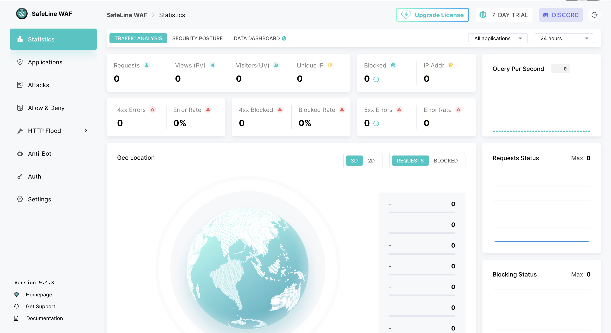

# 🧰 WAF Stack — SafeLine

> ✅ **STATUS: INSTALLED + RUNNING (English UI).** Stack SafeLine 9.4.3 live di VM `waf` per 2026-10-30, dashboard ke-akses + udah di-English-in (`REGION=-g`). **Belum**: daftar site (proxy ke DVWA) + integrasi log ke Wazuh — itu langkah berikutnya.

## Tujuan

Jalanin **SafeLine** sebagai reverse proxy WAF di depan DVWA, buat diadu sama ModSecurity. Bedanya, SafeLine pakai engine **semantic analysis** (signature-free) + anti-bot + dashboard manajemen sendiri, sementara ModSecurity pakai SecRule regex/libinjection + anomaly scoring. Satu VM, gantian di `:80` (toggle `up`/`down`, lihat [`../README.md`](../README.md)).

---

## Prerequisites

- WAF VM + Docker + agent Wazuh `waf` udah siap, lihat [`../README.md`](../README.md)
- RAM VM **≥ 6 GB** (SafeLine rakus: postgres + detector + mgt + chaos + fvm + luigi + tengine = 7 container)
- **CPU SSE4.2** — SafeLine wajib instruksi ini. Divalidasi:
  ```bash
  grep -o sse4_2 /proc/cpuinfo | head -1    # keluar: sse4_2 ✅ (Ryzen 5700G via VMware)
  ```
- Stack ModSecurity di `:80` udah di-`down` dulu (bebasin port + RAM).

---

## Step-by-Step

### 1. Install (WAJIB `sudo`)

```bash
# matiin ModSec dulu
cd /data/waf/scratch && docker compose down

# install — installer WAJIB root, dan NANYA path instalasi
cd /data/waf
sudo bash -c "$(curl -fsSLk https://waf.chaitin.com/release/latest/setup.sh)"
```

Pas prompt `雷池安装目录 (留空则为 '/data/safeline')` → ketik **`/data/waf/safeline`** (jangan dikosongin, biar konsisten sama stack lain). Installer download `docker-compose.yaml` + `.env` + pull image.

> **Catatan:** `sudo bash -c "$(curl ...)"` — `$(curl)` jalan as user (download script), hasilnya dieksekusi `sudo bash` as root. Jalan tanpa sudo → `ERROR: You need to be root`. Pre-create folder pakai `mkdir` **jangan** dilakuin: installer nolak direktori yang udah eksis (`'...' 已存在`) karena mau bikin sendiri.

### 2. Gotcha: pull image gagal (IPv6 + DNS)

Pull image **gagal berkali-kali** — bukan masalah SafeLine, tapi jaringan VM narik dari CDN Docker. Tiga error beruntun + fix-nya:

| Error | Arti | Fix |
|-------|------|-----|
| `dial tcp [2600:...]:443: network is unreachable` | Docker nyoba IPv6, VM gak punya route IPv6 (lab IPv4-only) | `sudo sysctl -w net.ipv6.conf.all.disable_ipv6=1` + `...default.disable_ipv6=1` |
| `connect: cannot assign requested address` | IPv6 udah mati tapi daemon masih nyoba | `sudo systemctl restart docker` (baca ulang state IPv6-off) |
| `lookup ... on 127.0.0.53:53: server misbehaving` | DNS hotspot (systemd-resolved stub) flaky | `sudo sed -i 's/^#\?DNS=.*/DNS=8.8.8.8 1.1.1.1/' /etc/systemd/resolved.conf` + `sudo systemctl restart systemd-resolved` |

Tiap `docker compose pull` **resume** dari layer yang udah ke-download, jadi retry = lanjut, bukan ulang dari nol. Setelah DNS andal, pull `35/35` ✅.

> `sysctl -w` sementara (reset pas reboot). Kalau SafeLine dipakai terus, bikin persistent di `/etc/sysctl.conf`.

### 3. Jadiin English

Personal Edition default-nya **Chinese-only** (gak ada toggle bahasa di dashboard, udah dicek tab `防护配置` + `控制台管理`). Dua cara, keduanya dari [GitHub issue #1163](https://github.com/chaitin/SafeLine/issues/1163):

**Cara 1 — English dari awal (`--en`, PALING BERSIH):** pas install (Step 1), tambahin flag `--en` → langsung narik build global, **gak perlu re-pull**:
```bash
sudo bash -c "$(curl -fsSLk https://waf.chaitin.com/release/latest/setup.sh)" -- --en
```
> Ini cara yang **disaranin kalau mulai dari nol**. Kita sendiri gak pakai ini (ketauan setelah terlanjur install Chinese), jadi belum dites langsung di lab — tapi inilah yang bikin "auto English" tanpa drama Step di bawah.

**Cara 2 — fix setelah terlanjur Chinese (`REGION=-g`, yang KITA pakai & terbukti):**
```bash
cd /data/waf/safeline
sudo sed -i 's/^REGION=.*/REGION=-g/' .env     # dari REGION= (kosong) jadi REGION=-g
sudo docker compose pull                        # narik image varian -g (global) — re-pull
sudo docker compose up -d --force-recreate
```
`REGION` nempel di tag image, jadi `-g` = **re-pull image varian global** (DNS udah fix, mulus). **Revert** ke Chinese = `REGION=` (kosong) + `--force-recreate`.

### 4. Ambil kredensial admin

```bash
sudo docker exec safeline-mgt resetadmin
```

Nge-print username (`admin`) + password + URL dashboard. Simpan ke `waf-passwords.txt` (gitignored). **Jangan commit.** Abis `--force-recreate` creds bisa reset → `resetadmin` lagi.

### 5. Akses dashboard

- URL: **`https://10.10.10.5:9443`** (TLS self-signed → browser warning, wajar). Container `safeline-mgt` expose `0.0.0.0:9443->1443`.
- Container (dari `docker ps`): `safeline-mgt` (dashboard), `safeline-tengine` (data-plane/proxy), `safeline-detector` (engine semantic), `safeline-pg` (postgres), `safeline-chaos`/`fvm`/`luigi` (anti-bot/dynamic/task).



> **⚠️ Catatan akses (management plane):** dashboard `:9443` itu **panel admin**. Idealnya diakses **VPN-only** (WireGuard), bukan dibuka di firewall WAN — karena rule WAN = panel kebuka ke seluruh hotspot `192.168.43.0/24`. Prinsip: **data plane (`:80`) → WAN** (sengaja dipapar ke attacker), **management plane (`:9443`) → WireGuard**. Tambahan: `访问白名单` console masih `0.0.0.0/0`, bisa diperketat ke subnet WireGuard.

### 6. Daftar site ⏳ BELUM

`Applications` → Add. Listen `10.10.10.5:80` → upstream `http://10.10.10.10:80` (DVWA). `tengine` baru bind `:80` setelah site didaftar (beda sama ModSec yang listen dari compose).

---

## Integrasi log ke Wazuh ⏳ BELUM

SafeLine nyimpen deteksi di **postgres internal**, bukan file datar kayak ModSecurity. **Tapi** versi 9.4.3 punya **export Syslog bawaan** (`Settings → General → Syslog`) — ini jalur paling bersih (gak perlu tail docker logs / poll API). Rencana:

- **Opsi A** — syslog SafeLine → Wazuh Manager (Dell) port `514`
- **Opsi B** (condong, konsisten sama ModSec) — syslog → rsyslog lokal VM `waf` → file → Wazuh agent `<localfile>`

Diputusin pas site udah jalan + ada attack event buat diuji.

---

## Verifikasi ⏳ BELUM

```bash
curl "http://192.168.43.100/vulnerabilities/sqli/?id=1' OR '1'='1"    # → block page SafeLine
```

- Attack event muncul di dashboard SafeLine (`Attacks`)
- Event nyampe Wazuh (`agent.name: waf`) sesuai metode syslog yang dipilih
