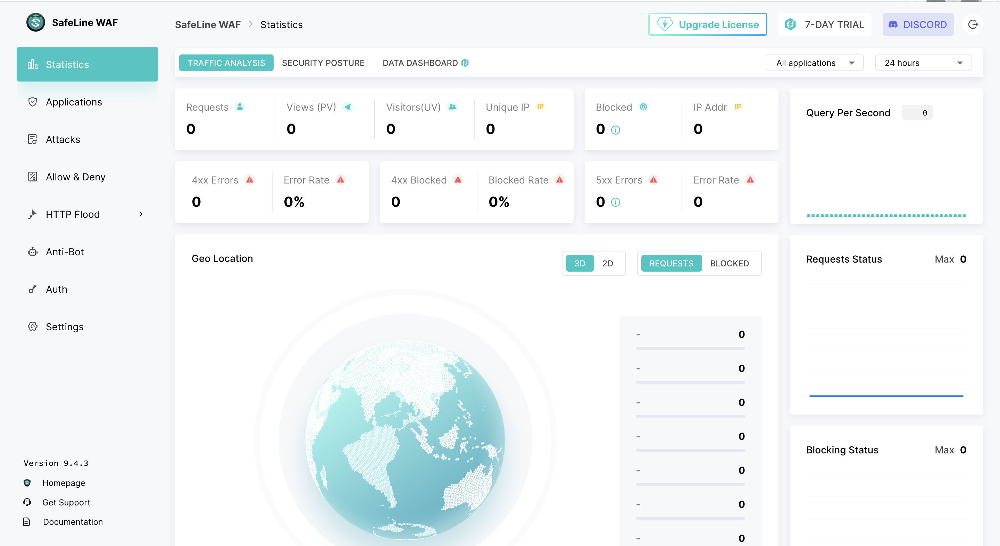
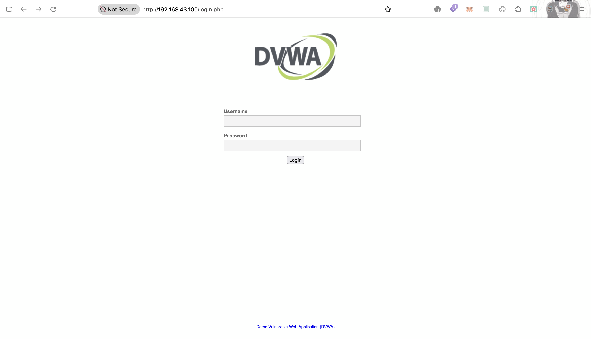
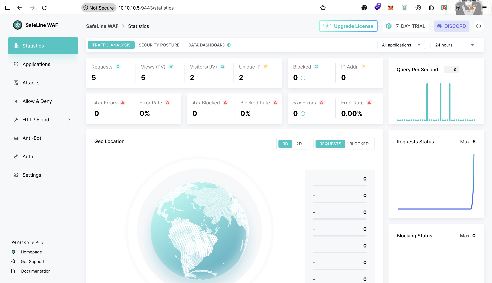

# 🧰 WAF Stack — SafeLine

> ✅ **STATUS: LIVE, PROXY + INTEGRASI WAZUH (EXPORTER) JALAN.** Stack SafeLine 9.4.3 live di VM `waf` per 2026-10-30 (English UI, `REGION=-g`), site DVWA terdaftar, pipeline Wazuh via exporter postgres → `events.json` → agent `<localfile>` → rule `100705`-`100707` LIVE end-to-end. Skenario serangan lengkap (block SQLi/XSS/CmdI, gap `127.0.0.1 | id`, fitur Rate Limiting & Allow/Deny beserta temuan soal cakupan Wazuh) ada di writeup lab: [`Labs/waf/safeline/README.md`](../../../Labs/waf/safeline/README.md).

## Tujuan

Jalanin **SafeLine** sebagai reverse proxy WAF di depan DVWA, buat diadu sama ModSecurity. Bedanya, SafeLine pakai engine **semantic analysis** (signature-free) + anti-bot + dashboard manajemen sendiri, sementara ModSecurity pakai SecRule regex/libinjection + anomaly scoring. Satu VM, gantian di `:80` (toggle `up`/`down`, lihat [`../README.md`](../README.md)).

---

## Prerequisites

- WAF VM + Docker + agent Wazuh `waf` udah siap, lihat [`../README.md`](../README.md)
- RAM VM **≥ 6 GB** (SafeLine rakus: postgres + detector + mgt + chaos + fvm + luigi + tengine = 7 container)
- **CPU SSE4.2** — SafeLine wajib instruksi ini. Divalidasi:
  ```bash
  grep -o sse4_2 /proc/cpuinfo | head -1    # keluar: sse4_2 ✅ (Ryzen 5700G via VMware)
  ```
- Stack ModSecurity di `:80` udah di-`down` dulu (bebasin port + RAM).

---

## Step-by-Step

### 1. Install (WAJIB `sudo`)

```bash
# matiin ModSec dulu
cd /data/waf/scratch && docker compose down

# install — installer WAJIB root, dan NANYA path instalasi
cd /data/waf
sudo bash -c "$(curl -fsSLk https://waf.chaitin.com/release/latest/setup.sh)"
```

Pas prompt `雷池安装目录 (留空则为 '/data/safeline')` → ketik **`/data/waf/safeline`** (jangan dikosongin, biar konsisten sama stack lain). Installer download `docker-compose.yaml` + `.env` + pull image.

> **Catatan:** `sudo bash -c "$(curl ...)"` — `$(curl)` jalan as user (download script), hasilnya dieksekusi `sudo bash` as root. Jalan tanpa sudo → `ERROR: You need to be root`. Pre-create folder pakai `mkdir` **jangan** dilakuin: installer nolak direktori yang udah eksis (`'...' 已存在`) karena mau bikin sendiri.

### 2. Gotcha: pull image gagal (IPv6 + DNS)

Pull image **gagal berkali-kali** — bukan masalah SafeLine, tapi jaringan VM narik dari CDN Docker. Tiga error beruntun + fix-nya:

| Error | Arti | Fix |
|-------|------|-----|
| `dial tcp [2600:...]:443: network is unreachable` | Docker nyoba IPv6, VM gak punya route IPv6 (lab IPv4-only) | `sudo sysctl -w net.ipv6.conf.all.disable_ipv6=1` + `...default.disable_ipv6=1` |
| `connect: cannot assign requested address` | IPv6 udah mati tapi daemon masih nyoba | `sudo systemctl restart docker` (baca ulang state IPv6-off) |
| `lookup ... on 127.0.0.53:53: server misbehaving` | DNS hotspot (systemd-resolved stub) flaky | `sudo sed -i 's/^#\?DNS=.*/DNS=8.8.8.8 1.1.1.1/' /etc/systemd/resolved.conf` + `sudo systemctl restart systemd-resolved` |

Tiap `docker compose pull` **resume** dari layer yang udah ke-download, jadi retry = lanjut, bukan ulang dari nol. Setelah DNS andal, pull `35/35` ✅.

> `sysctl -w` sementara (reset pas reboot). Kalau SafeLine dipakai terus, bikin persistent di `/etc/sysctl.conf`.

### 3. Jadiin English

Personal Edition default-nya **Chinese-only** (gak ada toggle bahasa di dashboard, udah dicek tab `防护配置` + `控制台管理`). Dua cara, keduanya dari [GitHub issue #1163](https://github.com/chaitin/SafeLine/issues/1163):

**Cara 1 — English dari awal (`--en`, PALING BERSIH):** pas install (Step 1), tambahin flag `--en` → langsung narik build global, **gak perlu re-pull**:
```bash
sudo bash -c "$(curl -fsSLk https://waf.chaitin.com/release/latest/setup.sh)" -- --en
```
> Ini cara yang **disaranin kalau mulai dari nol**. Kita sendiri gak pakai ini (ketauan setelah terlanjur install Chinese), jadi belum dites langsung di lab — tapi inilah yang bikin "auto English" tanpa drama Step di bawah.

**Cara 2 — fix setelah terlanjur Chinese (`REGION=-g`, yang KITA pakai & terbukti):**
```bash
cd /data/waf/safeline
sudo sed -i 's/^REGION=.*/REGION=-g/' .env     # dari REGION= (kosong) jadi REGION=-g
sudo docker compose pull                        # narik image varian -g (global) — re-pull
sudo docker compose up -d --force-recreate
```
`REGION` nempel di tag image, jadi `-g` = **re-pull image varian global** (DNS udah fix, mulus). **Revert** ke Chinese = `REGION=` (kosong) + `--force-recreate`.

### 4. Ambil kredensial admin

```bash
sudo docker exec safeline-mgt resetadmin
```

Nge-print username (`admin`) + password + URL dashboard. Simpan ke `waf-passwords.txt` (gitignored). **Jangan commit.** Abis `--force-recreate` creds bisa reset → `resetadmin` lagi.

### 5. Akses dashboard

- URL: **`https://10.10.10.5:9443`** (TLS self-signed → browser warning, wajar). Container `safeline-mgt` expose `0.0.0.0:9443->1443`.
- Container (dari `docker ps`): `safeline-mgt` (dashboard), `safeline-tengine` (data-plane/proxy), `safeline-detector` (engine semantic), `safeline-pg` (postgres), `safeline-chaos`/`fvm`/`luigi` (anti-bot/dynamic/task).



> **⚠️ Catatan akses (management plane):** dashboard `:9443` itu **panel admin**. Idealnya diakses **VPN-only** (WireGuard), bukan dibuka di firewall WAN — karena rule WAN = panel kebuka ke seluruh hotspot `192.168.43.0/24`. Prinsip: **data plane (`:80`) → WAN** (sengaja dipapar ke attacker), **management plane (`:9443`) → WireGuard**. Tambahan: `访问白名单` console masih `0.0.0.0/0`, bisa diperketat ke subnet WireGuard.

### 6. Daftar site

`Applications` → `Add Application`. `tengine` baru bind `:80` setelah site didaftar (beda sama ModSec yang listen dari compose).

| Field | Nilai | Catatan |
|-------|-------|---------|
| Domain | `*` | Nangkep semua request, termasuk yang masuk lewat NAT ke `192.168.43.100`. Jangan isi pakai `http://`, field ini buat hostname |
| Port | `80` (HTTP) | Target NAT pfSense tetap `10.10.10.5:80` |
| Mode | Reverse Proxy | |
| Upstream | `http://10.10.10.10:80` | DVWA |
| Application Name | `Web APP DVWA` | |

> **Gotcha:** form sempat nampilin warning `Abnormal access status of upstream server:unreachable` di field Upstream, padahal `curl -I http://10.10.10.10/` dari VM `waf` balik `302` dan `:80` masih kosong. Site tetap bisa di-submit dan proxy jalan normal, jadi warning ini gak mencerminkan kondisi traffic asli. Penyebab warning-nya sendiri gak ditelusuri.

---

## Integrasi log ke Wazuh ✅ LIVE (exporter)

SafeLine nyimpen deteksi di **postgres internal**, bukan file datar kayak ModSecurity.

> **Gotcha: Syslog gak gratis.** Form `Settings → Syslog` ada di 9.4.3, tapi waktu dicoba isi `10.10.10.5:5140` dan dites, yang keluar dialog `Upgrade License`. Di dialog itu `Attack Logs Export` masuk fitur paket **Lite**. Ikon hexagon teal di UI nandain fitur berbayar. `7-DAY TRIAL` sengaja gak dipakai, karena pipeline-nya bisa putus begitu trial habis.

> **⚠️ Prinsip dasar yang wajib dipegang di lab ini:** karena Syslog resmi berbayar, exporter kita cuma nge-query **satu tabel** (`mgt_detect_log_basic`, engine Attacks) — bukan jalur resmi yang nyatet semua jenis event SafeLine (Rate Limiting, Allow & Deny, dll). Akibatnya **gak semua yang "bekerja" di SafeLine otomatis jadi alert di Wazuh**. Jadi tiap kali mau mastiin suatu rule beneran ke-trigger, **selalu cek 2 sisi**: (1) **dashboard/log SafeLine sendiri** (ground truth — rule-nya jalan apa nggak, lihat Allow & Deny → Logs atau HTTP Flood → Rate Limiting), dan (2) **rule Wazuh yang kita bikin** (`100705`-`100707` — cuma nyatet event Attacks, bukan representasi lengkap dari semua yang terjadi di SafeLine). Jangan simpulkan "gak ada alert Wazuh = rule gak jalan" — bisa jadi rule-nya jalan beneran, cuma emang di luar cakupan 1 tabel yang kita tarik.

Jalur yang dipakai: baca event dari postgres `safeline-pg` → tulis JSON ke file di VM `waf` → Wazuh agent `<localfile>` (pola sama kayak ModSec). Folder `logs/` SafeLine gak bisa dipakai: `logs/detector/` kosong, `logs/nginx/` cuma `error.log`.

```
Kali/Mac ──serangan──> SafeLine ──block──> postgres mgt_detect_log_basic
                                                  │ safeline-log-exporter (poll 10 detik)
                                                  ▼
                                   /var/log/safeline/events.json
                                                  │ Wazuh agent <localfile> json
                                                  ▼
                                   Manager (Dell) ── rule 100705-100707 ── ALERT
```

Field dari tabel `mgt_detect_log_basic` yang dipakai rule, hasil lihat event asli:

| Field | Contoh | Arti |
|-------|--------|------|
| `event_id` | `c27796ca276445db93b26a7f961f37c4` | Sama dengan `event_id` di block page |
| `src_ip` | `192.168.43.193` | IP client asli (NAT pfSense gak ngubah source) |
| `url_path` | `/vulnerabilities/sqli/?id=1%27+OR+%271%27%3d%271` | Path + query string |
| `rule_id` | `m_sqli` | Modul deteksi engine |
| `attack_type` | `0` | Kode kategori, `0` = SQLi |
| `risk_level` | `3` | Tingkat risiko dari engine |
| `action` | `1` | `1` = diblokir |

### 1. Rule di Manager (Dell)

Copy [`waf_rules.xml`](../../../Detection-Engineer/wazuh/rule/waf_rules.xml) ke `/var/ossec/etc/rules/`, lalu:

```bash
sudo systemctl restart wazuh-manager
```

### 2. Pasang exporter (VM `waf`)

Dari M1:

```bash
scp safeline-log-exporter.sh safeline-log-exporter.service anang@10.10.10.5:/tmp/
```

Di VM `waf`:

```bash
sudo install -m 750 /tmp/safeline-log-exporter.sh /usr/local/bin/
sudo install -m 644 /tmp/safeline-log-exporter.service /etc/systemd/system/
sudo install -d -m 750 /var/log/safeline
sudo touch /var/log/safeline/events.json
sudo chmod 640 /var/log/safeline/events.json
```

### 3. Forward via agent (VM `waf`)

Tambahin di `/var/ossec/etc/ossec.conf`:

```xml
<localfile>
  <log_format>json</log_format>
  <location>/var/log/safeline/events.json</location>
</localfile>
```

```bash
sudo systemctl restart wazuh-agent
```

### 4. Nyalain exporter

Urutannya setelah agent di-restart, biar event lama yang udah ada ikut kebaca sebagai baris baru:

```bash
sudo systemctl daemon-reload
sudo systemctl enable --now safeline-log-exporter
```

> **Catatan:** `events.json` belum punya log rotation. Kalau SafeLine di-install ulang, `id` database mulai dari awal lagi, jadi hapus `/var/lib/safeline-exporter/last_id` biar event baru gak ke-skip.

---

## Verifikasi

### Proxy ke DVWA ✅

Buka `http://192.168.43.100/` dari browser M1 → halaman login DVWA keluar lewat NAT pfSense dan SafeLine.



Dashboard `Statistics` nyatat traffic-nya: `Requests 5`, `Unique IP 2`, `5xx Errors 0`. `Blocked` masih `0` karena ini traffic normal, jadi screenshot ini belum jadi bukti block.



### Pipeline Wazuh LIVE ✅

```bash
sudo systemctl status safeline-log-exporter --no-pager
sudo tail -n 3 /var/log/safeline/events.json
```

- `events.json` berisi event SQLi dengan `event_id` yang sama kayak di block page (bukti exporter nulis event beneran, bukan cuma proses jalan kosong)
- Alert `100707` (level 10, MITRE T1190) muncul di Wazuh dengan `agent.name: waf` — pipeline exporter → agent → rule → alert CONFIRMED LIVE end-to-end

### Serangan nyata + fitur WAF (Rate Limiting, Allow & Deny) — lihat writeup lab

Skenario block SQLi/XSS/Command Injection, gap deteksi `127.0.0.1 | id`, fitur **Rate Limiting** (HTTP Flood) dan **Allow & Deny** (whitelist/blacklist) beserta temuan soal cakupan Wazuh buat masing-masing (block generik nyampe Wazuh, tapi aksi Rate Limiting/Deny sendiri enggak) **dipindah ke** [`Labs/waf/safeline/README.md`](../../../Labs/waf/safeline/README.md) — konsisten sama pola `sentinel-waf` (Infrastructure = cara bikin, Labs = skenario serangan/fitur).

### Sisa checklist

- [ ] Deploy agent `<localfile>` + rule `100705`-`100707` di Manager (Dell) — langkah ada, belum terkonfirmasi full restart cycle dari nol di VM baru.
- [ ] Exporter belum punya log rotation (`events.json` numpuk terus) — belum jadi masalah karena ukuran masih kecil.
