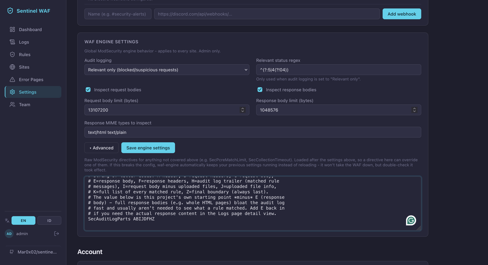
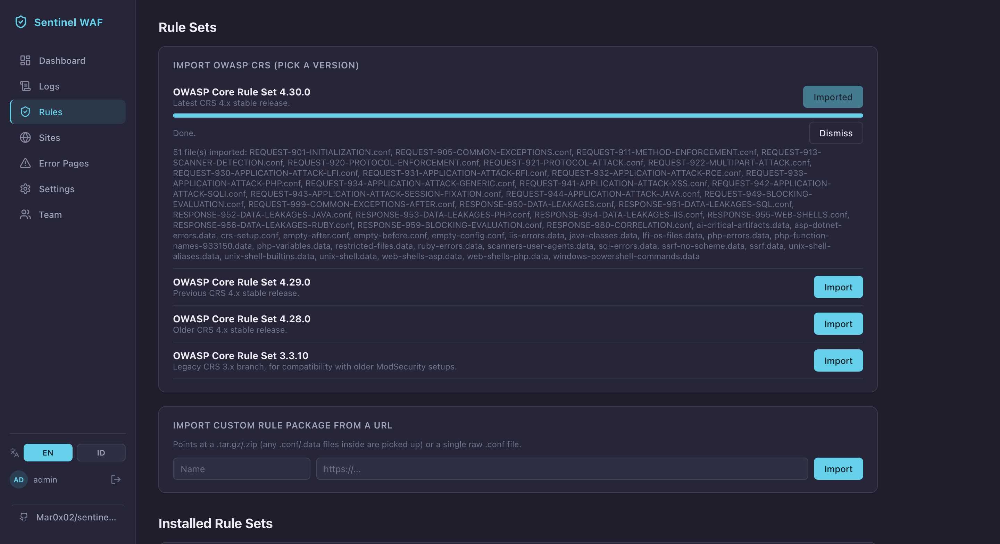
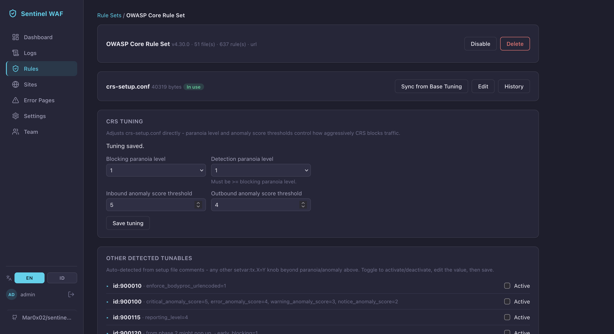
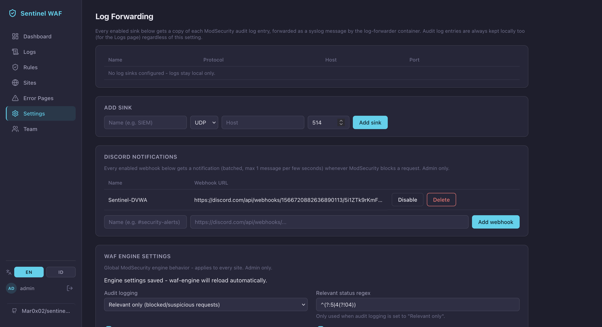
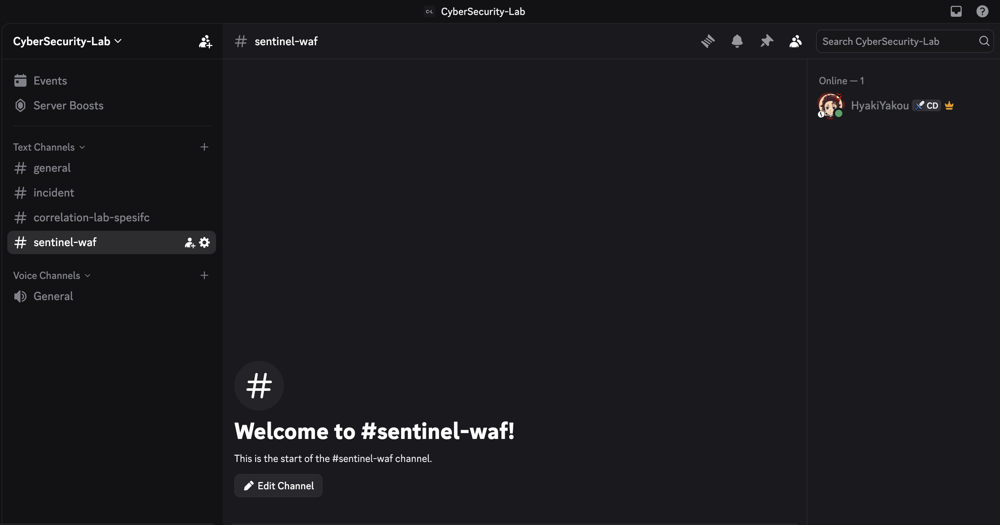
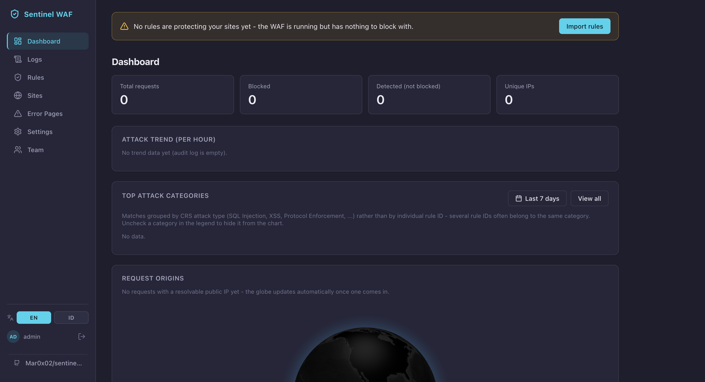
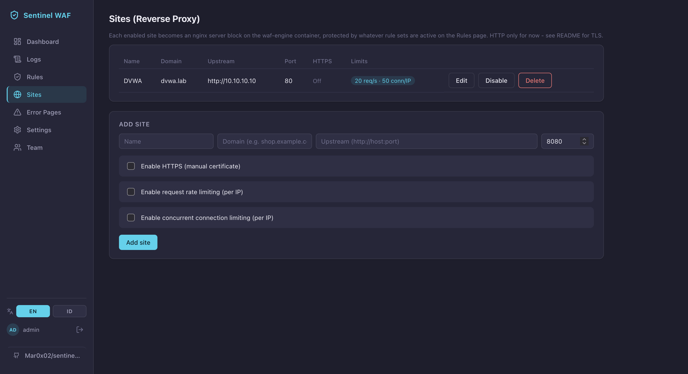
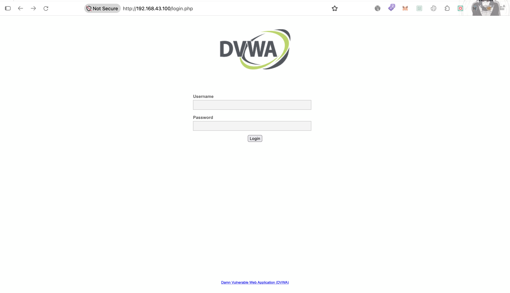

# 🛡️ WAF Stack — Sentinel WAF

> ✅ **STATUS: LIVE END-TO-END, TERMASUK WAZUH.** Mode **prod**, site DVWA live, OWASP CRS 4.30.0 PL1 default + custom rule ngeblok SQLi/XSS/Command Injection beneran (403 + notif Discord + Dashboard). **Integrasi Wazuh CONFIRMED LIVE**: alert `100709`/`100710` muncul di Wazuh Dashboard dengan field lengkap (severity, category, matched_data, rule_ids). Skenario serangan lengkap (termasuk gap `;id` yang udah ditutup custom rule, dan keterbatasan response-phase block yang belum) ada di writeup lab: [`Labs/waf/sentinel-waf/README.md`](../../../Labs/waf/sentinel-waf/README.md).

## Tujuan

Jalanin **Sentinel WAF** — dashboard manajemen WAF buatan sendiri ([`Mar0x02/sentinel-waf`](https://github.com/Mar0x02/sentinel-waf)) — sebagai stack ke-4 di VM `waf`, gantian di `:80` sama `modsecurity-crs`/`modsecurity-scratch`/`safeline`. Bedanya sama 2 stack ModSecurity lain: **engine tetap ModSecurity v3 + OWASP CRS**, tapi rule/site/TLS/rate-limit dikelola dari dashboard web (React + FastAPI), bukan edit file `.conf`/`docker exec` manual — jadi karakternya mirip SafeLine (managed WAF + dashboard sendiri), tapi engine-nya ModSecurity, bukan semantic analysis proprietary.

Repo upstream masih aktif dikembangin user sendiri — selama deploy di lab ini ketemu banyak masalah mode **dev**, jadi dipindah ke mode **prod** (`docker-compose.prod.yml`, nambahin setelah sesi deploy pertama):

```
Dev   : Dashboard React dev-server (:5173) + Backend FastAPI (:8000), 2 port kebuka
Prod  : nginx (:8000) → serve static build React + reverse-proxy /api/* → Backend (gak ada host port sendiri)
```

```
Dashboard (nginx :8000, serve FE + proxy /api/*) ──► Backend (FastAPI, internal only) ──► render config ──► shared Docker volume
                                                                │                                                 │
                                                            PostgreSQL                                  waf-engine (nginx+ModSecurity3+CRS)
                                                          (rule/site/account)                          watch volume → auto nginx reload
                                                                                                                   │
                                                                                                          modsec_audit.log (JSON)
                                                                                                                   │
                                                                                                          log-forwarder (sidecar) → syslog
```

Dashboard baca audit log ModSecurity langsung dari file (belum di-ingest ke Postgres — Postgres cuma nyimpen state rule/site/account). `log-forwarder` yang nge-tail audit log dan ngirim tiap transaksi ke syslog sink (plain text, bukan JSON) + opsional notifikasi Discord buat block baru.

---

## Prerequisites

- WAF VM + Docker + agent Wazuh `waf` udah siap, lihat [`../README.md`](../README.md)
- RAM VM **≥ 6 GB** — 5 container (`postgres`, `backend`, `frontend`, `waf-engine`, `log-forwarder`)
- Disk VM **cukup lega** (lihat gotcha disk penuh di Step 3 — udah di-resize ke 23GB)
- Docker Compose v2 (`docker compose version`)
- Stack WAF lain di `:80` udah di-`down` dulu (bebasin port)
- DVWA di `10.10.10.10:80` jalan
- Kredensial admin disimpan di `waf-passwords.txt` (gitignored, **jangan commit**)

---

## Step-by-Step

### 1. Clone + install (VM `waf`)

Repo-nya **gak divendor** ke `blue-team-soc-labs` — konsisten sama pola stack lain (image resmi gak dicopy source-nya ke sini). Yang di-track di repo ini cuma file override + dokumentasi integrasi.

```bash
# matiin stack WAF lain dulu
cd /data/waf/modsec-crs && docker compose down   # atau scratch/safeline, siapa yang lagi nyala

mkdir -p /data/waf/sentinel
cd /data/waf/sentinel
git clone https://github.com/Mar0x02/sentinel-waf.git .
```

### 2. Remap port `waf-engine` ke `:80`

Default compose `sentinel-waf` nge-expose `waf-engine` di host `8080` (HTTP) dan `8443` (HTTPS per-site) — bukan `:80`, beda dari pola lab ini (semua stack WAF gantian di `:80`, NAT pfSense `10.10.10.5:80` gak perlu diubah tiap ganti stack).

Copy override dari repo ini ke VM:

```bash
# dari Mac
scp Infrastructure/waf/sentinel-waf/docker-compose.override.yml anang@10.10.10.5:/data/waf/sentinel/
```

`docker-compose.override.yml` remap `waf-engine` ke `80:80` (compose auto-baca file ini tiap `up`, gak perlu flag `-f`). TLS `:8443` sengaja gak dipetain dulu — belum ada skenario TLS, lihat Catatan.

### 3. Jalanin stack (mode prod)

```bash
cd /data/waf/sentinel
docker compose -f docker-compose.prod.yml -f docker-compose.override.yml up -d --build
```

`docker-compose.prod.yml` **standalone** (bukan overlay dari `docker-compose.yml` dev — komentar di file upstream eksplisit bilang gitu, service `frontend`/`backend` beda Dockerfile/port), tapi `docker-compose.override.yml` kita (remap `waf-engine`) **tetap kepake bareng** karena cuma nyentuh service `waf-engine` yang sama persis di kedua compose file.

Ambil kredensial admin dari log (dicetak sekali pas akun pertama kali dibikin):

```bash
docker compose -f docker-compose.prod.yml logs backend | grep -A5 "admin account created"
```

Alternatif: `./install.sh --prod` (nunggu backend ready + auto-print kredensial) — **tapi gak include override kita**, jadi kalau dipakai, override tetap harus di-apply nyusul (`docker compose -f docker-compose.prod.yml -f docker-compose.override.yml up -d`) biar `waf-engine` balik ke `:80`. Reset password: `./reset-admin.sh admin`. Simpan ke `waf-passwords.txt`.

> **Gotcha nyata (2026-11-02): disk VM penuh.** `docker compose up --build` sempat gagal `no space left on device` — disk `/` cuma 12GB padahal VMDK sebenernya 32GB (LVM `ubuntu-lv` gak pernah ditarik ke `VSize` penuh `ubuntu-vg`, nyisa 11.5GB `VFree` nganggur). Fix **online, gak perlu matiin VM**: `sudo lvextend -l +100%FREE /dev/mapper/ubuntu--vg-ubuntu--lv` + `sudo resize2fs /dev/mapper/ubuntu--vg-ubuntu--lv` → `/` jadi 23GB. Masih ada ~5.4GB di luar partisi 3 yang belum dipartisi kalau suatu saat butuh lagi (`growpart` + `pvresize`).

### 4. Login dashboard + daftar site

- URL: `http://10.10.10.5:8000` — **satu port doang** di mode prod (nginx di container `frontend` ngelayanin static build React + reverse-proxy `/api/*` ke `backend`; `backend` sendiri **gak expose port ke host** sama sekali di `docker-compose.prod.yml`).
- Login `admin`, wajib ganti password.
- Tambah **Site**: upstream `http://10.10.10.10:80` (DVWA), `listen_port` **`80`** (bukan default `8080` — biar nyambung sama remap compose Step 2). Domain bebas (misal `dvwa.lab`) — gak masalah selama cuma 1 site yang listen di `:80`, nginx otomatis jadiin itu default server buat port itu, apapun Host header yang masuk.

> **Catatan keamanan.** Dokumen ini awalnya nyaranin dashboard diakses **WireGuard-only**, sama prinsipnya kayak panel `:9443` SafeLine (data plane ke WAN, management plane ke VPN). Yang kejalan: user bikin **pass rule di pfSense buat port dashboard** (awalnya `:5173`+`:8000` buat mode dev; mode prod sekarang cukup **`:8000` doang**, `:5173` gak relevan lagi), jadi management plane ikut kebuka ke WAN/hotspot `192.168.43.0/24`, bukan WireGuard-only. Dicatat apa adanya — kalau mau disamain ke pola SafeLine nanti, tinggal cabut pass rule WAN dan pastiin akses cuma lewat rule WireGuard yang udah ada ([`../pfsense-wireguard-setup.md`](../pfsense-wireguard-setup.md)).

### 5. WAF Engine Settings — audit log parts

Tab **Settings → WAF Engine Settings → Advanced** nyimpen raw ModSecurity directives (global, admin only, berlaku ke semua site). Default bawaan project ini (komentar udah ada di textarea-nya) **sengaja udah buang part `E` (response body)** dari `SecAuditLogParts` — alasannya sama persis kayak trim yang dilakuin manual di `modsecurity-scratch` Tahap 5 ([`../modsecurity-scratch/05-wazuh-integration.md`](../modsecurity-scratch/05-wazuh-integration.md)): response body (halaman HTML penuh) bikin audit log bengkak + berisiko bikin `log-forwarder`/entry JSON ke-truncate.

Yang dikerjain: **uncomment** baris `SecAuditLogParts ABIJDFHZ` di textarea Advanced (defaultnya ke-comment), biarin field lain (Audit logging `Relevant only`, body inspect on, limit bawaan) apa adanya, klik **Save engine settings**.



> Audit logging mode **"Relevant only"** + regex `^(?:5|4(?!04))` artinya audit log cuma kecatet buat response **5xx atau 4xx selain 404** — konsisten sama kebutuhan lab ini (yang mau dilacak adalah block/suspicious, bukan tiap request normal).

### 6. Import rule set — OWASP CRS

Tab **Rules** → section **Import OWASP CRS (pick a version)** nyediain beberapa versi CRS siap-import langsung dari URL upstream (gak perlu download manual): 4.30.0 (latest), 4.29.0, 4.28.0, 3.3.10 (legacy). Ada juga opsi **Import custom rule package from a URL** (`.tar.gz`/`.zip`/raw `.conf`) buat rule set di luar CRS.

Yang diambil: **OWASP Core Rule Set 4.30.0** (latest stable CRS 4.x). Hasil import: **51 file, 637 rule**, termasuk `crs-setup.conf` (jadi "In use") dan seluruh `REQUEST-9xx-*`/`RESPONSE-9xx-*` (protocol enforcement, SQLi, XSS, RCE, LFI/RFI, session fixation, scanner detection, data leakage, dst) + `.data` file pendukung (`sql-errors.data`, `scanners-user-agents.data`, `unix-shell*.data`, dll).



**CRS Tuning** (halaman detail rule set) nunjukin tuning disimpan langsung ke `crs-setup.conf`:

| Parameter | Nilai | Catatan |
|---|---|---|
| Blocking paranoia level | `1` | Sama kayak default `modsecurity-scratch` (PL1 block) |
| Detection paranoia level | `1` | Harus `>=` blocking PL |
| Inbound anomaly score threshold | `5` | Default CRS stock |
| Outbound anomaly score threshold | `4` | Default CRS stock |

Plus **"Other Detected Tunables"** — auto-detect dari komentar `setvar:tx.X=Y` di `crs-setup.conf` (`900010` enforce_bodyproc_urlencoded, `900100` breakdown anomaly score per severity, `900115` reporting_level, `900120` early_blocking, dst), bisa diaktifin satu-satu dari UI tanpa edit file manual.



> Belum diubah dari default — PL1/threshold 5/4 itu konfigurasi "out of the box" CRS, sama persis sama titik awal yang dipakai `modsecurity-scratch` sebelum di-tuning manual. Belum ada serangan yang dicoba buat liat PL1 CRS 4.30.0 nangkep apa/lolos apa di DVWA.

### 7. Integrasi log ke Wazuh ✅ LIVE END-TO-END

`log-forwarder` ngirim tiap transaksi (block maupun detect) sebagai **satu baris syslog plain text**, bukan JSON kayak audit log ModSecurity mentah. Format awal cuma `client/method/uri/status/rules`, tapi user (developer repo ini juga) nambahin field biar lebih kaya — `syslog_message()` di `log-forwarder/forwarder.py` sekarang milih **rule attack-tagged dengan severity terburuk** (exclude rule meta kayak `949110` anomaly score yang gak punya tag `attack-*`) buat ngisi `severity`/`category`/`matched_data`:

```
waf[blocked] client=192.168.43.193 host=192.168.43.100 method=POST uri=/vulnerabilities/exec/ status=403 user_agent="Mozilla/5.0 ..." severity=CRITICAL category=RCE rules=920350,932230,932125,932250,949110 matched_data="Matched Data: ;ls /etc found within ARGS:ip: ;ls /etc"
```

Jadi decoder JSON bawaan (dipakai rule `100700`-`100704` buat stack ModSecurity lain) **gak jalan** di sini — perlu decoder regex custom.

**a. Decoder** ([`Detection-Engineer/wazuh/decoder/sentinel-waf-decoder.xml`](../../../Detection-Engineer/wazuh/decoder/sentinel-waf-decoder.xml)):

```xml
<decoder name="sentinel-waf">
  <prematch>waf</prematch>
  <regex offset="after_prematch" type="pcre2">\[(\S+)\] client=(\S+) host=(\S+) method=(\S+) uri=(\S+) status=(\d+) user_agent="([^*]+)" severity=(\S+) category=(\S+) rules=(\S+) matched_data="([^"]+)"</regex>
  <order>waf_action, srcip, dstip, http_method, url, status, user_agent, severity, category, rule_ids, matched_data</order>
</decoder>
```

```bash
scp Detection-Engineer/wazuh/decoder/sentinel-waf-decoder.xml anang@<IP-DELL>:/tmp/
# di Dell — scp LANGSUNG ke /var/ossec/etc/ bakal "Permission denied" (folder root-owned), scp ke /tmp dulu baru sudo install
sudo install -m 644 /tmp/sentinel-waf-decoder.xml /var/ossec/etc/decoders/
```

> **Divalidasi pakai `wazuh-analysisd -t` sebelum restart.** Iterasi pertama decoder sempat error (ketauan dari command ini), user fix sendiri + nambahin field `host`/`user_agent`/`severity`/`category`/`matched_data` biar event lebih kaya. Selalu jalanin `sudo /var/ossec/bin/wazuh-analysisd -t` abis edit decoder/rule, **sebelum** restart service — biar ketauan syntax error tanpa bikin `wazuh-manager` crash-loop.

**b. Rule** ([`Detection-Engineer/wazuh/rule/waf_rules.xml`](../../../Detection-Engineer/wazuh/rule/waf_rules.xml), grup `sentinel-waf,waf,`):

```xml
<rule id="100708" level="0">
  <decoded_as>sentinel-waf</decoded_as>
  <description>Sentinel WAF: event ModSecurity ($(http_method) $(url)) dari $(srcip)</description>
</rule>

<rule id="100709" level="12">
  <if_sid>100708</if_sid>
  <field name="waf_action">blocked</field>
  <field name="severity">CRITICAL</field>
  <description>WAF: request diblokir Sentinel WAF ($(http_method) $(url)) dari $(srcip) dengan $(severity) category $(category)</description>
  <mitre><id>T1190</id></mitre>
  <group>attack,blocked,</group>
</rule>

<rule id="100710" level="9">
  <if_sid>100708</if_sid>
  <field name="waf_action">blocked</field>
  <field name="severity">ERROR</field>
  <description>WAF: request diblokir Sentinel WAF ($(http_method) $(url)) dari $(srcip) dengan $(severity) category $(category)</description>
  <mitre><id>T1190</id></mitre>
  <group>attack,blocked,</group>
</rule>
```

Beda dari rencana awal (yang nunggu skenario buat rule per-attack-type kayak `100702`-`100704`): karena decoder sekarang udah nangkep field `severity`/`category` langsung dari ModSecurity (bukan parsing ulang `rules=` buat nebak jenis serangan), rule-nya di-split **by severity** — `100709` (level 12, `CRITICAL`) buat block high-confidence (SQLi/XSS/RCE di lab ini semua CRITICAL), `100710` (level 9, `ERROR`) buat tier di bawahnya. Field `category` (`SQLi`/`XSS`/`RCE`/dst, dari tag `attack-*` CRS) udah ikut ke-tampilin di `description`, jadi analis gak perlu buka `matched_data` buat tau jenis serangannya.

```bash
sudo install -m 644 /tmp/waf_rules.xml /var/ossec/etc/rules/
sudo /var/ossec/bin/wazuh-analysisd -t && sudo systemctl restart wazuh-manager
```

**c. Daftarin sink di dashboard** — tab `Settings` → section **Log Forwarding** → `ADD SINK`: Name `SIEM WAZUH`, protokol **UDP**, host `<IP-DELL>` (IP hotspot Dell saat ini), port `5140`.



> **Bonus udah jalan duluan: notifikasi Discord.** Section **Discord Notifications** (terpisah dari sink syslog) udah jalan dari sebelum integrasi Wazuh — webhook `Sentinel-DVWA` ngarah ke channel `#sentinel-waf` di server Discord `CyberSecurity-Lab`. Independen total dari Wazuh, gak butuh sink syslog/decoder sama sekali.



**d. Listener syslog di Wazuh Manager (Dell)** — tambah di `/var/ossec/etc/ossec.conf`:

```xml
<remote>
  <connection>syslog</connection>
  <port>5140</port>
  <protocol>udp</protocol>
  <allowed-ips>10.10.10.5</allowed-ips>
</remote>
```

```bash
sudo systemctl restart wazuh-manager
```

**e. Buka port di pfSense** — WAF VM (`10.10.10.5`, LAN1) kirim syslog ke Dell (`192.168.43.130`, luar firewall) lewat WAN pfSense, butuh firewall rule (tab **Firewall → Rules → LAN**):

| Protocol | Source | Destination | Port |
|---|---|---|---|
| **UDP** (bukan TCP!) | `10.10.10.5` | `192.168.43.130` | `5140` |

> **Gotcha nyata: rule kebuat TCP duluan, salah protokol.** Sink dashboard pakai `UDP`, tapi rule pfSense yang pertama dibikin `IPv4 TCP` — mismatch gini bikin firewall **drop diam-diam** (gak ada error di Sentinel maupun Wazuh, paketnya cuma ilang). Fix: edit rule, ganti Protocol ke `UDP`. Selalu cocokin protocol rule firewall sama protocol yang dipilih di sink.

> **Beda sama SafeLine:** SafeLine syslog export berbayar (fitur Lite, lihat [`../safeline/README.md`](../safeline/README.md)), jadi dipaksa pakai exporter postgres manual. Sentinel WAF syslog-nya **gratis** (bagian dari `log-forwarder` bawaan) — gak perlu exporter tambahan.

**Verifikasi pipe:** alert `100709` **CONFIRMED muncul** di Wazuh Dashboard (filter `rule.id:100709`, index `wazuh-alerts-*`) abis test serangan — field `severity`/`matched_data`/`rule_ids`/`dstip`/`srcip`/`decoder.name` semua kebaca bener. Skenario serangan lengkap + screenshot alert ada di writeup lab: [`Labs/waf/sentinel-waf/README.md`](../../../Labs/waf/sentinel-waf/README.md).

---

## Verifikasi

### Install + dashboard (mode prod) ✅

Deploy prod sukses, login `admin` berhasil dari browser lewat `http://10.10.10.5:8000` (pfSense pass rule, lihat Catatan keamanan di Step 4). Dashboard nunjukin banner eksplisit **"No rules are protecting your sites yet - the WAF is running but has nothing to block with."** — jadi walau proxy jalan, belum ada rule yang di-*import* lewat tab Rules.



### Site DVWA terdaftar ✅

Site `DVWA` ditambahin di tab Sites: domain `dvwa.lab`, upstream `http://10.10.10.10`, port `80`, rate limit `20 req/s · 50 conn/IP` (opsional, dipasang).



### Proxy ke DVWA lewat WAN ✅

`http://192.168.43.100/login.php` (WAN pfSense, NAT ke `10.10.10.5:80`) nunjukin halaman login DVWA — proxy `waf-engine` → `10.10.10.10:80` kebukti jalan end-to-end.



### Engine settings — audit log parts ✅

`SecAuditLogParts ABIJDFHZ` di-uncomment + disimpan (tab Settings → Advanced), nge-trim part `E` (response body) dari audit log — sama kayak konvensi `modsecurity-scratch`.


### Notifikasi Discord ✅ (bonus, independen dari Wazuh)

Webhook `Sentinel-DVWA` terdaftar, channel `#sentinel-waf` dibikin di server Discord `CyberSecurity-Lab`. Belum ada notif masuk (wajar — belum ada yang di-block, rule belum di-*import*).

### Rule set OWASP CRS 4.30.0 diimport ✅

51 file / 637 rule ke-import, `crs-setup.conf` in use, tuning default stock (PL1/PL1, anomaly 5/4) — belum di-ubah. Screenshot proses import + detail tuning ada di Step 6.

### Serangan nyata + Wazuh — lihat writeup lab

Skenario serangan (SQLi/XSS/Command Injection), gap deteksi `;id` (udah ditutup custom rule `100002`), false positive `csp-report.php`, response-phase block yang gak efektif ke client, dan bukti alert Wazuh `100709`/`100710` **dipindah ke** [`Labs/waf/sentinel-waf/README.md`](../../../Labs/waf/sentinel-waf/README.md) — konsisten sama pola `modsecurity-scratch` (Infrastructure = cara bikin, Labs = skenario serangan).

### Sisa checklist

- [ ] Exclusion `920420` buat `/csp-report.php` (rule udah didesain, lihat [writeup lab](../../../Labs/waf/sentinel-waf/README.md#4-false-positive--csp-reportphp-bukan-serangan)) — belum ditulis ke `WAF Engine Settings → Advanced`
- [ ] Response-phase block (`953100`/`100710`) tercatat "Blocked" tapi gak efektif ke client — keterbatasan arsitektur nginx+ModSecurity, bukan bug Sentinel. Belum ada mitigasi/keputusan (detail di [writeup lab](../../../Labs/waf/sentinel-waf/README.md#6-response-phase-block-severityerror--tercatat-blocked-client-gak-nerima-403))
- [x] ~~Gap command injection `;id`~~ — **DITUTUP**, custom rule `100002` (tab Rules → Custom Rules), detail di [writeup lab](../../../Labs/waf/sentinel-waf/README.md#1-command-injection--dvwa-exec-post-ip--gap-ditemuin--ditutup-custom-rule)

---

## Catatan & Gotcha

- **Decoder: `matched_data` wajib ada di regex, tapi `log-forwarder` cuma kirim dia kalau ada rule ber-tag `attack-*` yang match.** Di lab ini selalu ada (minimal `920350`, yang nempel di semua request karena akses via IP mentah), jadi belum pernah nyebabin masalah — tapi kalau suatu saat ada transaksi tanpa satupun rule `attack-*` match, baris syslog-nya bakal **gak ke-decode sama sekali** (gak nongol field apa pun di Wazuh, cuma raw log). Belum perlu difix sekarang, cuma dicatat sebagai edge case laten.
- **RAM 6GB cukup** buat 5 container Sentinel, gak OOM. Yang mentok duluan malah **disk**, bukan RAM (lihat gotcha Step 3).
- **Mode dev ditinggalin.** Deploy awal pakai `docker-compose.yml` dev (dashboard `:5173` + API `:8000` kepisah) sempat jalan, tapi user (yang juga developer repo ini) nemu banyak masalah pas ngembangin lebih lanjut, jadi upstream nambahin `docker-compose.prod.yml` (nginx serve static build + proxy `/api/*`, 1 port `:8000`) dan itu yang dipakai seterusnya di lab ini. Screenshot dashboard versi dev (`:5173`) udah diganti ke versi prod.
- **TLS belum ada.** Sentinel upstream belum support ACME/Let's Encrypt, HTTPS cuma lewat upload cert manual per-site. Lab ini belum butuh TLS (NAT cuma `:80`), jadi `8443` sengaja gak dipetain di override — tambahin kalau mau eksperimen TLS nanti.
- **`waf_action` di decoder cuma `blocked`/`detected`** — ngikutin 2 nilai yang `log-forwarder` kirim (lihat `log-forwarder/forwarder.py` upstream, fungsi `is_blocked`: `http_code == 403` → `blocked`). Kalau ternyata ada status block lain (misal custom error page bukan 403), decoder perlu disesuaikan.
- **Persistent collection (`ip`/`session`/`user`) gak reliable** di upstream — kalau mau rate-limiting per-IP, pakai fitur "rate limiting per-site" bawaan dashboard, bukan `SecAction` collection manual kayak di `modsecurity-scratch`.
- **Mode WAF (enforce/detection) masih global** di upstream, belum per-rule/per-site — beda sama paranoia gating per-rule yang dipakai di `modsecurity-scratch` Tahap 4.
