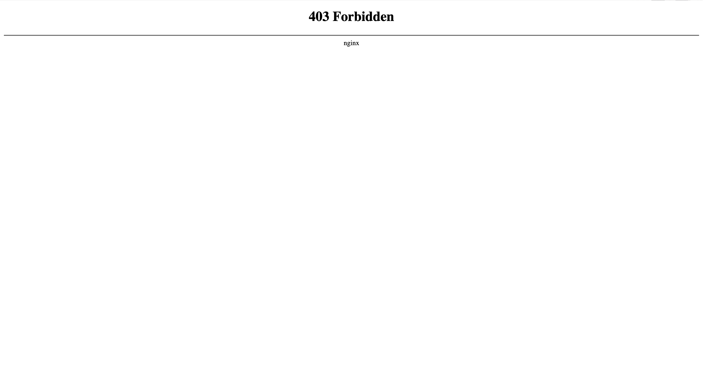
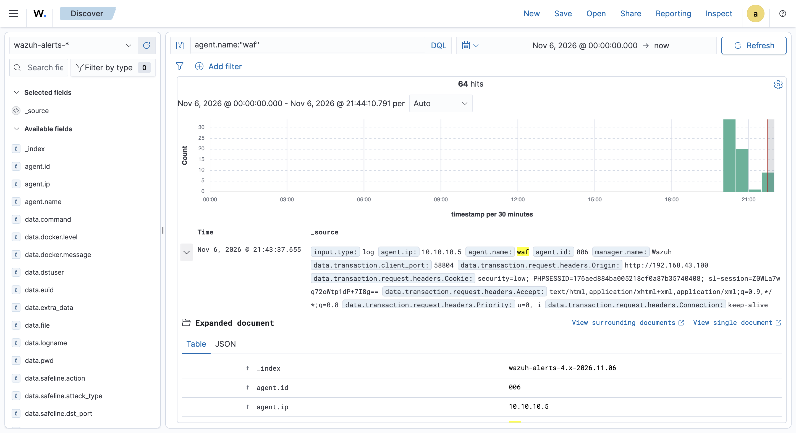
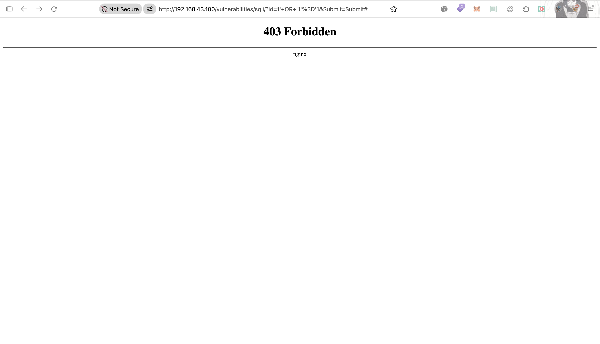
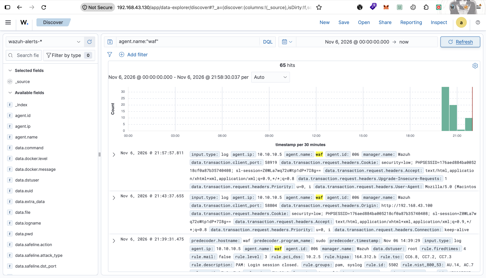
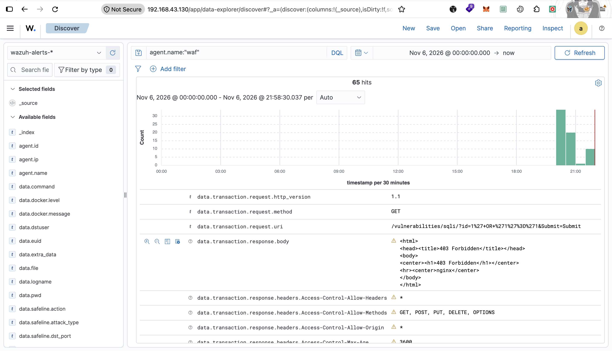
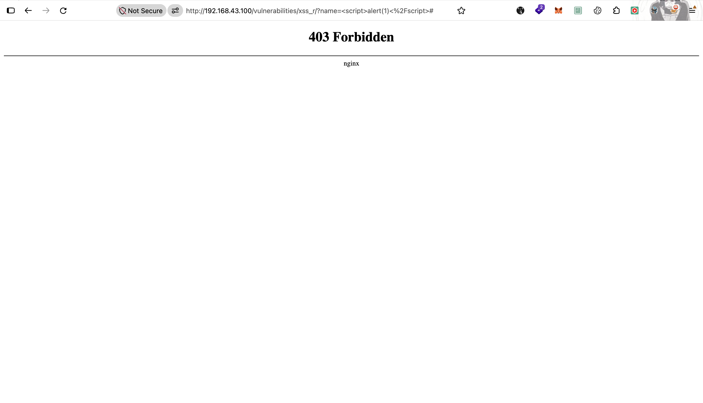
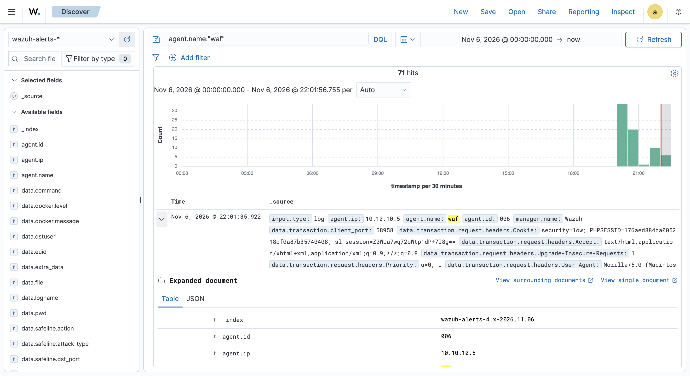
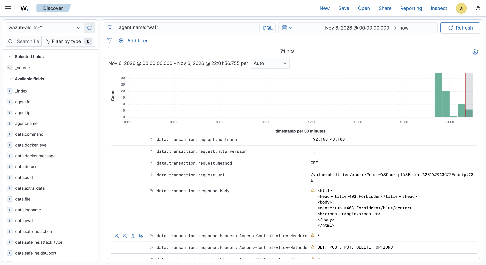

# WAF Lab — ModSecurity + OWASP CRS (Image Resmi)

> ✅ **STATUS: BLOCK + ALERT WAZUH CONFIRMED (3 skenario: CmdI, SQLi, XSS).** Ketiganya diblok (403) OWASP CRS 4.30.0 PL1 dan nyampe jadi alert Wazuh. **Temuan kunci — kategorisasi rule beda hasil:** SQLi (`100703`) dan XSS (`100704`) naik bener ke rule spesifik (tag CRS cocok), tapi command injection cuma nyangkut di rule generik `100701` (tag CRS `attack-rce` ≠ tag yang dicari rule `100702`) — gap tag, lihat Catatan.

## Tujuan

Adu serangan web ke DVWA lewat WAF **ModSecurity + OWASP CRS** (image resmi `owasp/modsecurity-crs:nginx`), nilai dua hal:

1. **Response**: payload mana yang **diblok** (403) vs **lolos** ke backend.
2. **Detection**: apa yang kecatat di audit log ModSec, gimana masuk Wazuh, dan **ketepatan rule Wazuh** (custom rule `100700`-`100704` berdasarkan tag CRS).

- **Infrastruktur / cara bikin**: [`Infrastructure/waf/modsecurity-crs/`](../../../Infrastructure/waf/modsecurity-crs/README.md) — deploy image resmi, integrasi Wazuh via `<localfile>`.
- **Rule Wazuh**: [`Detection-Engineer/wazuh/rule/waf_rules.xml`](../../../Detection-Engineer/wazuh/rule/waf_rules.xml) (`100700`-`100704`, group `modsecurity`).

---

## Topologi serangan

```
Browser (192.168.43.193) ──serangan──> WAF (192.168.43.100, via NAT pfSense) ──block 403──> audit.log (JSON)
       attacker eksternal                ModSecurity v3 + OWASP CRS 4.30.0                │
                                                                              Wazuh agent <localfile>
                                                                                            ▼
                                                                      Wazuh Manager (Dell) ── rule 100700-704 ── ALERT
```

## Prerequisites

- Stack ModSecurity+CRS live, site DVWA proxy-an, integrasi Wazuh (`<localfile>` → rule `100700`-`104`) — lihat [`Infrastructure/waf/modsecurity-crs/README.md`](../../../Infrastructure/waf/modsecurity-crs/README.md).
- DVWA `security=low`, punya session (`PHPSESSID`).
- Akses lewat WAN pfSense: `http://192.168.43.100/`.

---

## Skenario & Bukti

### 1. Command Injection — DVWA `exec` (POST `ip`), payload `;whoami` ✅ Block + Alert

```
POST /vulnerabilities/exec/
ip=;whoami
```

Browser nerima block page nginx standar (403, bukan custom page — stack ini belum punya `error_page` custom kayak Sentinel):



**CRS yang match** (dari JSON audit, fase request): `920350` (host header IP mentah, nempel di semua request lab ini) + famili RCE `932235`/`932260`/`932340`/`932380` (Unix/Windows Command Injection, berbagai variasi match) + `949110` (anomaly exceeded, total score **23** — jauh di atas threshold `5`, karena 4 rule RCE sekaligus nyumbang skor).

**Alert Wazuh CONFIRMED** — Wazuh Discover (agent `waf`, 64 hits hari itu), alert dengan field lengkap:



```json
{
  "agent": { "ip": "10.10.10.5", "name": "waf", "id": "006" },
  "data": {
    "transaction": {
      "client_ip": "192.168.43.193",
      "is_interrupted": "true",
      "request": { "method": "POST", "uri": "/vulnerabilities/exec/" },
      "response": { "http_code": "403" },
      "messages": [
        { "message": "Host header is a numeric IP address", "details": { "ruleId": "920350" } },
        { "message": "Remote Command Execution: Unix Command Injection (command without evasion)", "details": { "ruleId": "932235", "data": "Matched Data: ;whoami found within ARGS:ip: ;whoami" } },
        { "message": "Remote Command Execution: Direct Unix Command Execution", "details": { "ruleId": "932260" } },
        { "message": "Remote Command Execution: Direct Unix Command Execution (No Arguments)", "details": { "ruleId": "932340" } },
        { "message": "Remote Command Execution: Windows Command Injection", "details": { "ruleId": "932380" } },
        { "message": "Inbound Anomaly Score Exceeded (Total Score: 23)", "details": { "ruleId": "949110" } }
      ]
    }
  },
  "rule": {
    "level": 7,
    "description": "WAF: request diblokir ModSecurity (POST /vulnerabilities/exec/) dari 192.168.43.193",
    "groups": ["modsecurity", "waf", "attack", "blocked"],
    "mitre": { "id": ["T1190"], "tactic": ["Initial Access"], "technique": ["Exploit Public-Facing Application"] },
    "id": "100701"
  },
  "location": "/data/waf/modsec-crs/logs/audit.log"
}
```

**Temuan — alert berhenti di rule generik, gak naik ke rule spesifik:** `rule.id` yang keluar cuma **`100701`** (level 7, "request diblokir" — generik), **bukan `100702`** (command injection spesifik, level 10). Root cause: rule `100702` nyari substring **`attack-command-injection`** di `transaction.messages` — tag ini **tag custom yang user tulis sendiri** di `modsecurity-scratch` (`conf/nginx/modsec/rules/rules-command-injection.conf`, rule id `100005`: `tag:'attack-command-injection'`), bukan tag dari ruleset manapun. Sementara CRS (stack ini) pakai **`attack-rce`** — dan ini bukan pilihan sembarangan dari CRS, itu tag **bawaan resmi OWASP CRS sendiri** (hardcoded di `REQUEST-932-APPLICATION-ATTACK-RCE.conf`). Jadi begitu rule `100702` (yang ditulis ngikutin convention custom lokal) di-*share* ke stack `modsecurity-crs` (yang pakai taksonomi resmi CRS), tag-nya gak nyambung — bukan CRS yang "beda sendiri", tapi rule Wazuh kita yang belum nyesuaiin ke standar CRS. **Ini bukan bug yang kelewat, tapi konsekuensi yang diterima dari keputusan desain**: rule `100700`-`104` sengaja **reuse** satu set rule/tag dari `modsecurity-scratch`, bukan bikin rule baru/terpisah per stack — jadi begitu ada stack dengan taksonomi tag beda (CRS native), gap kayak gini emang kemungkinan muncul ("cmdi CRS=attack-rce, tambah alternation nanti" — udah dicatat dari awal, lihat `update.md`). Dampaknya: analis tetap dapet alert (gak kelewat, level 7 cukup kelihatan), tapi **kategorisasi serangannya salah** — gak kebedain dari block generik lain.

### 2. SQL Injection — DVWA `sqli` (GET `id`), payload `1' OR '1'='1` ✅ Block + Alert, kategorisasi BENER

```
GET /vulnerabilities/sqli/?id=1' OR '1'='1&Submit=Submit
```



**CRS yang match**: `920350` (host header IP mentah) + `942100` (SQL Injection Attack Detected via **libinjection**) + `949110` (anomaly exceeded, total score `8`).

**Alert Wazuh CONFIRMED, dan kali ini kategorisasinya BENER**: `rule.id` yang keluar **`100703`** (level **10**, spesifik SQLi) — bukan nyangkut di rule generik `100701` kayak skenario 1:

```json
{
  "agent": { "ip": "10.10.10.5", "name": "waf", "id": "006" },
  "data": {
    "transaction": {
      "client_ip": "192.168.43.193",
      "is_interrupted": "true",
      "request": { "method": "GET", "uri": "/vulnerabilities/sqli/?id=1%27+OR+%271%27%3D%271&Submit=Submit" },
      "response": { "http_code": "403" },
      "messages": [
        { "message": "Host header is a numeric IP address", "details": { "ruleId": "920350" } },
        { "message": "SQL Injection Attack Detected via libinjection", "details": { "ruleId": "942100", "data": "Matched Data: s&sos found within ARGS:id: 1' OR '1'='1" } },
        { "message": "Inbound Anomaly Score Exceeded (Total Score: 8)", "details": { "ruleId": "949110" } }
      ]
    }
  },
  "rule": {
    "level": 10,
    "description": "WAF: SQL Injection diblokir dari 192.168.43.193",
    "groups": ["modsecurity", "waf"],
    "mitre": { "id": ["T1190"], "tactic": ["Initial Access"], "technique": ["Exploit Public-Facing Application"] },
    "id": "100703"
  },
  "location": "/data/waf/modsec-crs/logs/audit.log"
}
```




**Kenapa ini beda dari skenario 1**: rule `100703` nyari tag `attack-sqli` di `transaction.messages` — dan CRS native **emang pakai tag `attack-sqli` yang sama persis** (keliatan di `tags` rule `942100` di atas), gak kayak command injection yang CRS-nya pakai `attack-rce` (beda dari tag custom `attack-command-injection` punya `modsecurity-scratch`). Jadi dugaan sebelumnya ("SQLi/XSS kemungkinan reusable, gak kena masalah tag kayak cmdi") **confirmed bener** buat SQLi.

### 3. XSS — DVWA `xss_r` (GET `name`), payload `<script>alert(1)</script>` ✅ Block + Alert, kategorisasi BENER

```
GET /vulnerabilities/xss_r/?name=<script>alert(1)</script>
```



**CRS yang match**: `920350` (host header IP mentah) + 4 rule XSS sekaligus — `941100` (libinjection), `941110` (script tag vector), `941160` (HTML injection/NoScript), `941390` (javascript method `alert(`) + `949110` (anomaly exceeded, total score `23`).

**Alert Wazuh CONFIRMED, kategorisasi BENER lagi**: `rule.id` **`100704`** (level **10**, spesifik XSS):

```json
{
  "data": {
    "transaction": {
      "client_ip": "192.168.43.193",
      "request": { "method": "GET", "uri": "/vulnerabilities/xss_r/?name=%3Cscript%3Ealert%281%29%3C%2Fscript%3E" },
      "response": { "http_code": "403" },
      "messages": [
        { "message": "Host header is a numeric IP address", "details": { "ruleId": "920350" } },
        { "message": "XSS Attack Detected via libinjection", "details": { "ruleId": "941100" } },
        { "message": "XSS Filter - Category 1: Script Tag Vector", "details": { "ruleId": "941110" } },
        { "message": "NoScript XSS InjectionChecker: HTML Injection", "details": { "ruleId": "941160" } },
        { "message": "Javascript method detected", "details": { "ruleId": "941390" } },
        { "message": "Inbound Anomaly Score Exceeded (Total Score: 23)", "details": { "ruleId": "949110" } }
      ]
    }
  },
  "rule": {
    "level": 10,
    "description": "WAF: XSS diblokir dari 192.168.43.193",
    "groups": ["modsecurity", "waf"],
    "mitre": { "id": ["T1190"], "tactic": ["Initial Access"], "technique": ["Exploit Public-Facing Application"] },
    "id": "100704"
  },
  "location": "/data/waf/modsec-crs/logs/audit.log"
}
```




Sama kayak SQLi: tag CRS native `attack-xss` cocok persis sama yang dicari rule `100704`, jadi naik bener ke level spesifik. **3 dari 3 kategori yang dites sekarang**: SQLi dan XSS kategorisasinya bener, cuma Command Injection yang nyangkut di rule generik (gap tag, skenario 1).

---

## Hasil deteksi

| Kategori | Payload | CRS rule | Alert Wazuh | Level | Kategorisasi |
|---|---|---|---|---|---|
| Command Injection | `;whoami` (POST `ip`) | `932235/932260/932340/932380` + `949110` | **`100701`** (generik) | 7 | ❌ **Salah** — harusnya `100702` (command injection), gak match krn tag CRS `attack-rce` ≠ string yang dicari rule (`attack-command-injection`) |
| SQL Injection | `1' OR '1'='1` (GET `id`) | `942100` (libinjection) + `949110` | **`100703`** (spesifik) | 10 | ✅ **Bener** — tag CRS `attack-sqli` cocok persis sama yang dicari rule |
| XSS | `<script>alert(1)</script>` (GET `name`) | `941100/941110/941160/941390` + `949110` | **`100704`** (spesifik) | 10 | ✅ **Bener** — tag CRS `attack-xss` cocok persis sama yang dicari rule |

---

## Catatan

- **Gap rule Wazuh `100702` vs tag CRS — konsekuensi keputusan desain reuse, bukan bug yang kelewat:** rule `100700`-`104` sengaja ditulis **reuse** satu set rule/tag dari `modsecurity-scratch`, bukan bikin rule baru/terpisah per stack WAF. `attack-rce` itu tag **bawaan resmi OWASP CRS sendiri** (hardcoded di `REQUEST-932-APPLICATION-ATTACK-RCE.conf`), sementara `attack-command-injection` yang dicari rule `100702` itu tag custom yang user tulis sendiri di `modsecurity-scratch` (`rules-command-injection.conf` id `100005`). Begitu rule hasil reuse ini dipakai ke stack dengan taksonomi beda (CRS native), gap kayak gini emang kemungkinan muncul — udah diprediksi dari awal, bukan ketauan baru. Kalau mau ditutup: alternation regex (`attack-command-injection|attack-rce`) di rule `100702`, tapi ini opsional, bukan keharusan — tergantung mau nambah cakupan atau cukup terima keterbatasan dari keputusan reuse ini. `100703`/`100704` (SQLi/XSS) **CONFIRMED gak kena masalah ini** (skenario 2 & 3) — kebetulan tag custom yang dipakai di `modsecurity-scratch` buat SQLi/XSS emang sama persis sama tag resmi CRS (`attack-sqli`/`attack-xss`), gak kayak command injection.
- **`920350` nempel di semua request** di lab ini (akses via IP mentah `192.168.43.100`, bukan domain) — bukan indikasi serangan protocol, sama kayak temuan di stack `sentinel-waf`.
- Belum ada custom `error_page`/block page branded di stack ini (beda dari `sentinel-waf`) — client nerima 403 nginx polos.
