# WAF Lab — SafeLine (Semantic Engine, signature-free)

> ✅ **STATUS: BLOCK TERBUKTI JALAN (SQLi/XSS/CmdI + Rate Limiting + Allow & Deny).** Serangan dari browser/curl diblok SafeLine (403, `event_id` di block page). Gap: command injection `127.0.0.1 | id` lolos GET+POST. 2 fitur tambahan dites: **Rate Limiting** (HTTP Flood → Error Limiting, 10×403/10detik → block 30 menit) dan **Allow & Deny** (Deny = block total level akses, Allow = bypass total semua rule WAF termasuk deteksi serangan). **Temuan penting soal Wazuh**: block generik SQLi/XSS nyampe Wazuh (`100707`), tapi aksi Rate Limiting & Deny/Allow **TIDAK** (confirmed, di luar cakupan tabel yang dibaca exporter) — lihat section Catatan.

## Tujuan

Adu serangan web ke DVWA lewat **SafeLine** — WAF dengan engine **semantic analysis** (signature-free, beda dari ModSecurity yang regex/libinjection), plus coba fitur tambahan bawaan (**HTTP Flood → Rate Limiting**, **Allow & Deny**) yang gak ada di stack ModSecurity. Nilai dua hal:

1. **Response** — payload/akses **diblok** (403 page SafeLine) vs **lolos** ke backend DVWA.
2. **Detection** — block-nya kecatet di exporter (`events.json`) → Wazuh agent `<localfile>` → jadi **alert SIEM**, atau **enggak** (dan kenapa).

- **Infrastruktur / cara bikin**: [`Infrastructure/waf/safeline/`](../../../Infrastructure/waf/safeline/README.md) — install, daftar site, integrasi Wazuh via exporter.
- **Rule Wazuh**: [`Detection-Engineer/wazuh/rule/waf_rules.xml`](../../../Detection-Engineer/wazuh/rule/waf_rules.xml) (`100705`-`100707`).

---

## Topologi serangan

```
Kali/Mac/PC (192.168.43.x) ──serangan──> SafeLine (192.168.43.100, via NAT pfSense) ──block 403──> postgres mgt_detect_log_basic
                                          (engine Attacks/semantic)                        │
                                                                          safeline-log-exporter (poll 10 detik)
                                                                                            ▼
                                                                              /var/log/safeline/events.json
                                                                                            │ Wazuh agent <localfile>
                                                                                            ▼
                                                                          Wazuh Manager (Dell) ── rule 100707 ── ALERT (SQLi)

Rate Limiting (HTTP Flood) & Allow/Deny (Custom Rules) ──block──> subsistem lain SafeLine (BUKAN mgt_detect_log_basic)
                                                                                            │
                                                                                     TIDAK kebaca exporter
                                                                                            ▼
                                                                                      TIDAK ADA alert Wazuh
```

## Prerequisites

- SafeLine live, site DVWA terdaftar (`Domain *`, upstream `http://10.10.10.10:80`), integrasi Wazuh (exporter + agent `<localfile>` + rule `100705`-`100707`) — lihat [`Infrastructure/waf/safeline/README.md`](../../../Infrastructure/waf/safeline/README.md).
- DVWA `security=low`.
- Akses lewat WAN pfSense: `http://192.168.43.100/`.

---

## Skenario & Bukti

### 1. Block serangan generik ✅

```bash
curl -G "http://192.168.43.100/vulnerabilities/sqli/" --data-urlencode "id=1' OR '1'='1"
```

Balasannya block page SafeLine (`Access Forbidden` / `Blocked For Attack Detected`) dengan `event_id: c27796ca276445db93b26a7f961f37c4` di akhir HTML. Modul yang nyala cuma `Attacks`, jadi block ini murni dari engine semantic, tanpa rule custom.

Kalau balasannya `302` ke `login.php`, berarti serangan **lolos** dari WAF (dilempar ke login karena belum punya session DVWA), bukan ke-block.

### 2. Uji method + jenis serangan — gap `127.0.0.1 | id` ❌

Dari browser, XSS dan SQLi lewat GET diblokir, sedangkan command injection lewat form POST lolos dan `id` kejalan di server:


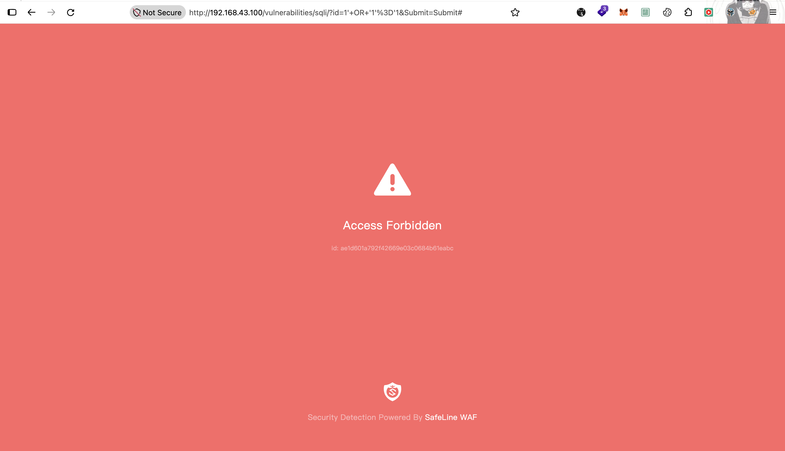
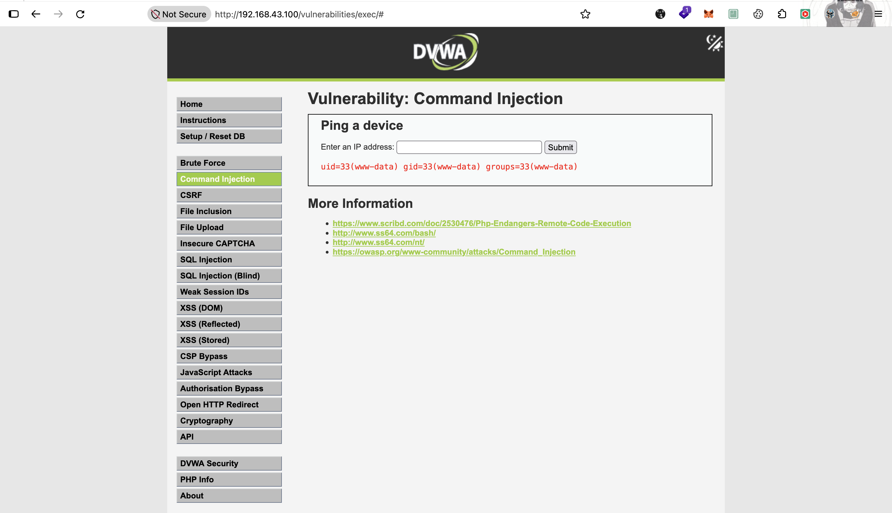

Sekilas kayak POST gak diperiksa, padahal method dan jenis serangannya kecampur. Jadi diuji silang pakai `curl` (cek ada/nggaknya `event_id` di balasan):

| # | Serangan | Method | Payload | Hasil |
|---|----------|--------|---------|-------|
| 1 | SQLi | POST | `id=1' OR '1'='1` | ✅ Diblokir |
| 2 | XSS | POST | `name=<script>alert(1)</script>` | ✅ Diblokir |
| 3 | Command injection | POST | `ip=127.0.0.1 \| id` | ❌ Lolos |
| 4 | Command injection | GET | `ip=127.0.0.1 \| id` | ❌ Lolos |
| 5 | Command injection | POST | `ip=127.0.0.1; cat /etc/passwd` | ✅ Diblokir |

Kesimpulan:

- **Body POST diperiksa** (#1, #2, #5), jadi masalahnya bukan di method.
- **`127.0.0.1 | id` gak kedeteksi engine**, di GET maupun POST (#3, #4). Modul yang nyala cuma `Attacks`, dan kesimpulan ini cuma berlaku buat payload yang dites, bukan semua command injection.
- **Gap deteksi:** request yang lolos gak bikin event SafeLine, jadi gak ada yang dikirim exporter dan gak ada alert di Wazuh.

### 3. Rate Limiting (HTTP Flood → Error Limiting) ✅

Menu `Settings → HTTP Flood → Rate Limiting`. Tiga grup rule bawaan (`Access Limiting`, `Attack Limiting`, `Error Limiting`) — cuma **Error Limiting** yang dinyalain, sesuai kebutuhan: *"IP yang bikin 10× response 403/404 dalam 10 detik → block 30 menit"*. Ini persis nilai default rule-nya, gak perlu tuning.

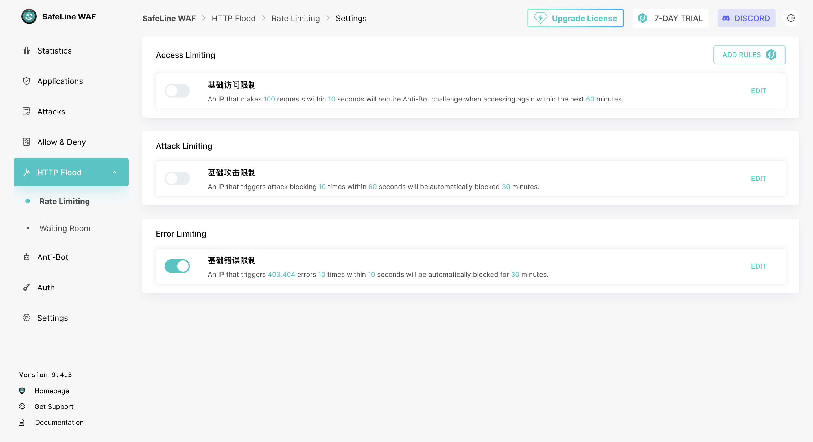

Uji: 11 request beruntun ke `/vulnerabilities/sqli/` pakai payload SQLi (`id=1' OR '1'='1`) — bukan karena session invalid, tapi payloadnya sendiri yang bikin tiap request ke-block 403 sama engine **Attacks** (semantic SQLi), sebelum sempat nyentuh Rate Limiting:

```bash
for i in {1..11}; do
curl -s -o /dev/null -w "%{http_code}\n" \
  -H "Cookies:security=low; PHPSESSID=176aed884ba005218cf0a87b35740408" \
 http://192.168.43.100/vulnerabilities/sqli/?id=1'+OR+'1'%3D'1\&Submit\=Submit
done
```

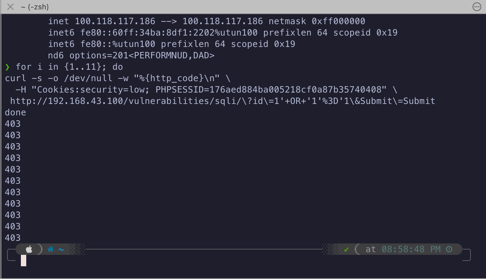

Begitu ambang (10×403/10 detik) kebentur, request berikutnya **gak lagi balik 403 DVWA** — IP malah ketangkep page block SafeLine sendiri:

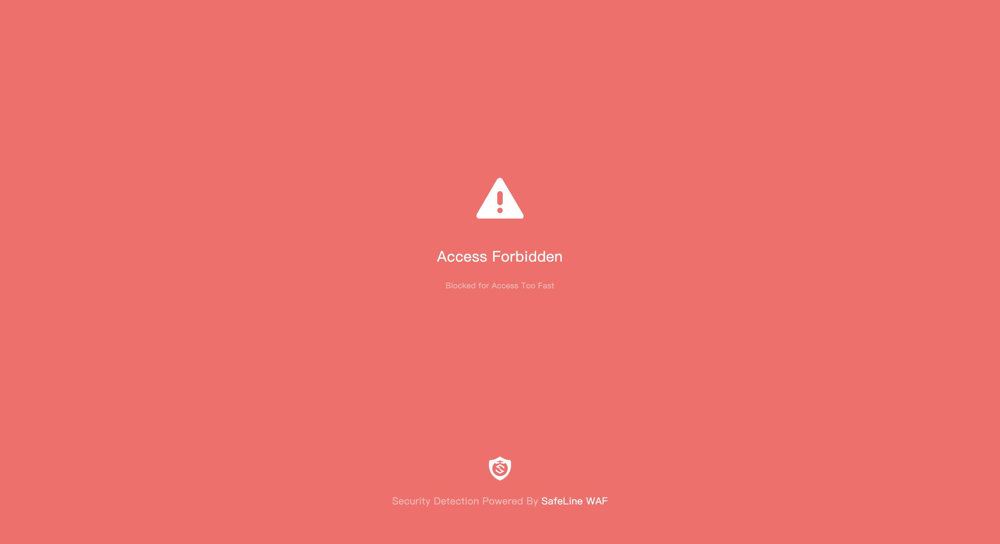

**Konsekuensi penting:** karena tiap 403 di atas berasal dari deteksi SQLi (bukan error 403/404 generik), tiap request-nya JUGA kecatet independen sebagai event Attacks di `mgt_detect_log_basic` (bukan kejadian Rate Limiting). SSH ke VM `waf` nunjukin 11 entry baru di `events.json`, masing-masing `rule_id: m_sqli`, `action: 1` (blocked), id berurutan `47`-`57`:

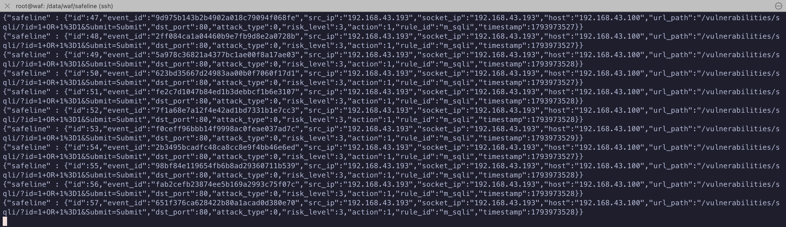

Karena tabel ini yang dibaca exporter, **serangan yang jadi penyebabnya nyampe ke Wazuh** — bukan sebagai 1 alert "Rate Limiting", tapi sebagai banyak alert `100707` (SQLi) beruntun, satu per request yang ke-block:

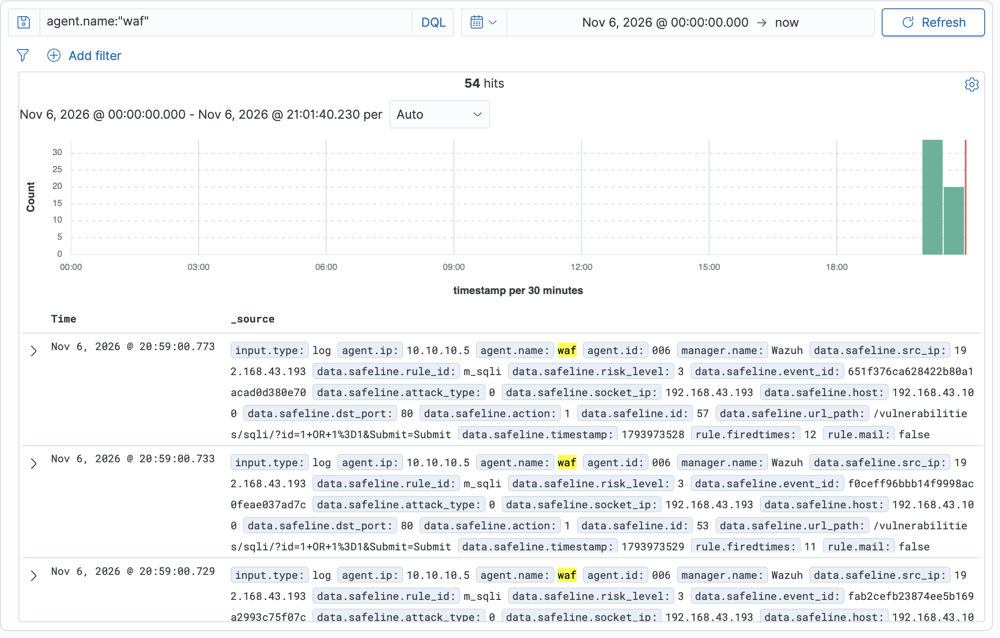

**Tapi block Rate Limiting-nya sendiri (aksi "IP di-lockout 30 menit") — TIDAK ADA log/alert terpisah di Wazuh.** Satu-satunya bukti kalau rule-nya beneran tercapai cuma ada di dashboard `HTTP Flood → Rate Limiting`, bukan di pipeline Wazuh:

| IP | Application | Reason | Blocked | Action | Start At | Status |
|----|-------------|--------|---------|--------|----------|--------|
| `192.168.43.193` | Web APP DVWA | `10 Reqs within 10 seconds, 基础错误限制 was triggered` | 1 | Block **30 minutes** | 2026-11-06 20:58:52 | Aktif |
| `192.168.43.193` | Web APP DVWA | `10 Reqs within 10 seconds, 基础错误限制 was triggered` | 2 | Block **30 minutes** | 2026-11-05 14:44:46 | Unblocked (tes sebelumnya) |

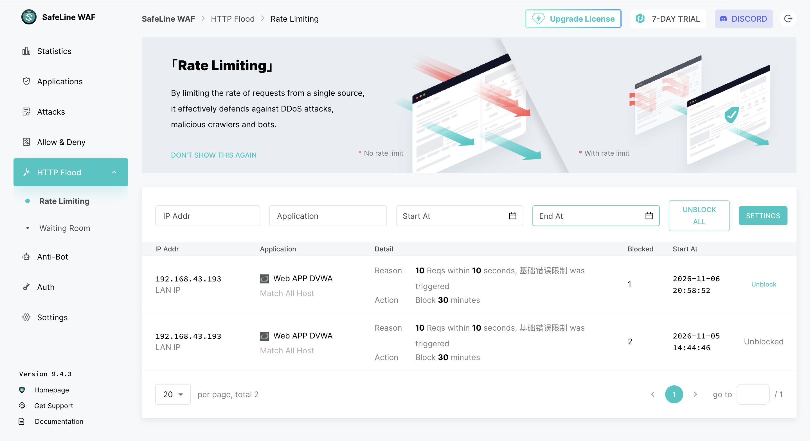

Kesimpulan sama kayak Allow & Deny (skenario 4): block Rate Limiting = event level akses (bukan tabel Attacks) → gak kebaca exporter → gak ada alert Wazuh buat aksi lockout-nya sendiri. Yang kebaca cuma **akibat sampingnya** (serangan SQLi yang jadi pemicu), bukan event Rate Limiting-nya.

### 4. Allow & Deny (whitelist/blacklist per-IP) ✅

Menu `Allow & Deny → Custom Rules`, 2 tab: **Whitelist** (tipe rule **Allow**) dan **Blacklist** (tipe rule **Deny**).

**Tes 1 — Deny Rule, block total:** rule `Test Mac Blacklist` (Deny, `Source IP Equals 192.168.43.193` — IP Mac), monitor mode **OFF** (block beneran, bukan cuma log).

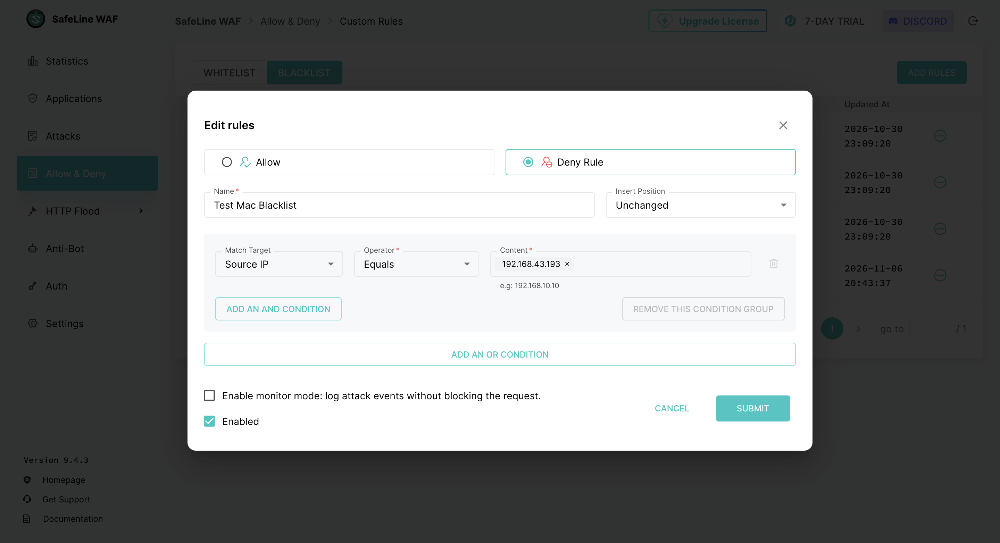

Begitu rule aktif, akses dari IP itu ke DVWA (termasuk `login.php`, halaman biasa — bukan payload serangan) langsung ketolak total, balik page block SafeLine sendiri:

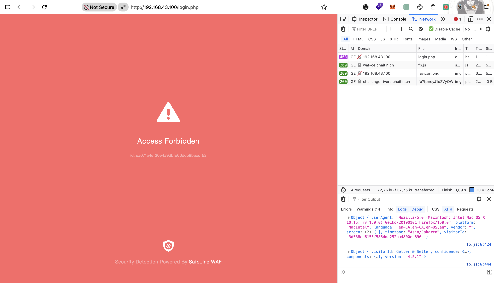

Tab **Logs** SafeLine nyatet 2 entry Action `Blocked` buat IP + rule ini:

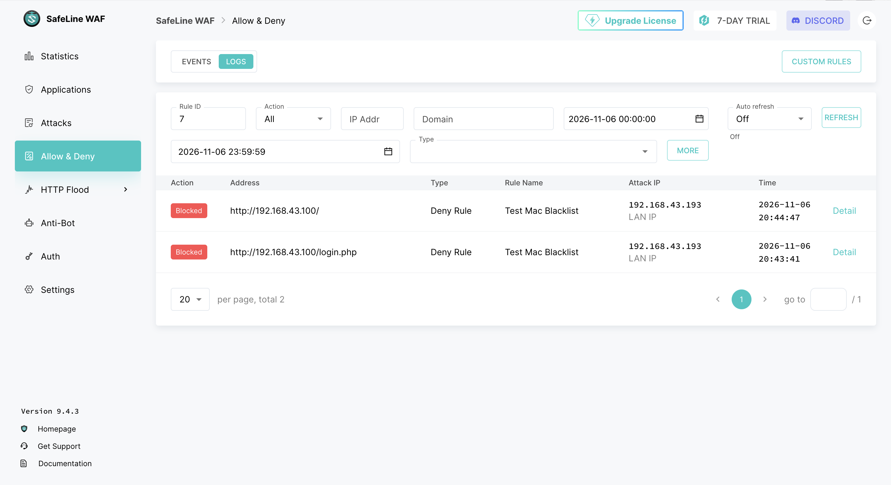

**Gak nyampe Wazuh:** block ini **gak muncul di exporter** (`events.json`) dan **gak ada alert di Wazuh**, walau di sisi SafeLine sendiri (tab Logs di atas) jelas tercatat. Konsisten sama dugaan sebelumnya — exporter cuma query tabel `mgt_detect_log_basic` (engine Attacks/semantic), sementara Allow & Deny itu subsistem beda yang gak nulis ke tabel itu.

Ini **sengaja gak perlu ditutup jadi alert Wazuh buat kasus ini** — block di sini murni hasil dari aturan Deny yang nolak IP ke *sites* (akses backend/jaringan), bukan deteksi payload serangan di level aplikasi. Karakternya lebih mirip drop di firewall/access-control daripada event IDS/IPS yang perlu dikorelasikan analis, jadi gak masuk cakupan rule Wazuh yang ada (`100705`-`100707`, yang memang didesain buat event Attacks).

**Tes 2 — rule yang sama ditoggle dari Deny ke Allow:** begitu tipe rule-nya diganti jadi **Allow**, IP yang tadi keblok total langsung bisa akses lagi normal:

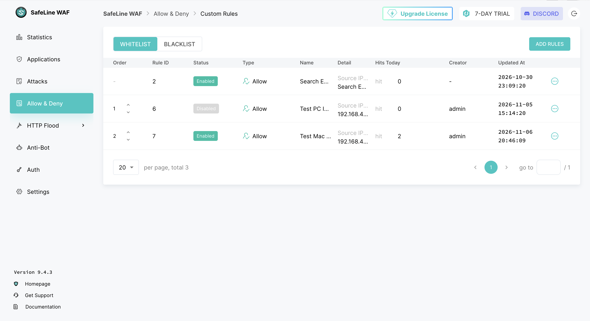
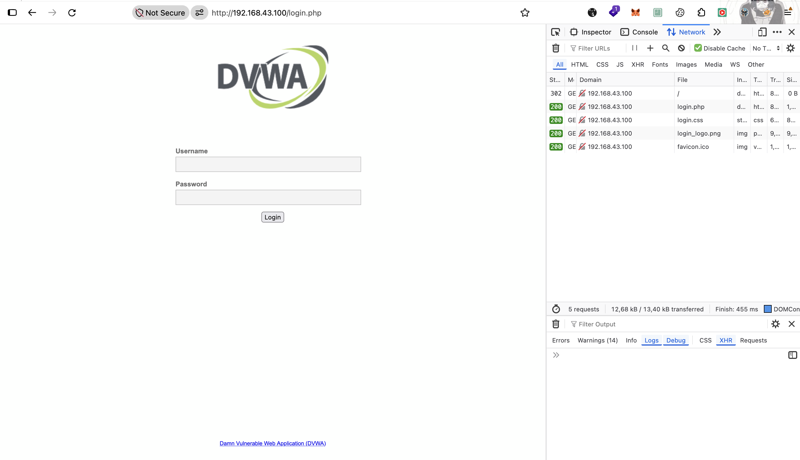

Yang lebih penting: **Allow meniadakan *semua* rule WAF buat IP itu**, bukan cuma ngebalikin akses biasa. Payload SQLi yang normalnya keblok rule Attacks (`id=1' OR '1'='1`) sekarang **lolos total dan dieksekusi beneran** (5 baris data balik, gak ada page block sama sekali):

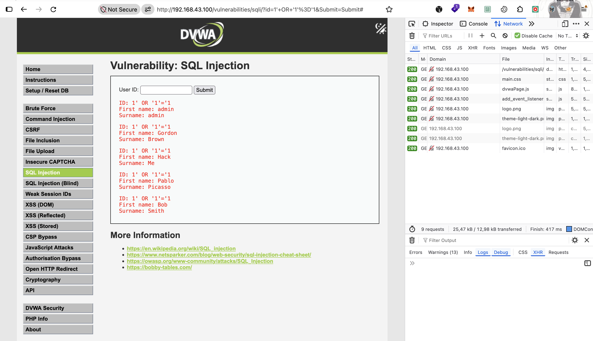

Kesimpulan:
- **Deny** = block total di level akses/jaringan ke site, apapun request-nya — gak perlu alert Wazuh tiap kejadian (lihat alasan di atas), beda dari rule Attacks yang spesifik payload serangan.
- **Allow** = bypass total dari *semua* rule WAF (termasuk deteksi Attacks/SQLi/XSS) — IP ini bisa ngapain aja ke site, WAF-nya efektif transparan. Dipakai buat IP yang bener-bener tepercaya (misal scanner/monitoring internal), bukan buat di-pukul rata ke semua trusted IP karena risikonya gede (gak ada proteksi sama sekali).

---

## Hasil deteksi

| Kategori | Payload/Aksi | SafeLine | Nyampe Wazuh? | Wazuh rule.id |
|---|---|---|---|---|
| SQL Injection | `id=1' OR '1'='1` (GET/POST) | 403, `rule_id: m_sqli` | ✅ Ya | `100707` |
| XSS | `<script>alert(1)</script>` (GET) | 403 | belum dicek field `rule_id` XSS | — |
| Command Injection | `127.0.0.1 \| id` (GET/POST) | **200 — LOLOS** | tidak ada (gak ada event) | — |
| Command Injection | `127.0.0.1; cat /etc/passwd` (POST) | 403 | belum dicek field `rule_id` CMDi | — |
| Rate Limiting | 10×403 SQLi dalam 10 detik → lockout 30 menit | Block (dashboard `HTTP Flood`) | **Serangan pemicu**: ✅ (`100707` ×11). **Event lockout-nya sendiri**: ❌ | `100707` (buat serangan pemicu doang) |
| Allow & Deny (Deny) | akses normal dari IP yang di-blacklist | Block total (dashboard `Allow & Deny → Logs`) | ❌ (sengaja, lihat Catatan) | — |
| Allow & Deny (Allow) | SQLi dari IP yang di-whitelist | **Lolos total** (semua rule WAF non-aktif) | ❌ (gak ada yang perlu dialert — WAF emang sengaja transparan) | — |

---

## Catatan

- **Prinsip dasar integrasi Wazuh di lab ini**: karena fitur Syslog resmi SafeLine berbayar, kita pakai *workaround* — exporter yang cuma nge-query **1 tabel** (`mgt_detect_log_basic`, engine Attacks). Akibatnya **gak semua yang "bekerja" di SafeLine otomatis jadi alert di Wazuh** — Rate Limiting dan Allow & Deny itu buktinya (lihat skenario 3 & 4). Analis SOC yang pakai lab ini **wajib cek 2 sisi** kalau ragu suatu rule beneran ke-trigger: (1) dashboard/log SafeLine sendiri (ground truth), dan (2) alert Wazuh yang ada (cakupan parsial, cuma event Attacks). Jangan simpulkan "gak ada alert Wazuh = rule gak jalan". Detail setup pipeline-nya ada di [`Infrastructure/waf/safeline/README.md`](../../../Infrastructure/waf/safeline/README.md), section "Integrasi log ke Wazuh".
- **Gap command injection `127.0.0.1 | id`** — lolos total GET+POST, gak ketangkep engine semantic SafeLine. Belum dibikinin mitigasi (SafeLine gak expose custom rule kayak Sentinel/ModSecurity di edisi Personal yang dipakai), dicatat sebagai keterbatasan edisi gratis.
- **Rate Limiting & Allow/Deny (Deny) — block-nya emang gak perlu jadi alert SIEM**: karakternya block level akses/jaringan (mirip firewall drop), bukan deteksi payload serangan aplikasi yang butuh dikorelasikan analis. Beda kasus kalau exporter suatu saat diperluas buat baca tabel lain — baru masuk akal didesain jadi alert.
- **Allow — risiko desain, bukan bug**: begitu IP di-whitelist, SEMUA rule WAF (termasuk deteksi serangan) mati buat IP itu, dibuktikan lewat bypass SQLi total di skenario 4. Dipakai hati-hati, cuma buat IP yang beneran tepercaya.
