# WAF Lab — Sentinel WAF (OWASP CRS 4.30.0, PL1 default)

> ✅ **STATUS: LIVE.** Deteksi end-to-end tervalidasi 2026-11-02 — serangan dari browser diblok WAF (403) dan muncul jadi alert di Wazuh (`100709` CRITICAL + `100710` ERROR, MITRE `T1190`). **2 temuan penting:** (1) command injection `;id` awalnya lolos total — **DITUTUP** custom rule `100002` (tab Rules → Custom Rules), sekarang 403. (2) rule response-phase (`953100` PHP Information Leakage) tercatat "Blocked" di log/Wazuh, tapi **client beneran nerima konten normal (gak ke-block)** — keterbatasan arsitektur nginx+ModSecurity buat block di fase response body, belum ada mitigasi.

## Tujuan

Adu serangan web ke DVWA lewat **Sentinel WAF** — dashboard manajemen WAF buatan sendiri, engine ModSecurity v3 + OWASP CRS 4.30.0 default (PL1, anomaly threshold 5/4, belum di-tuning) — terus nilai dua hal:

1. **Response** — payload **diblok** (403 custom page Sentinel) vs **lolos** ke backend DVWA.
2. **Detection** — block-nya kecatat di audit log ModSec → di-forward `log-forwarder` → **Wazuh** → jadi **alert SIEM** dengan severity/category/matched_data.

- **Infrastruktur / cara bikin**: [`Infrastructure/waf/sentinel-waf/`](../../../Infrastructure/waf/sentinel-waf/README.md) — deploy mode prod, import CRS, integrasi Wazuh.
- **Rule Wazuh**: [`Detection-Engineer/wazuh/rule/waf_rules.xml`](../../../Detection-Engineer/wazuh/rule/waf_rules.xml) (`100708`–`100710`).

---

## Topologi serangan

```
Browser (192.168.43.193) ──serangan web──> WAF (192.168.43.100, via NAT pfSense) ──block 403──> modsec_audit.log
       attacker eksternal                    Sentinel WAF (ModSecurity+CRS)              │
                                                                            log-forwarder ─┤── Discord (real-time)
                                                                                           │
                                                                             syslog UDP:5140
                                                                                           ▼
                                                                     Wazuh Manager (Dell) ── ALERT (T1190)
```

## Prerequisites

- Sentinel WAF mode prod live, site DVWA terdaftar (`listen_port=80`), OWASP CRS 4.30.0 di-*import* — lihat [`Infrastructure/waf/sentinel-waf/README.md`](../../../Infrastructure/waf/sentinel-waf/README.md).
- Integrasi Wazuh (decoder + rule + sink syslog + pfSense rule UDP) udah live.
- DVWA `security=low`, punya session (`PHPSESSID`).
- Akses lewat WAN pfSense: `http://192.168.43.100/` (bukan domain — host header numerik, lihat Catatan).

---

## Skenario & Bukti

### 1. Command Injection — DVWA `exec` (POST `ip`) — gap ditemuin ✅ DITUTUP custom rule

Dicoba 3 payload berurutan di field `Ping a device`:

| Payload | Hasil | Matched rules |
|---|---|---|
| `;id` (sebelum custom rule) | **200 — LOLOS**, command kejalan (`uid=33(www-data) gid=33(www-data) groups=33(www-data)`) | `920350` doang (rule umum, bukan RCE) |
| `;whoami` | **403 — Blocked** | `920350, 932235, 932260, 932340, 932380, 949110` |
| `;ls /etc` | **403 — Blocked** | `920350, 932230, 932125, 932250, 949110` |
| `;id` (setelah custom rule `100002`) | **403 — Blocked** | `920350, 100002` |


**Analisis gap:** `;id` lolos total — gak satupun rule CRS RCE (`932xxx`) match, cuma `920350` (rule umum, selalu nempel di request manapun di lab ini). Begitu payload diganti `;whoami` atau `;ls /etc`, CRS langsung nangkep (rule `932xxx`, famili *Unix Shell Expression / Command Injection*) + `949110` anomaly exceeded → block. Jadi **gap-nya selektif per-payload**, bukan command injection secara umum lolos: command generik/pendek (`id`) gampang lolos deteksi signature/libinjection, command yang "lebih mencurigakan" (`whoami`, path `/etc`) kena. Pola ini **sama** kayak bypass `127.0.0.1 | id` yang ketemu di stack SafeLine ([`../../../Infrastructure/waf/safeline/README.md`](../../../Infrastructure/waf/safeline/README.md)) — dua WAF beda engine, gap yang mirip buat payload `id` yang sama.

**Fix — custom rule `100002`** ditulis lewat tab Rules → rule set **Custom Rules** (`rules-command-injection.conf`), khusus nutup payload `id` doang (sesuai skenario yang ketemu, bukan spekulasi daftar TTP, ikut [[feedback-rules-driven-by-lab]]):

```
SecRule ARGS,ARGS_NAMES,REQUEST_BODY "@rx (?i)(?:[;|&\x60]|\$\(|\|\|)\s*(?:id)\b(?!=)" \
    "id:100002, \
    phase:2, \
    deny, \
    nolog, \
    auditlog, \
    t:none,t:urlDecodeUni,t:lowercase,t:htmlEntityDecode, \
    msg:'Command Injection Attack Detected', \
    severity:CRITICAL, \
    tag:'paranoia-level/1', \
    tag:'attack-command-injection'"
```


Match: separator shell (`;`/`|`/`&`/backtick/`$(`/`||`) diikuti (spasi opsional) kata `id`, **negative lookahead `(?!=)`** biar gak kena false-positive parameter normal kayak `&id=5` — teknik yang sama persis yang dipakai di `modsecurity-scratch` buat masalah serupa. Transformasi `urlDecodeUni`+`lowercase`+`htmlEntityDecode` nutup evasion encoding dasar. `deny` langsung (bukan anomaly scoring) karena ini high-confidence signature match, bukan heuristik.

**Hasil:** `;id` sekarang **403 — Blocked**, matched rules `920350, 100002`.


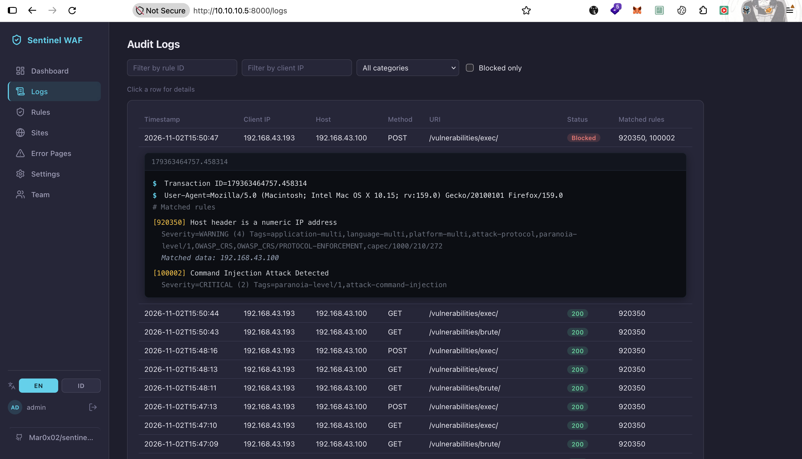

### 2. SQL Injection — DVWA `sqli` (GET `id`)

```
GET /vulnerabilities/sqli/?id=1' OR '1'='1&Submit=Submit
```


- **WAF**: `403` — rule `942100` (SQL Injection Attack Detected via libinjection), severity `CRITICAL`.

### 3. XSS — DVWA `xss_r` (GET `name`)

```
GET /vulnerabilities/xss_r/?name=<script>alert(1)</script>
```

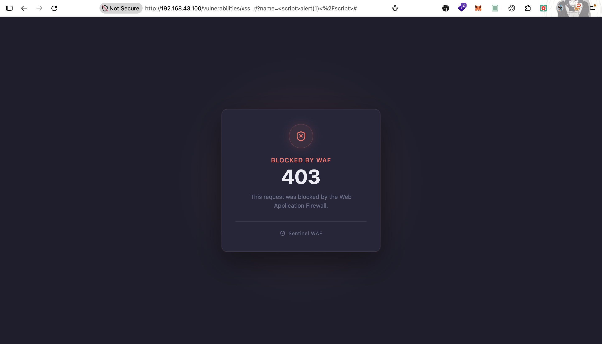

- **WAF**: `403` — 4 rule sekaligus: `941100` (libinjection), `941110` (script tag vector), `941160` (HTML injection), `941390` (javascript method), severity `CRITICAL`.

### 4. False positive — `csp-report.php` (bukan serangan)

Buka `http://192.168.43.100/vulnerabilities/xss_d/` (DOM XSS) bikin browser otomatis nembak **3× `POST /csp-report.php`** — CSP violation report bawaan browser, bukan input user sama sekali. Ke-block juga:

```
[920350] Host header is a numeric IP address
Severity=WARNING (4) — Matched data: 192.168.43.100
[920420] Request content type is not allowed by policy
Severity=CRITICAL (2) — Matched data: |application/csp-report|
[949110] Inbound Anomaly Score Exceeded (Total Score: 8)
```

**Root cause:** `920350` fire di **semua** request di lab ini (DVWA diakses lewat IP mentah `192.168.43.100`, bukan domain) nyumbang skor 3 (severity WARNING), `920420` (content-type `application/csp-report` gak di-whitelist CRS) nyumbang skor 5 (severity CRITICAL, cukup sendirian buat nembus threshold) → total 8 ≥ threshold 5 → block. **Bukan false negative/positive dari sisi attack detection** — murni efek samping cara akses lab ini (IP langsung, bukan domain) ketemu CRS yang strict soal content-type. `920420` yang jadi "penyebab utama" (severity CRITICAL, skor 5 ≥ threshold sendirian), bukan `920350` (WARNING, skor 3, gak pernah cukup block sendirian — kebuktikan dari request normal lain yang cuma match `920350` tetep lolos 200/302).

**Exclusion yang didesain** (belum ditulis ke dashboard — opsional, nunggu keputusan): scoped ke path `/csp-report.php` doang, gak nyentuh rule `920420` di tempat lain:

```
SecRule REQUEST_FILENAME "@streq /csp-report.php" \
    "id:100001,\
    phase:1,\
    pass,\
    nolog,\
    t:none,\
    ctl:ruleRemoveById=920420"
```

### 5. Notifikasi Discord & statistik Dashboard

Semua block (whoami, `;ls /etc`, sqli, 3× csp-report, xss) masuk ke channel `#sentinel-waf` **real-time**.

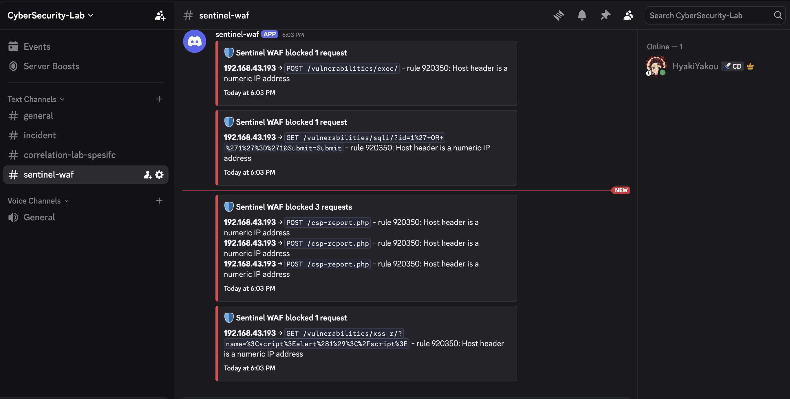
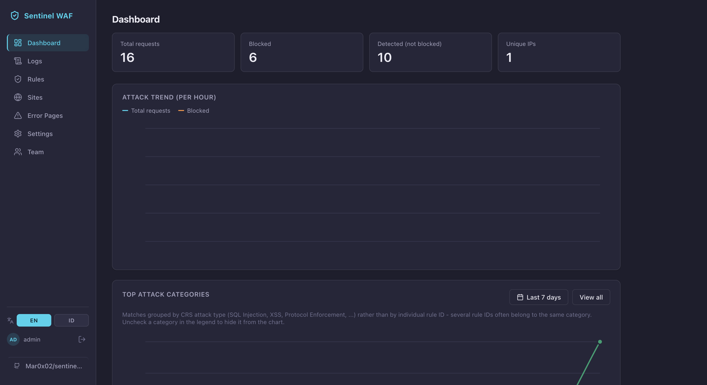
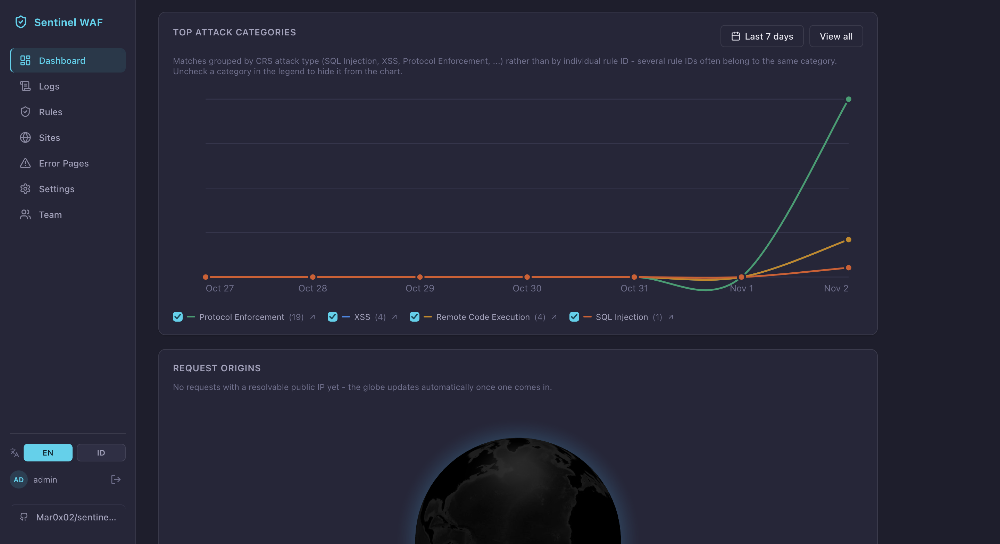
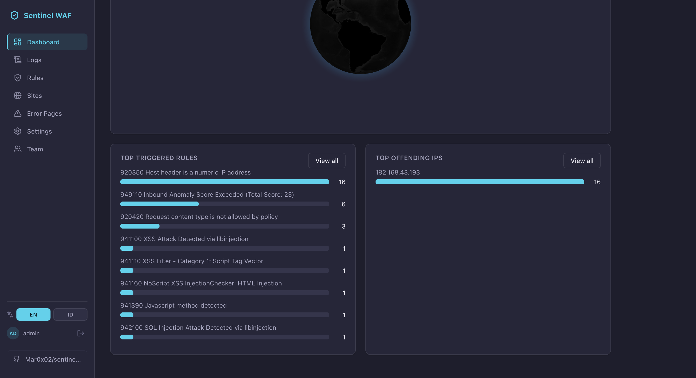

Chart **Top Attack Categories** didominasi `Protocol Enforcement (19)` — tapi ini **bukan indikasi serangan protocol terbanyak**, murni `920350` yang nempel di semua request karena cara akses lab (IP mentah). `XSS (4)`, `Remote Code Execution (4)`, `SQL Injection (1)` lebih representatif buat "serangan beneran". **Top Offending IPs**: `192.168.43.193` (16 request, satu-satunya sumber — browser tester, bukan multi-attacker).

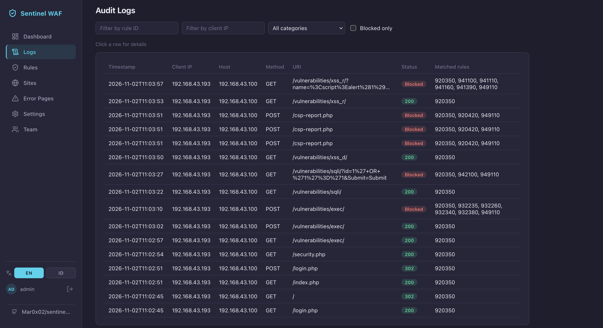

### 6. Response-phase block (`severity=ERROR`) — tercatat "Blocked", client gak nerima 403

`GET /vulnerabilities/sqli/?Submit=Submit` (parameter `id` **gak diisi sama sekali**, bukan payload serangan) bikin DVWA ngelempar warning PHP mentah ke response body:

```
Warning: Undefined array key "id" in /var/www/html/vulnerabilities/sqli/source/low.php on line 5
```

ModSecurity nangkep ini di fase **response body** (outbound) sebagai *information disclosure*, bukan di fase request:

```
[920350] Host header is a numeric IP address
  Severity=WARNING (4) — Matched data: 192.168.43.100
[953100] PHP Information Leakage
  Severity=ERROR (3), Tags=attack-disclosure,OWASP_CRS/DATA-LEAKAGE-PHP
  Matched data: Matched Data: Undefined array key found within RESPONSE_BODY
[959100] Outbound Anomaly Score Exceeded (Total Score: 4)
  Severity=EMERGENCY (0)
```

Skor outbound `4` (dari `953100` doang, severity `ERROR`) ≥ **outbound threshold `4`** (lihat CRS Tuning di [`Infrastructure/waf/sentinel-waf/README.md`](../../../Infrastructure/waf/sentinel-waf/README.md)) → ModSecurity **mutusin block**. Dashboard Sentinel nyatet status `Blocked` dengan jujur sesuai keputusan itu:

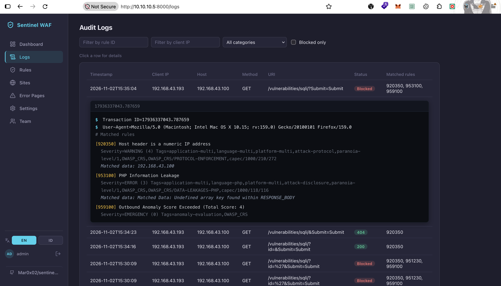

**Tapi client (browser) gak nerima halaman block 403** — yang kebuka justru halaman DVWA SQLi **normal, lengkap**, cuma ada banner warning PHP nongol di atasnya:

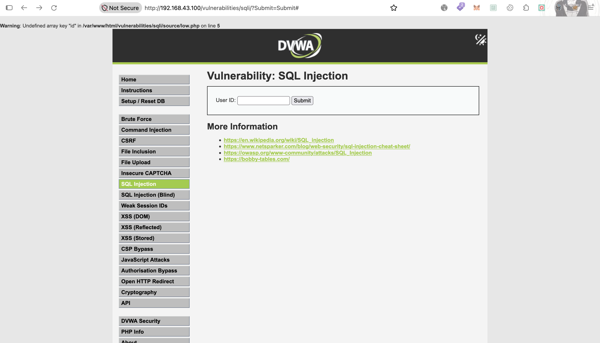

**Kenapa bisa beda begini (root cause):** rule `953100` ini jalan di **fase 4 (response body)**, setelah nginx **udah mulai/selesai ngirim response** dari upstream DVWA (status `200` + body) ke client. Begitu header response terkirim ke client, ModSecurity/nginx **gak bisa narik balik** status code itu buat diganti jadi `403` — jadi keputusan "block" yang tercatat di audit log (dan diteruskan ke Wazuh) itu **akurat merepresentasikan keputusan internal ModSecurity**, tapi **gak merepresentasikan apa yang client terima di jaringan**. Ini keterbatasan arsitektur umum di connector nginx+ModSecurity buat rule response-phase, bukan bug/inkonsistensi logging Sentinel WAF.

**Wazuh tetep CONFIRMED alert `100710`** (severity `ERROR`, level 9) — jadi dari sisi SIEM, deteksinya tetap kebukti jalan bener (ini **bukti pertama rule `100710` fire**, sebelumnya cuma `100709` yang punya bukti). JSON asli (dari Wazuh Discover, di-trim kolom `highlight`/`sort`):

```json
{
  "_index": "wazuh-alerts-4.x-2026.11.02",
  "_source": {
    "agent": { "name": "Wazuh", "id": "000" },
    "data": {
      "waf_action": "blocked",
      "severity": "ERROR",
      "srcip": "192.168.43.193",
      "matched_data": "Matched Data: Undefined array key found within RESPONSE_BODY",
      "http_method": "GET",
      "rule_ids": "920350,953100,959100",
      "dstip": "192.168.43.100",
      "category": "Protocol,Disclosure",
      "url": "\"/vulnerabilities/sqli/?Submit=Submit\"",
      "status": "403"
    },
    "rule": {
      "level": 9,
      "description": "WAF: request diblokir Sentinel WAF (GET \"/vulnerabilities/sqli/?Submit=Submit\") dari 192.168.43.193 dengan ERROR category Protocol,Disclosure",
      "groups": ["sentinel-waf", "waf", "attack", "blocked"],
      "mitre": { "id": ["T1190"], "tactic": ["Initial Access"], "technique": ["Exploit Public-Facing Application"] },
      "id": "100710"
    },
    "location": "192.168.43.100",
    "decoder": { "name": "sentinel-waf" },
    "full_log": "waf[blocked] client=192.168.43.193 host=192.168.43.100 method=GET uri=\"/vulnerabilities/sqli/?Submit=Submit\" status=403 user_agent=\"Mozilla/5.0 ...\" severity=ERROR category=Protocol,Disclosure rules=920350,953100,959100 matched_data=\"Matched Data: Undefined array key found within RESPONSE_BODY\""
  }
}
```

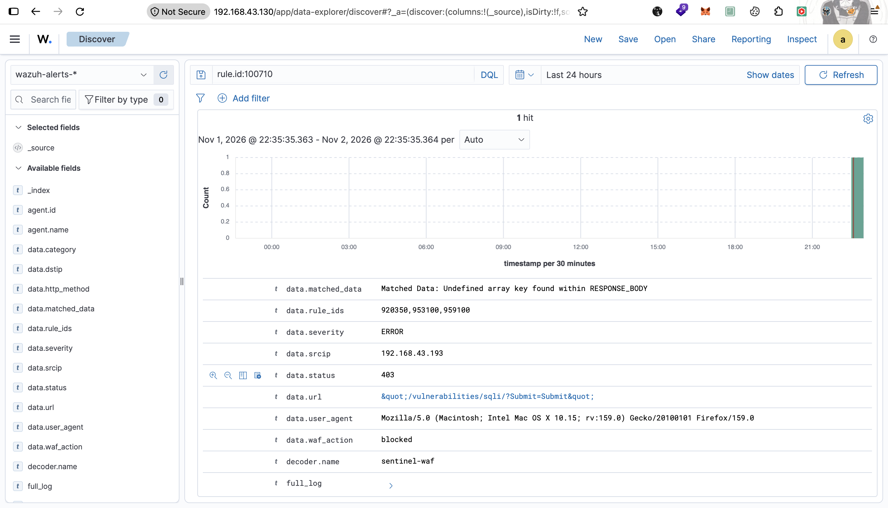

**2 hal non-obvious yang kebuka dari JSON mentah:**

- **`agent.name: "Wazuh"`, `agent.id: "000"`** — bukan `agent.name: "waf"` kayak stack `modsecurity-scratch`/`modsecurity-crs`. Bedanya: stack ModSecurity lain forward log lewat **Wazuh Agent beneran** (`<localfile>` baca file lokal di VM `waf`), sementara Sentinel kirim **syslog langsung ke Manager** (`log-forwarder` → UDP → `ossec-remoted`) — gak ada Agent yang di-install di VM `waf` buat jalur ini. Agent `000` ("Wazuh") itu representasi event yang masuk langsung ke Manager tanpa lewat Agent terdaftar.
- **`location: "192.168.43.100"`** — bukan `10.10.10.5` (IP asli VM `waf`). Paket syslog UDP dari `10.10.10.5` (LAN1) ke Dell (`192.168.43.130`, luar firewall) lewat **WAN pfSense**, kena **outbound NAT** di situ — source IP yang keliatan dari sisi Dell jadi IP WAN pfSense (`192.168.43.100`, kebetulan **sama** persis sama IP yang dipakai buat NAT DVWA ke publik). Jadi `location` (metadata jaringan asli dari Wazuh `remoted`) kebetulan match sama `data.dstip` (field hasil parse kita sendiri dari `host=` HTTP) — **dua sumber data yang beda, nilainya kebetulan sama**, jangan dikira itu satu hal yang sama.
- **`data.url` ada tanda kutip literal** (`\"/vulnerabilities/sqli/?Submit=Submit\"`) — beda dari contoh `100709` yang URL-nya polos tanpa kutip. Diduga dari gimana ModSecurity nyatet `request.uri` di audit log buat transaksi spesifik ini; penyebab persisnya gak ditelusuri lebih lanjut (gak ngaruh ke parsing, decoder tetap nangkep bener).

> **Implikasi buat analis SOC:** field `data.status: 403` + `data.waf_action: blocked` di alert Wazuh **gak selalu berarti attacker beneran kena block**. Buat alert yang `data.rule_ids`-nya ngandung rule response-phase (`95xxxx` — data leakage family), analis perlu curiga: WAF *mendeteksi dan nyoba* block, tapi secara jaringan belum tentu berhasil nutup akses ke konten yang leak. Verifikasi manual (coba akses ulang / cek response asli) tetep perlu buat kasus kayak gini.

---

## Hasil deteksi

| Kategori | Payload | WAF | ModSec rule | **Wazuh rule.id** | Level | MITRE |
|---|---|---|---|---|---|---|
| Command Injection | `;id` (sebelum custom rule) | **200 — LOLOS** | `920350` doang | **tidak ada alert** | — | — |
| Command Injection | `;id` (setelah custom rule `100002`) | 403 | `920350`+`100002` (custom) | *(belum dicek langsung ke Wazuh — custom rule set `severity:CRITICAL`, polanya harusnya map ke `100709` kayak event CRITICAL lain)* | — | — |
| Command Injection | `;whoami` / `;ls /etc` | 403 | `932xxx` family + `949110` | **`100709`** | 12 | T1190 |
| SQL Injection | `1' OR '1'='1` | 403 | `942100` | **`100709`** | 12 | T1190 |
| XSS | `<script>alert(1)</script>` | 403 | `941100/941110/941160/941390` | **`100709`** | 12 | T1190 |
| False positive | `POST /csp-report.php` ×3 | 403 | `920350`+`920420` | **`100709`** | 12 | T1190 (salah label — bukan serangan) |
| Info disclosure (response-phase) | `GET /sqli/?Submit=Submit` (id kosong) | 403 **di log**, tapi client nerima 200 + konten leak | `953100`+`959100` | **`100710`** | 9 | T1190 (block tercatat, gak efektif ke client) |

5 dari 6 event severity `CRITICAL` (→ `100709`); 1 event (response-phase, severity `ERROR`) → `100710` — lihat skenario 6.

### Wujud alert di Wazuh

Contoh alert Command Injection `;ls /etc` (`100709`) — JSON asli dari Wazuh Discover (di-trim kolom `highlight`/`sort`/`fields`):

```json
{
  "_index": "wazuh-alerts-4.x-2026.11.02",
  "_source": {
    "agent": { "name": "Wazuh", "id": "000" },
    "data": {
      "waf_action": "blocked",
      "severity": "CRITICAL",
      "srcip": "192.168.43.193",
      "matched_data": "Matched Data: ;ls /etc found within ARGS:ip: ;ls /etc",
      "http_method": "POST",
      "rule_ids": "920350,932230,932125,932250,949110",
      "dstip": "192.168.43.100",
      "category": "Protocol,RCE",
      "url": "/vulnerabilities/exec/",
      "user_agent": "Mozilla/5.0 (Macintosh; Intel Mac OS X 10.15; rv:159.0) Gecko/20100101 Firefox/159.0",
      "status": "403"
    },
    "rule": {
      "firedtimes": 1,
      "mail": true,
      "level": 12,
      "description": "WAF: request diblokir Sentinel WAF (POST /vulnerabilities/exec/) dari 192.168.43.193 dengan CRITICAL category Protocol,RCE",
      "groups": ["sentinel-waf", "waf", "attack", "blocked"],
      "mitre": { "id": ["T1190"], "tactic": ["Initial Access"], "technique": ["Exploit Public-Facing Application"] },
      "id": "100709"
    },
    "location": "192.168.43.100",
    "decoder": { "name": "sentinel-waf" },
    "full_log": "waf[blocked] client=192.168.43.193 host=192.168.43.100 method=POST uri=/vulnerabilities/exec/ status=403 user_agent=\"Mozilla/5.0 ...\" severity=CRITICAL category=Protocol,RCE rules=920350,932230,932125,932250,949110 matched_data=\"Matched Data: ;ls /etc found within ARGS:ip: ;ls /etc\"",
    "timestamp": "2026-11-02T14:25:53.573+0000"
  }
}
```

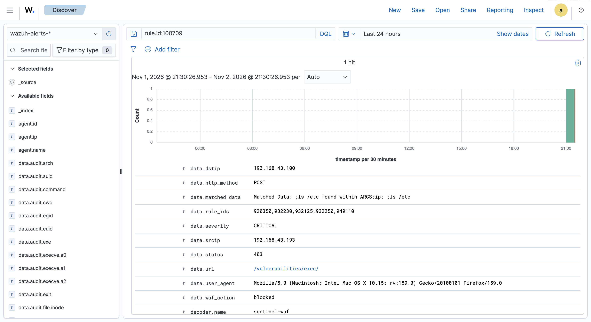

Field `category` di sini `Protocol,RCE` — gabungan 2 tag `attack-*` dari rule yang match (`920350`=`attack-protocol`, `932xxx`=`attack-rce`), bukan cuma satu kategori. Bandingin sama `100710` di bawah (`Protocol,Disclosure`) — pola yang sama: `category` selalu gabungan semua tag `attack-*` yang match di transaksi itu, bukan cuma "yang paling parah" (beda dari `severity`/`matched_data` yang emang dipilih dari rule ter-parah doang).

> **Catatan `rule.mail`:** `100709` (level 12) punya `mail: true`, `100710` (level 9) `mail: false` — ini default threshold level email alert Wazuh (`ossec.conf` global, bukan sesuatu yang di-set manual per-rule di `waf_rules.xml`), bukan something yang kita konfigurasi sendiri di integrasi ini.

Alir dari log mentah ke alert: `log-forwarder` pilih rule **attack-tagged** ber-severity terburuk (exclude rule meta non-attack kayak `949110`) buat ngisi `severity`/`matched_data` → decoder `sentinel-waf` parse jadi field dinamis → rule [`waf_rules.xml`](../../../Detection-Engineer/wazuh/rule/waf_rules.xml) `100709` match `waf_action:blocked` + `severity:CRITICAL` → alert level 12, MITRE `T1190` auto-enrich dari DB MITRE Wazuh.

---

## Catatan

- **Detection ≠ blocking dua-duanya kebukti** — kecuali buat gap `;id`: lolos WAF *dan* gak ada alert SIEM (karena `log-forwarder` cuma kirim event kalau `is_blocked`/attack-tag match; request yang bener-bener gak match rule apapun gak dianggap "blocked" walau secara konten harusnya dicurigai).
- **False positive (`csp-report.php`) juga ikut ke-alert** sebagai `100709` — rule Wazuh saat ini belum bisa bedain "block beneran karena serangan" vs "block karena artefak protocol" (keduanya severity CRITICAL dari sisi ModSecurity). Analis SOC perlu baca `data.category`/`data.matched_data` manual buat mbedain, bukan cuma percaya level alert.
- **Robustness rule**: `920350` (host header IP) nempel di semua request di lab ini — bukan karena serangan protocol beneran, tapi karena DVWA diakses via IP mentah, bukan domain. Analis yang gak ngerti konteks ini bisa salah baca statistik "Protocol Enforcement" di Dashboard sebagai serangan terbanyak.
- **"Blocked" di log ≠ client beneran keblokir** — khusus rule response-phase (fase 4 / outbound, kayak `953100` di skenario 6). Status `blocked` di audit log/dashboard/Wazuh merefleksikan **keputusan ModSecurity**, bukan **hasil fisik di koneksi client** — begitu nginx udah kirim header+body dari upstream sebelum ModSecurity selesai evaluasi fase 4, keputusan block gak bisa dieksekusi ke client yang sama. Analis perlu curiga ekstra buat alert dengan rule family `95xxxx` (response/data-leakage), bukan langsung percaya "udah aman karena ke-log blocked".
